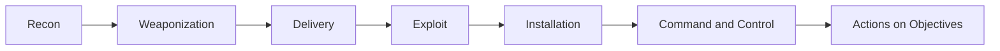
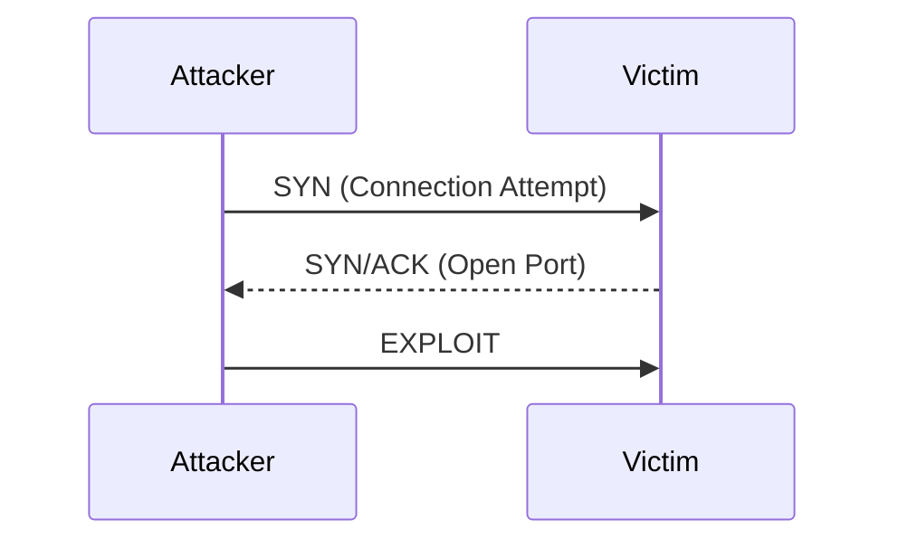
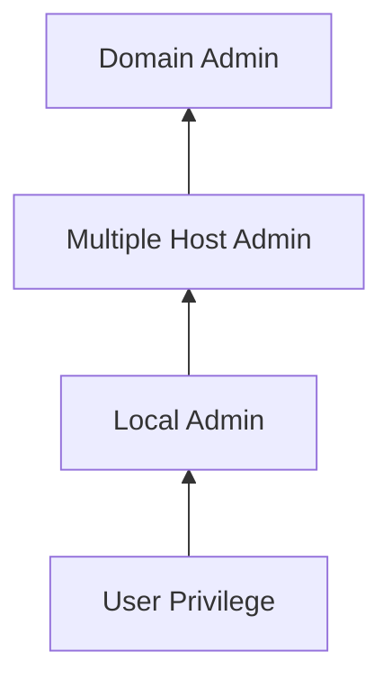
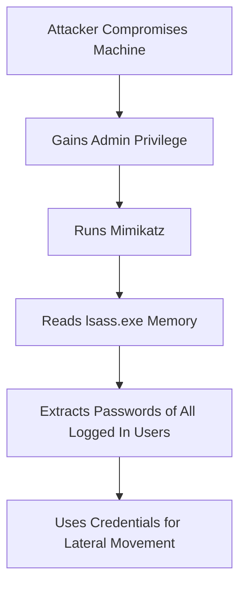
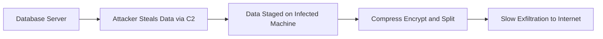

> **Goal of this section:**
> We'll understand how the attacker deals with the endpoint after successfully completing exploitation, and what the post-exploitation tactics in the MITRE ATT&CK matrix are, such as Execution, Persistence, Privilege Escalation, Lateral Movement, and Exfiltration, so that as the Blue Team we can build an effective defense at every stage.

## Table of Contents
- [Introduction](#introduction)
- [Endpoint Centricity](#endpoint-centricity)
- [The Cyber Kill Chain and Incoming Delivery](#the-cyber-kill-chain-and-incoming-delivery)
- [Initial Exploitation](#initial-exploitation)
- [Service-Side Exploits](#service-side-exploits)
- [Client-Side Exploits](#client-side-exploits)
- [Post-Exploitation Tactics and MITRE ATTCK](#post-exploitation-tactics-and-mitre-attck)
- [Tactic Execution](#tactic-execution)
- [Tactic Persistence](#tactic-persistence)
- [Tactic Discovery](#tactic-discovery)
- [Tactic Privilege Escalation](#tactic-privilege-escalation)
- [Privilege Escalation Methods](#privilege-escalation-methods)
- [Tactic Credential Access and Mimikatz](#tactic-credential-access-and-mimikatz)
- [Tactic Lateral Movement](#tactic-lateral-movement)
- [Tactic Collection](#tactic-collection)
- [Tactic Exfiltration](#tactic-exfiltration)
- [Summary](#summary)

## Introduction

In this section, we're covering the first part of SEC450.3, titled "Understanding Endpoints, Logs, and Files," specifically the part on **Endpoint Attack Tactics**.

This topic is very important in cybersecurity because most of the key stages of any attack (such as Code Execution, Persistence, and Lateral Movement) happen on, and leave their traces on, the endpoint itself, not just the network. In other words, if you're a SOC analyst and all you have is network traffic, you'll be able to see the domains and protocols, but you'll need endpoint data to know which process made the connection, which user was compromised, and what was being sent inside the encrypted tunnel.

## Endpoint Centricity

The idea here is that the most important steps of any attack are tied to the endpoint, such as:

- **Exploitation**
- **Code Execution**
- **Persistence**
- **Information Discovery**: such as accounts, files, and privileges
- **Privilege Escalation**
- **Lateral Movement**
- **Data Collection** in preparation for exfiltration

### Why Is the Endpoint More Important Than the Network in an Investigation?

Think of it like a crime investigator: the network gives you information about "who contacted whom," but the endpoint gives you information about "who actually carried out the act." In other words, the endpoint is where you'll find the real artifacts of exploitation, lateral movement, and data theft.

## The Cyber Kill Chain and Incoming Delivery

The Lockheed Martin Cyber Kill Chain divides an attack into stages:

1. Recon
2. Weaponization
3. Delivery
4. Exploit
5. Installation
6. Command & Control (C2)
7. Actions on Objectives

> [!NOTE]
> The Recon and Weaponization stages happen on the attacker's own machine, and the Delivery stage is usually network-centric (such as an email with an attachment or a compromised website). But after Delivery, everything else is host-centric, meaning it's tied to the endpoint.

In this section, we'll start from the **Exploitation** stage (the fourth stage) and continue to the end of the Kill Chain, assuming Delivery has already succeeded.

## Initial Exploitation

The first step in exploitation is the attacker launching an exploit against a specific process or user. If it succeeds, the attacker effectively becomes that process/user, with all the privileges it has.

The important question you need to ask yourself as an analyst: **"What was actually compromised?"**

| Situation | Result |
|--------|---------|
| A service running under a low-privilege account | Almost no damage |
| A process running with standard user privileges | User privileges |
| A web server running with root privileges | Total disaster (Root) |

> [!IMPORTANT]
> This is why companies always try to reduce the privileges that programs and services run with to the minimum possible, so that if a compromise happens, the damage is limited. The same applies to users: if a user works as an Administrator and falls for a phishing email, the code that runs will have full admin privileges.

### Service-Side Exploits

These exploits need a **Listening Port** open on the machine, such as Web, SMB, VNC, or RDP.

**Advantages for the attacker:**
- They don't need any user interaction
- They can be repeated (repeated exploitation) easily and without the victim noticing

**Disadvantage:**
- The Firewall can easily stop them if the port is closed

### Client-Side Exploits

In this type, the attacker tries to trick the user into opening a file or visiting a website, such as:
- "Open this Word file"
- "Click this link in my email"

> [!TIP]
> The key difference is that client-side exploits can't easily be repeated against the same person, because they rely on tricking the user, and there's no guarantee they'll open the same file or visit the same site again. When service-side exploits aren't available, the attacker usually turns to this method.

## Post-Exploitation Tactics and MITRE ATTCK

As soon as the exploit succeeds, the nature of the compromise changes completely: the attacker now "owns the box." The activities that happen after that are categorized excellently in the **MITRE ATT&CK** matrix (Attacker Tactics, Techniques, and Common Knowledge), and they are:

- Execution
- Persistence
- Privilege Escalation
- Defense Evasion
- Credential Access
- Discovery
- Lateral Movement
- Collection
- Command and Control
- Exfiltration

> [!NOTE]
> Every tactic in the ATT&CK matrix is divided into techniques and sub-techniques, and each one is documented with real-world examples from known attacks and APT groups, along with ways to detect and prevent it. It's an essential resource for anyone working on the Blue Team.

Many security teams now use the ATT&CK matrix as a baseline list of the things they should be able to detect, at a minimum.

## Tactic Execution

After exploitation comes establishing **Code Execution**. Usually, a regular command shell is opened, or even an advanced shell such as Meterpreter.

An important example: if the attacker manages to get into a SQL Server, they can use the `xp_cmdshell` command, which takes a command from the SQL interpreter, opens a real command shell with it, and executes commands on the system.

> [!WARNING]
> Application Control tools are very effective at stopping execution, because any attempt to run code that isn't on the allow list will be stopped and will alert the security team immediately.

## Tactic Persistence

Persistence means the attacker uses a specific technique to make sure their access to the machine continues over time.

### Why Does the Attacker Take the Risk of Setting Up Persistence?

Because without persistence, every time the user reboots or logs out, the attacker would have to exploit the machine again, which carries the risk of being detected or of the exploit failing altogether. At the same time, though, setting up persistence requires changes to the system (such as a registry key or a scheduled task), and that can catch the attention of security tools.

> [!TIP]
> The attacker may use more than one persistence method at the same time (Registry Key + Scheduled Task), so that if the security team discovers one, they still have another way in.

## Tactic Discovery

At this stage, the attacker needs to explore the environment they're in so they can continue, including:

- Account and group names
- User privileges
- Files and folders on the system and the network
- Services running locally and on the network
- Other machines on the network
- Installed software and its settings

### The Living Off the Land Technique

Attackers prefer to use the operating system's built-in commands, such as `netstat` and process lists, because that lets them get by without drawing attention: alerting on these things could flood the SOC with false positives.

## Tactic Privilege Escalation

After the exploit succeeds, the attacker has a foothold, but usually with limited privileges, so they try to escalate those privileges.

### Privilege Escalation Methods

Hosts are designed specifically **not to allow** privilege escalation, so how does it happen?

1. **Abusing someone or something that has the privilege** to perform the task for them (such as an admin user or a service running as root)
2. **Abusing features of the OS itself** (such as incorrect file permissions)
3. **Exploiting vulnerabilities in the software or the kernel**

#### Examples of Abusing OS Permissions

- Hijacking admin startup items
- Modifying service executables
- Unquoted paths
- DLL search order hijacking
- Modifiable scheduled tasks

> [!TIP]
> There's a tool called **PowerUp** (part of the PowerSploit framework) that automates discovering these weaknesses. It's PowerShell code that runs entirely in memory, which makes it harder to detect.

#### Kernel Exploitation

Exploiting vulnerabilities in the kernel itself, the core "program" of the operating system. A real-world example: the **Dirty Pipe** vulnerability (CVE-2022-0847) in 2022, which allowed the attacker to overwrite any file they chose, leading to very serious privilege escalation.

## Tactic Credential Access and Mimikatz

Credential dumping is a way to escalate privileges by reading passwords stored in memory or in the registry, but it requires the attacker to have already reached admin level.

### How Does Mimikatz Work?

Windows uses the concept of **Single Sign-On**, which means the password is stored in memory (in a process called `lsass.exe`) so the user doesn't have to type it every time. The **Mimikatz** tool takes advantage of this: it reads the memory of `lsass.exe` and extracts the password hash, and sometimes the plaintext password.

> [!WARNING]
> If more than one person is logged in on the same machine, Mimikatz can steal all of their passwords/hashes, not just the original victim's, which makes it a very powerful tool for lateral movement.

## Tactic Lateral Movement

The attacker rarely reaches the data they want from the first machine they compromise, so they have to pivot through the environment to gather more privileges and access.

To perform lateral movement, they need:
1. **Access to the machine** (through an exploit or legitimate credentials)
2. **The code they want to run** (built-in commands or stored malware)

### Remote Administration Protocols

| Type | Examples |
|-------|---------|
| CLI | SSH, SMB w/PSExec, PowerShell remoting, WMI |
| GUI | RDP, VNC, X11 forwarding |

## Tactic Collection

Once lateral movement succeeds, the attacker starts collecting useful information from every machine they reach, such as:

- Files from local/remote file shares
- Screen captures and video
- Key Logging
- Stealing emails
- Exporting databases

## Tactic Exfiltration

Actually stealing data is much harder than just accessing it. The attacker has to:

- Move large amounts of data (gigabytes) across the network
- Gather the data in an intermediate location (staging), because internal servers usually don't have direct internet access
- Find an open port to send data out
- Split and encrypt the data to hide it
- Send it slowly so as not to attract attention

### Finding a Way Out

If the network has a **Default Deny Outbound Policy**, the attacker will find that most ports are closed and may be forced to use only the allowed ports, such as 25 (SMTP) or 80/443 (HTTP/HTTPS), which often leaves traces in the firewall deny logs.

> [!IMPORTANT]
> The attacker will usually use the correct protocol for its port (such as HTTP on port 80), which makes detection difficult and dependent mainly on the destination URL or the volume/timing of the upload.

## Summary

- An attack is divided into two main phases: **Pre-Exploitation** (stages 1-4 of the Kill Chain) and **Post-Exploitation** (stages 5-7, which is where MITRE ATT&CK focuses)
- Some stages are network-centric and some are host-centric
- The core post-exploitation tactics are: Execution, Persistence, Discovery, Privilege Escalation, Credential Access, Lateral Movement, Collection, Exfiltration
- Every tactic has many techniques documented in the MITRE ATT&CK matrix
- The closer the attacker gets to their goal, the more important, and the easier, it becomes to detect them at the endpoint level
