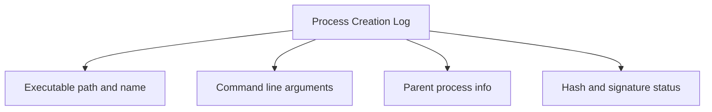
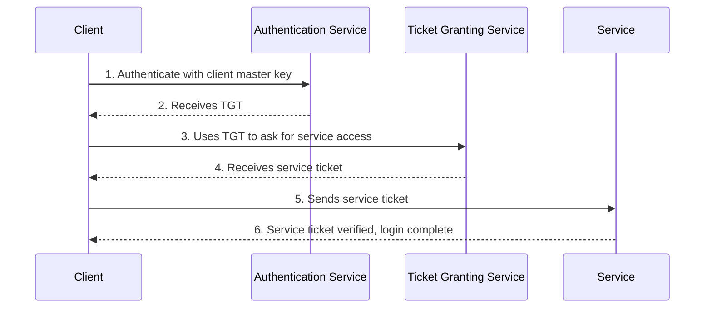

> **Goal of this section:**  
> We'll go through the most important events every SOC analyst must know by heart: logins on Windows and Linux, Process Creation, Firewall logs, Object Access, Services, Scheduled Tasks, USB events, User/Group management, Windows Defender, PowerShell logging, and finally the Kerberos protocol and all the Event IDs related to it.


## Table of Contents
- [Introduction](#introduction)
- [Windows Logins: Event ID 4624/4625](#windows-logins-event-id-46244625)
- [RunAs Logins: Event ID 4648](#runas-logins-event-id-4648)
- [Linux Logins](#linux-logins)
- [Linux Login Failures](#linux-login-failures)
- [Process Creation Logs](#process-creation-logs)
- [Process Creation Logs in Windows](#process-creation-logs-in-windows)
- [Process Creation Logs in Linux: Auditd](#process-creation-logs-in-linux-auditd)
- [Process Creation Logs in Linux: Snoopy](#process-creation-logs-in-linux-snoopy)
- [Windows Firewall with Advanced Security](#windows-firewall-with-advanced-security)
- [Interpreting Linux iptables Firewall Logs](#interpreting-linux-iptables-firewall-logs)
- [Windows Object Access Auditing](#windows-object-access-auditing)
- [Service Creation: Event ID 7045/4697](#service-creation-event-id-70454697)
- [New Scheduled Tasks: Event ID 4698](#new-scheduled-tasks-event-id-4698)
- [USB Plug and Play Events](#usb-plug-and-play-events)
- [New User Creation and Group Management](#new-user-creation-and-group-management)
- [Windows Defender](#windows-defender)
- [PowerShell Logs](#powershell-logs)
- [The Kerberos Protocol](#the-kerberos-protocol)
- [Summary](#Summary)

## Introduction

In this section we'll get to know the most important events that show up constantly in SOC work, and learn how to interpret them correctly. This knowledge is essential, because half the battle is understanding how attacks work, and the other half is knowing which logs those attacks leave behind. It isn't simple and it takes time and effort, but it's the foundation of any professional analyst's work.

## Windows Logins: Event ID 4624/4625

Logins are among the events you'll run into most often. They're recorded in the **Security log channel** under:

- **Event ID 4624** — successful login.
- **Event ID 4625** — failed login.

### The Most Important Fields in the Event

| Field | Description |
|------|--------|
| Account Name | The account used to log in |
| Account Domain | For an Active Directory account, this is the domain name. For a local account, it's the name of the machine itself |
| Logon Type | The type of login (explained in detail below) |
| Network Info | Information about the remote machine (if the login came over the network) |

### Logon Types

Not all logins in Windows are alike, and this difference matters a lot during an investigation:

| Logon Type | Number | Description |
|------|--------|---------|
| Interactive (local account) | 2 | The user is physically sitting in front of the machine |
| Interactive (domain account) | 11 | Same idea, but with a domain account |
| Network | 3 | Such as connecting to a File Share or an SMB Connection |
| Service | 5 | A service logging in with its own account |
| RDP | 10 | A remote login via Remote Desktop |

> [!IMPORTANT]
> If you see Logon Type 2, it usually means the person has physical access to the machine. Logon Type 10, on the other hand, means the login happened over the network only, and that's a big difference when determining the scope of a compromise.

### Noise in Event ID 4624

Event ID 4624 is one of the events you **must know well**, but it's very noisy, because it doesn't only show User Accounts; **Computer Accounts** also log in to the Domain Controllers.

> [!TIP]
> A common first step to filter out the noise is to exclude all 4624 events where the **Account Name ends with a $**, because that's how Active Directory denotes Computer Accounts, and their activity is rarely security-relevant even though it can make up the largest volume of logs.

## RunAs Logins: Event ID 4648

Event ID 4648 documents something completely different: anyone who used the **runas** command to run a process as another user account.

### Analogy

It's like the **sudo** command in Linux, but it's less common in Windows, which is what makes it a strong indicator that a particular account has been compromised.

### What the Log Shows

- **Subject** — who performed the action.
- **Account Whose Credentials Were Used** — the account that was switched to.
- **Target** — where that account was used.

### Practical Example

Suppose an attacker has the passwords for "student" and "bob", but their access is only available from the "student" laptop, and they want to reach data only "bob" can access. They'll use the runas command to "become" bob. As a defender, if you know there's no logical reason for bob's account to be used from student's laptop, you now have an **anomalous condition** you can detect through Event ID 4648.

## Linux Logins

Unlike Windows, Linux logins are **simple in theory**, but they are:

- Inconsistent.
- Spread across multiple lines (multi-line).
- Often reference **pam** (Pluggable Authentication Module).

### Example of an SSH Login with a Key

```
ubuntu sshd[459]: Connection from 123.45.67.89 port 57356 on 99.99.99.99 port 22
ubuntu sshd[459]: Postponed publickey for root from 123.45.67.89 port 57356 ssh2 [preauth]
ubuntu sshd[459]: Accepted publickey for root from 123.45.67.89 port 57356 ssh2: RSA SHA256:ao98RFOF9sdffaf09vijw877afsdlMfMFKLEe
ubuntu sshd[459]: pam_unix(sshd:session): session opened for user root by (uid=0)
ubuntu sshd[459]: Starting session: shell on pts/0 for root from 123.45.67.89 port 57356 id 0
```

The problem is that the messages are written in **Syslog** format without any fixed structure, which makes parsing hard for the SIEM. The login itself is split across several lines, each with partial info, so if you want the full details you have to read all the related lines together. The file this is recorded in is usually `/var/log/auth.log` or `/var/log/secure`.

## Linux Login Failures

Unfortunately, there's nothing like `Event ID = 4625` in Linux that gathers all failures in one place. You have to look for several patterns.

### Examples of Different Kinds of Failure

| Case | Example |
|------|--------|
| Wrong username | `Dec 29 17:15:36 ubuntu sshd[14771]: Invalid user pi from 174.194.132.127` |
| Wrong password over SSH | `Dec 29 09:13:23 ubuntu sshd[54117]: Failed password for root from 174.194.132.127 port 55646 ssh2` |
| Wrong password on the desktop | `Dec 29 09:19:19 ubuntu lightdm: pam_unix(lightdm:auth): authentication failure; ... user=student` |

> [!NOTE]
> Remote failures come with the source IP and the username that was attempted, but the password used is **never written** to the log, because that would be a security risk.

## Process Creation Logs

**Process Creation Logs** are among the most important logs you can collect in any environment. They should record:

- The path and name of the executable.
- The arguments the program was run with.
- The parent process.
- The metadata: the hash, signature status, etc.

### Sources

| System | Sources |
|------|--------|
| Windows | Audit Policy, Sysmon, EDR |
| Linux | auditd, Snoopy, Sysdig, Auditbeat |

> [!IMPORTANT]
> Almost all malware will leave a trace in this log. The arguments distinguish legitimate use of a tool like PowerShell from malicious use of the same tool, which makes this log a very powerful tool for detecting attempts to bypass Application Control.



## Process Creation Logs in Windows

The two main sources:

### Event ID 4688 (Security Channel)

Part of the built-in auditing. Its main advantage is that it **doesn't need any extra agent** and usually works right away, because most organizations already collect the Security log.

### Sysmon Event ID 1 (Microsoft-Windows-Sysmon/Operational)

A more detailed option that requires installing a separate driver and service. It gives you extra details such as:

- The program description, product name, and company name (if it has a digital signature).
- Several types of hash directly inside the same log.

> [!TIP]
> Because the hashes are available directly in the log, you can start running hash-based checks without interacting with the endpoint or the file itself at all. Sysmon actually works almost like a **mini EDR**, but without any response capability.

## Process Creation Logs in Linux: Auditd

**auditd** is the main Linux Auditing Subsystem, and it's available in almost every distribution.

- It records: file reads/writes, system calls, executed commands, login attempts, and network traffic.
- The **aureport** tool generates reports on all events.
- **auditd doesn't block anything**; it only records the information.

### A Rule for Monitoring Process Creation

```bash
auditctl -a exit,always -F arch=b64 -S execve -k proc_create
```

This adds a rule named `proc_create` that always logs when the `execve` system call exits, for 64-bit programs.

### Example auditd Output

```
type=SYSCALL msg=audit(1546105134.866:8332): arch=c000003e syscall=59 success=yes exit=0 ... comm="whoami" exe="/usr/bin/whoami" key="procmon"
type=EXECVE msg=audit(1546105134.866:8332): argc=1 a0="whoami"
type=CWD msg=audit(1546105134.866:8332): cwd="/var/log"
type=PATH msg=audit(1546105134.866:8332): item=0 name="/usr/bin/whoami" ...
type=PROCTITLE msg=audit(1546105134.866:8332): proctitle="whoami"
```

| Line Type | Purpose |
|------|--------|
| SYSCALL | Information about the user and the executed command |
| EXECVE | The command line and arguments |
| CWD | The current working directory |
| PATH | The path of the executable |
| PROCTITLE | The title of the process that was created |

> [!WARNING]
> auditd is so powerful that it's sometimes hard to tell exactly what happened from it, because of how many lines and fields there are for a single event.

## Process Creation Logs in Linux: Snoopy

**Snoopy Logger** is an easier way to log command lines in Linux.

- Installation is very easy: `sudo apt install snoopy`
- By default it writes to `/var/log/auth.log`.
- Its format is much simpler than auditd's.

### Example

```
Dec 20 10:05:33 ubuntu snoopy[4550]: [login:student ssh:(123.45.67.89 53123 10.0.0.1 22) sid:3907 tty:/dev/pts/1 (1000/student) uid:student(1000)/student(1000) cwd:/tmp]: git clone https://github.com/rebootuser/LinEnum.git
```

This example shows an attacker downloading the **LinEnum** tool, which is commonly used to look for Privilege Escalation vulnerabilities. That's a clear danger sign that should raise an alert immediately.

> [!NOTE]
> The tool isn't 100% reliable and can be bypassed, but that doesn't cancel out its usefulness. Remember the "complete solution principle": a tool doesn't have to be perfect to be useful.

## Windows Firewall with Advanced Security

**WFAS** has two logging options:

1. **Text files (pfirewall.log)** — a separate file for each profile, with a maximum size of 32MB.
2. **Windows Event Channel** — also records process information, and is easier to collect.

### The Most Important Event IDs

| Event ID | Meaning |
|------|--------|
| 5156 | Allowed (the connection was allowed) |
| 5157 | Connection Block (the connection was blocked) |
| 5152 | Packet Block (the packet was blocked) |
| 5154 | Listening (listening on a port) |

### pfirewall.log Fields

```
[date] [time] [action] [protocol] [src-ip] [dst-ip] [src-port] [dst-port] [size] [tcpflags] [tcpsyn] [tcpack] [tcpwin] [icmptype] [icmpcode] [info] [path]
```

## Interpreting Linux iptables Firewall Logs

### Example

```
Dec 20 07:32:33 ubuntu kernel: [ 945.682935] [UFW ALLOW] IN= OUT=ens33 SRC=192.168.42.155 DST=192.168.42.2 LEN=76 TOS=0x00 PREC=0x00 TTL=64 ID=61739 DF PROTO=UDP SPT=45469 DPT=53 LEN=56
```

The format consists of a **Syslog Header** at the start, followed almost entirely by **Key=Value pairs**. Some fields (such as `DF` or `IN=`) aren't fully structured Key=Value, which makes parsing harder.

| Field | Meaning |
|------|--------|
| Timestamp/Hostname | From the Syslog Header |
| Action (ALLOW/DENY) | The decision the firewall made |
| IN/OUT | The physical interface |
| SRC/DST | The source and destination IP address |
| PROTO | The protocol (TCP, UDP, ICMP) |
| SPT/DPT | The source and destination port |

## Windows Object Access Auditing

This covers monitoring files and the Registry, specifically:

- **Event ID 4657** — a Registry value was modified.
- **Event ID 4663** — an attempt was made to access a specific object.
- **Event ID 4660** — an object was deleted.

### Sections of the Log

| Section | Meaning |
|------|--------|
| Subject | Who touched the file/key |
| Object | Exactly what was touched |
| Process Info | The program responsible for the access |
| Access Request Info | The type of access (read/write) |

> [!IMPORTANT]
> Enabling Object Access Auditing in the Security Policy alone is **not enough**; you have to specify exactly which files or Registry keys you want to monitor, otherwise you won't get any logs.

## Service Creation: Event ID 7045/4697

**Services** are processes that run silently in the background, and attackers commonly use them as a means of **Persistence**.

| Channel | Event ID | Notes |
|------|--------|---------|
| System | 7045 | Always logged when a new service is created |
| Security | 4697 | Available on Windows 10+ if "Audit Security System Extension" is enabled |

### Red Flags

- **Service File Name** — is it in an unusual location, such as a Temp folder?
- **Service Name** — is it an innocent-looking name like "Google Updater", or a random name?
- **Service Account** — which account will the process run as?

## New Scheduled Tasks: Event ID 4698

A **Scheduled Task** lets a command run at a later time or on a recurring schedule, locally or on a remote machine.

- It's used for **Persistence** and **Lateral Movement**.
- The responsible Event ID: **4698** in the Security Channel.
- **"Audit Other Object Access Events"** must be enabled to record these events.

> [!NOTE]
> The actual command data inside a 4698 event is stored in nested XML, which makes automated parsing a bit harder.

## USB Plug and Play Events

**Event ID 6416** in the Security Channel records any USB device that gets connected, and it requires enabling **"Audit PNP Activity"**.

### Important Fields

| Field | Meaning |
|------|--------|
| Class | The device type (Hub, Audio, Storage) |
| Vendor ID (VID) | Similar to the OUI of a MAC Address; it identifies the manufacturer |
| Product ID (PID) | The product type |

> [!WARNING]
> Real-world USB attacks do exist, such as the **DarkVishnya** incident documented by Kaspersky in 2018, in which attackers planted devices like the Bash Bunny inside actual banks.

## New User Creation and Group Management

### Creating a New User

**Event ID 4720** — documents the creation of any new user account.

### Modifying Group Membership

| Event ID | Meaning |
|------|--------|
| 4732 | A user was added to a local group, such as Administrators |
| 4728 | A user was added to a global group at the Active Directory level |

> [!IMPORTANT]
> Adding an illegitimate user to the Administrators group means the attacker has most likely already reached administrative-level privilege.

## Windows Defender

The logs are in a channel called **Windows Defender/Operational**, and the most important Event IDs are:

| Event ID | Meaning |
|------|--------|
| 1116 | Malware was detected |
| 1006 | Malware was detected (in a different format) |

The event contains the name of the detected virus and the path of the infected file.

## PowerShell Logs

**Event ID 4104 — Script Block Logging** in the PowerShell/Operational Channel.

- It records every command run in PowerShell (if enabled in the Audit Policy).
- **Very noisy**.
- Its biggest advantage: it records the **actual text** the PowerShell Engine executes, so even if the command was heavily obfuscated, the event will give you the decoded version.

> [!NOTE]
> The command's output (the result) is **not recorded** in Event ID 4104; to get it, you need to use something like **Transcription Logging**.

## The Kerberos Protocol

### The General Idea

**Kerberos** is the main authentication protocol in Windows, and it's used by default whenever it's available (which is the case in most Active Directory environments). The system relies on encrypted **Tickets** exchanged between 3 parties:

- **Client** — the machine that wants to access a service.
- **Server/Service** — the service being accessed.
- **KDC (Key Distribution Center)** — which is the Domain Controller.

### Authentication Steps



1. The user requests a **Ticket Granting Ticket (TGT)** from the **Authentication Service (AS)** using the Client Master Key (a hash derived from the password).
2. The KDC verifies it and returns the TGT.
3. When the user needs to reach a service, they use the TGT to request a **Service Ticket** from the **Ticket Granting Service (TGS)**.
4. The TGS gives them the Service Ticket.
5. The user sends the Service Ticket to the requested service.
6. If everything checks out, the user gets access to the service.

### Kerberos Events in the Security Channel

| Event ID | Meaning |
|------|--------|
| 4768 | A Kerberos Authentication Ticket (TGT) was requested |
| 4769 | A Kerberos Service Ticket was requested |
| 4770 | A Kerberos Service Ticket was renewed |

### Event ID 4768 Details

The event shows: Account Name, Supplied Realm Name, User ID (SID), Client Address, and Result Code. The service name is **krbtgt**, because it's the service responsible for issuing TGTs.

> [!TIP]
> If you see TGT requests coming from a machine the user isn't supposed to be using, that's a strong indicator the account has been compromised. A Result Code of 0x0 means success; any other value means failure, and you should look up its code.

### Event ID 4769/4770 Details

They contain the same information as the TGT event, plus the **Service Name** and **Service ID** — the service the user is requesting access to (such as FILESHARE01).

> [!NOTE]
> A Failure Code of `0x20` just means the ticket has expired; it's a normal informational event without much security value.

### How to Tell Whether a Login Used Kerberos

The **Authentication Package** field inside Event ID 4624 (on the host machine, not on the Domain Controller) shows:

| Value | Meaning |
|------|--------|
| Kerberos | Kerberos was used |
| NTLM | NTLM was used (and it may show the version, v1/v2, or LM) |
| Negotiate | Prefers Kerberos, but falls back to NTLM if it isn't available |

> [!WARNING]
> When you see Authentication Package = NTLM, especially the old NTLM v1 or LM versions, that's an indicator worth investigating, because most modern machines shouldn't be relying on these old protocols.

## Summary

- **Event ID 4624/4625** are the most important login events in Windows, and you need to understand Logon Types such as 2, 3, 10, and 11.
- **Event ID 4648** shows RunAs usage, and it's a strong indicator of an attacker moving between accounts (Lateral Movement).
- Linux logins are less structured and spread across multiple lines, and there's no single Event ID for failures.
- **Process Creation Logs** (4688, Sysmon Event 1, auditd, Snoopy) are among the most powerful tools for detecting malware.
- **Firewall Logs** (WFAS and iptables) give you visibility at the level of the machine itself, not just the network.
- **Object Access Auditing** (4657/4663/4660) requires manually enabling it for every file or Registry key you want to monitor.
- **Service Creation (7045/4697)** and **Scheduled Tasks (4698)** are among the most common Persistence techniques.
- **USB Events (6416)** give you details about any device connected to the machine.
- **New User/Group Management (4720/4732/4728)** exposes attempts to create backdoor accounts.
- **PowerShell Script Block Logging (4104)** automatically decodes obfuscated commands.
- **Kerberos** relies on 3 parties (Client, KDC, Service), and its main events are 4768, 4769, and 4770.


