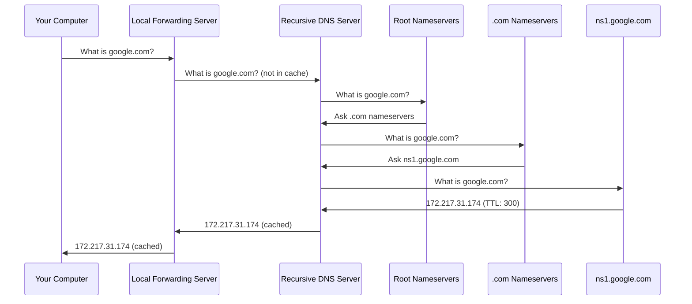
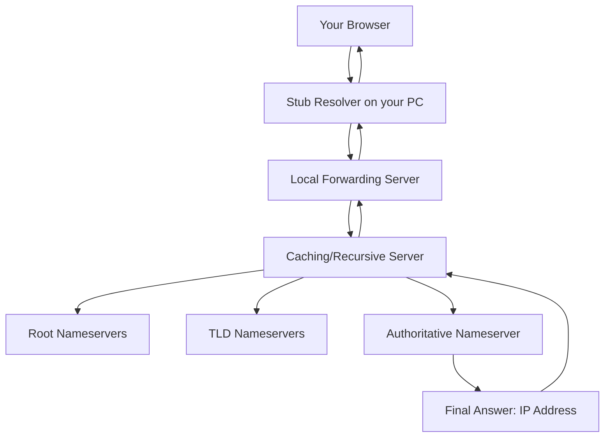
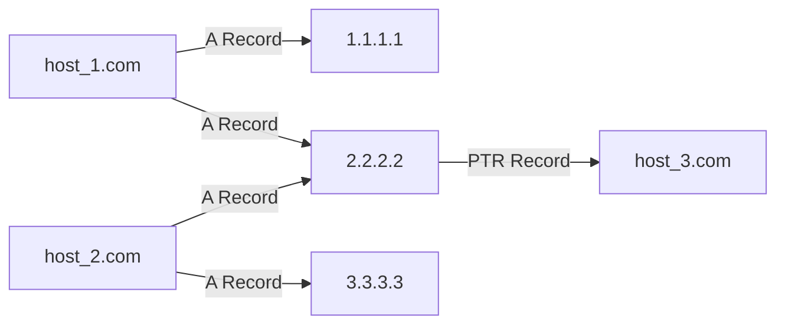
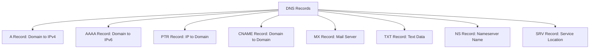

> **Goal of this section:**
> You'll understand what DNS is and why it matters to every SOC Analyst, learn the different types of DNS Records, see how DNS works from the moment you type a website name until it turns into an IP Address, and learn about the risks that can be carried out against you using DNS.

---

## Table of Contents


- [Introduction](#introduction)
- [why-dns-matters](#why-dns-matters)
- [dns-server-client-types)](#dns-server-client-types)
- [dns-lookup-route](#dns-lookup-route)
- [dns-record-types](#dns-record-types)
- [dns-many-to-many](#dns-many-to-many)
- [dns-misunderstanding-dangers](#dns-misunderstanding-dangers)
- [dns-diagrams](#dns-diagrams)
- [comparison-tables](#comparison-tables)
- [key-notes](#key-notes)
- [summary](#summary)


---

## Introduction

DNS, or the **Domain Name System**, is one of the most important protocols that any **SOC Analyst** needs to understand well. In fact, almost every **Incident** you work on will require you to link an **IP Address** to a **Domain Name**. DNS isn't just an ordinary protocol; it's also a tool that attackers can exploit in many ways, such as **DNS Tunneling** and **DNS Spoofing**.

---

## why-dns-matters
### The core idea: a digital phone book

Imagine you want to call John but you don't know his number, so you look up his name in the phone book and find the number. DNS does exactly the same thing for the internet.

- **The name** = `google.com`
- **The number** = `172.217.31.174`
- **The DNS Server** = the phone book

```
You type: google.com
    ↓
DNS returns: 172.217.31.174
    ↓
The browser sends: an HTTP GET Request to 172.217.31.174
```

### Why does this matter to the Blue Team?

1. Almost **every Incident** requires linking the IP to the Domain Name
2. DNS can be used for **Command & Control (C2)**
3. DNS can be used for **Data Exfiltration** through **DNS Tunneling**
4. DNS can be manipulated to redirect users to fake websites
5. It provides you with important **Threat Intelligence** about the Attacker Infrastructure

---

## dns-server-client-types

### 1. Stub Resolver

This is the **DNS Client** that runs on your device (your laptop or phone).

- It is what initiates the **DNS Query**
- It can **Cache** answers it has already seen
- On Windows, you can view the Cache with this command:

```cmd
ipconfig /displaydns
```

> **Note:** Linux doesn't cache by default.

### 2. Forwarding Server

This is usually the **Home Router** or the company's **Domain Controller**.

- It stores answers in its **Cache** so it can respond quickly
- It doesn't perform **Recursion** to the Root Servers
- If it doesn't have the answer, it sends the question up to the Caching Server

### 3. Caching/Recursive Server

This is the **ISP DNS** or services such as **8.8.8.8** (Google) or **1.1.1.1** (Cloudflare).

- It performs full **Recursion** to the Root Servers if the answer isn't in the Cache
- It stores answers for later use
- You can run one at home using **Pi-Hole**

### 4. Authoritative Nameserver

This is the Server that holds the original, definitive answers.

- **It performs neither Caching nor Recursion**
- It is the true source of the information
- Example: `ns1.google.com` holds the original answers for everything in `google.com`

---

## dns-lookup-route
### The complete Flow

When you type `google.com` in the browser and there's nothing in the Cache, the journey goes like this:

```
1. Your device (Stub Resolver) asks the Local Forwarding Server
2. The Forwarding Server doesn't have the answer → it asks the Recursive Server
3. The Recursive Server asks the Root Nameservers "."
4. The Root Server says: "Ask the .com Nameservers"
5. The Recursive Server asks the .com Nameservers
6. The .com Server says: "Ask ns1.google.com"
7. The Recursive Server asks ns1.google.com and gets the IP
8. The answer is stored in the Cache and returned to your device
```

### The TTL concept

Every DNS answer comes with a **TTL (Time To Live)** in seconds.

- If the TTL = 300 seconds (5 minutes)
- Anyone who asks about the same Domain within those 5 minutes gets the answer straight from the Cache
- Once the TTL expires, the Cache entry expires and the Query is done from scratch

---

## dns-record-types

### A Record and AAAA Record

The most important type in DNS and the one you'll see most often.

| Type | Use |
|-------|-----------|
| **A** | Translates a Domain Name to an IPv4 Address |
| **AAAA** | Translates a Domain Name to an IPv6 Address |

**The most important Fields in the A Record:**

- **Question:** Which Domain is being asked about?
- **Answer:** What is the IP Address? (There can be more than one IP!)
- **Transaction ID:** A number that links the Request to the Response
- **TTL:** How long the answer will be kept in the Cache (in seconds)
- **Source/Destination IP:** Who asked? And who was asked?

> **A practical example:**
> A single visit to `aol.com` generates more than 60 A Record Queries for 58 different Domains!

### PTR Record

This is the opposite of the A Record — the "reverse lookup" of DNS.

- You send the IP and get back the Domain Name
- **Very important:** The IP is written in reverse!
- Example: If you want to do a Reverse Lookup for `8.8.4.4`, you'll see this in Wireshark: `4.4.8.8.in-addr.arpa`

```bash
# In the Terminal
nslookup 8.8.4.4
```

> **Warning:** Don't rely on the PTR Record! It can differ from the A Record and isn't necessarily correct.

### TXT Record

It stores any ASCII text up to 255 characters.

**Main uses:**

| Use | Explanation |
|-----------|-------|
| **SPF (Sender Policy Framework)** | A list of the Servers allowed to send Email from this Domain |
| **DKIM** | A Public Key used to verify the Email's signature |
| **Domain Ownership** | Proving ownership of the Domain to verification services |

**Example of an SPF Record:**
```
v=spf1 include:_spf.google.com ~all
```

> **Security risk:** TXT Records can be used for DNS Tunneling! We'll talk about it later.

### CNAME Record

It Redirects from one Domain to another Domain.

```
www.sec450.com  →  CNAME  →  sec450.com  →  1.2.3.4
```

**Its uses:**
- Multiple names for the same server (www, ftp, and mail all point to the same IP)
- Automatically redirecting `sans.org` to `www.sans.org`

> **Warning:** Don't make a CNAME point to another CNAME, because that can create an infinite Loop!

### MX Record

It specifies the Mail Server responsible for the Domain.

**The journey of sending an Email:**
```
1. MX Record Query for sec450.com → mail.sec450.com
2. A Record Query for mail.sec450.com → 1.2.3.4
3. SMTP Connection to that IP
```

**Important rule:** A lower Priority value = a higher priority (the Email is sent to it first)

### SRV Record

It helps Clients find a specific Service on the Network.

**Syntax:**
```
_service._proto.name
```

**Example:**
```
_ldap._tcp.sec450.com  →  LDAP service over TCP
```

You'll see it a lot in **Active Directory** environments.

### NS Record

It specifies the name of the Authoritative DNS Server for the Domain.

```
google.com  →  NS  →  ns1.google.com
```

It is stored in two places:
1. On the **TLD Nameserver** (for example `.com`) for Delegation
2. On the **Domain's Own Nameservers** as Authority Records

---

## dns-many-to-many
### Important rules you need to memorize

These rules are very important in security investigations:

1. **A single Domain can point to more than one IP (or to no IP at all)**
   - `host_1.com` → `1.1.1.1` and `2.2.2.2`

2. **Multiple Domains can point to the same IP**
   - `host_1.com` and `host_2.com` both → `2.2.2.2`

3. **A PTR Record can point to any Domain (or to nothing)**
   - It doesn't have to be the same Domain that was requested

4. **Any of these can change at any time**
   - This is very important in Investigations!

### How this affects investigations

```
A dangerous scenario:

1. An Attacker buys evilsite.com
2. They point evilsite.com to the same IP as google.com
3. The Security system notices suspicious activity on evilsite.com
4. You block the IP
5. The result: you blocked Google instead of blocking the Attacker!
```

> **The lesson:** Always Check the Logs before you block any IP!

---

## dns-misunderstanding-dangers

### PTR Records aren't trustworthy

RFC 1912 recommends that "every Internet-reachable host should have a PTR Record," but in reality:

- The PTR isn't always present
- The PTR can point to the wrong Domain
- The PTR can change at any time

**A real example from Google:**
```
google.com  →  A Record  →  142.250.6.206
142.250.6.206  →  PTR Record  →  lga25s72-in-f14.1e100.net
```

Notice that the PTR doesn't return `google.com`, and that's completely normal!

**Why `1e100.net`?**
It comes from Google! `1e100` is the scientific way of writing the number Googol (10^100), from which the company's name was derived.

---

## dns-diagrams
### DNS Query journey diagram



### DNS Server types diagram



### DNS many-to-many relationship diagram



### DNS Record types diagram



---

## comparison-tables
### Complete table of DNS Record types

| Type | Code | Use | Example |
|-------|-------|-----------|------|
| **A** | 1 | Domain → IPv4 | `google.com → 142.250.6.206` |
| **AAAA** | 28 | Domain → IPv6 | `google.com → 2607:f8b0:4004::200e` |
| **PTR** | 12 | IP → Domain | `206.6.250.142.in-addr.arpa → google.com` |
| **CNAME** | 5 | Domain → Domain | `www.example.com → example.com` |
| **MX** | 15 | Mail Server | `sec450.com → mail.sec450.com` |
| **TXT** | 16 | Text Data | `v=spf1 include:_spf.google.com ~all` |
| **NS** | 2 | Nameserver | `google.com → ns1.google.com` |
| **SRV** | 33 | Service Location | `_ldap._tcp.sec450.com → ldap.sec450.com:389` |

### Comparing DNS Server types

| Type | Cache | Recursion | Authority | Example |
|-------|-------|-----------|-----------|--------|
| **Stub Resolver** | Sometimes | No | No | Your personal device |
| **Forwarding Server** | Yes | No | No | Home Router, Domain Controller |
| **Caching/Recursive** | Yes | Yes | No | 8.8.8.8, 1.1.1.1 |
| **Authoritative** | No | No | Yes | ns1.google.com |

### Useful commands for DNS Analysis

| Command | Use | Platform |
|-------|-----------|--------|
| `nslookup google.com` | A Record Query | Windows/Linux |
| `nslookup -type=mx google.com` | MX Record Query | Windows/Linux |
| `nslookup 8.8.4.4` | PTR Record Query | Windows/Linux |
| `dig google.com A` | Detailed A Record Query | Linux |
| `dig -x 8.8.4.4` | Reverse DNS Lookup | Linux |
| `ipconfig /displaydns` | Display the DNS Cache | Windows |
| `host -t txt google.com` | TXT Records | Linux |

---

## key-notes

> [!IMPORTANT]
> The **PTR Record** isn't trustworthy! Don't base your security decisions on it alone. Always verify the A Record against the PTR.

> [!WARNING]
> If you find a suspicious Domain pointing to the IP of a trusted website (such as Google), **don't block that IP right away!** You'll block the trusted website by mistake! In these cases, always block the **Domain**, not the IP.

> [!NOTE]
> The **Transaction ID** in DNS is very important. It links each **Request** to its **Response**. It's very useful in Analysis.

> [!TIP]
> When you investigate an Incident, always collect the **Domain Name** and the **IP Address** together. If you only have the Domain or only the IP, you'll miss very important information.

> [!IMPORTANT]
> **TXT Records** can be used for **DNS Tunneling**, a technique attackers use to exfiltrate Data or control Malware over the DNS protocol. You need to monitor unusual TXT Records!

> [!NOTE]
> A very low **TTL** can be a warning sign! Attackers sometimes use a very short TTL so they can change the IP quickly and evade Blocking.

---

## Summary
### Key points

- **DNS** is the internet's "phone book"; it translates names into numbers
- There are **4 types** of DNS Servers: Stub Resolver, Forwarding, Caching/Recursive, Authoritative
- The **A Record** is the most important; it translates a Domain to IPv4
- The **PTR Record** is the reverse, and it isn't trustworthy
- **CNAME** creates an Alias from one Domain to another Domain
- **MX** is for Email, **TXT** is for text (such as SPF and DKIM)
- DNS relationships are **Many-to-Many**: one Domain → multiple IPs, and multiple Domains → one IP
- Always block the **Domain**, not the **IP**, to avoid Collateral Damage
- The **TTL** determines how long the answer is kept in the Cache
