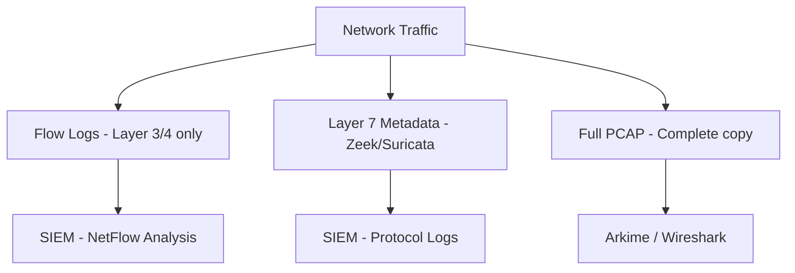
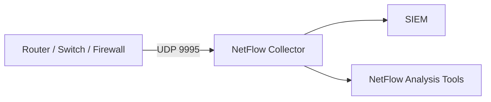
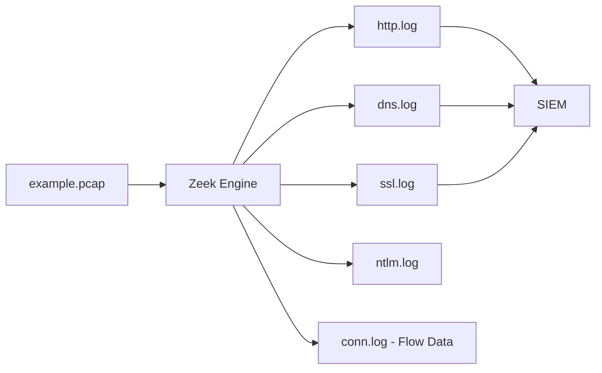
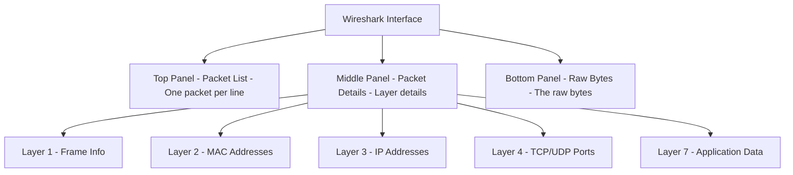
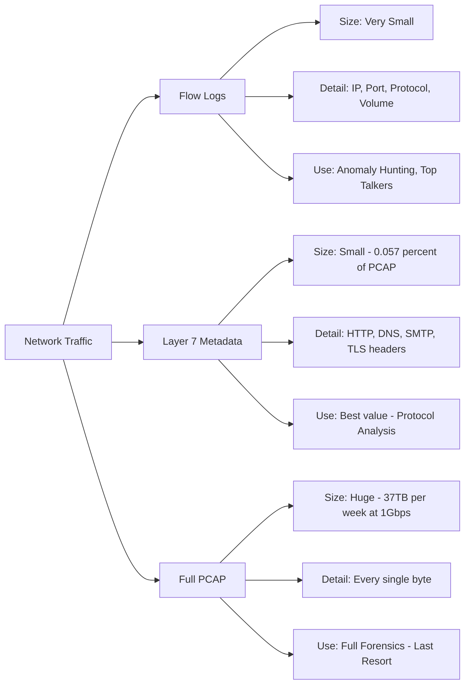

> **Goal of this section:**
> We'll understand how we collect network traffic data and the difference between the 3 main methods (Flow Logs, Layer 7 Metadata, Full PCAP), and when to use each one in the SOC.

---

## Table of Contents

- [Introduction](#introduction)
- [Overview: The 3 Capture Formats](#overview-the-3-capture-formats)
- [Level 1: Flow Logs (NetFlow)](#level-1-flow-logs-netflow)
- [Level 2: Layer 7 Metadata (Zeek / Suricata)](#level-2-layer-7-metadata-zeek--suricata)
- [Level 3: Full Packet Capture (PCAP)](#level-3-full-packet-capture-pcap)
- [Wireshark: The PCAP Analysis Tool](#wireshark-the-pcap-analysis-tool)
- [Comparison Diagram](#comparison-diagram)
- [Comparison Table](#comparison-table)
- [Key Notes](#key-notes)
- [Summary](#summary)

---

## Introduction

When an attack happens on the network, the first question asked is:
**"What data do we have about the traffic that passed through?"**

The answer depends on **how** you collect network data. There are 3 levels of collection:

1. **Flow Logs**: high-level data (Layer 3 and 4 only)
2. **Layer 7 Metadata**: detailed application-level data
3. **Full PCAP**: a complete copy of every byte that crossed the network

Each one has its own uses, advantages, and disadvantages. We'll explain them one by one.

---

## Overview: The 3 Capture Formats



---

## Level 1: Flow Logs (NetFlow)

### What Is a Flow Log?

A flow log is the lightest type of data you can collect about the network.
It operates at **Layer 3 (IP)** and **Layer 4 (TCP/UDP)** only, which means it doesn't see the contents of the packets.

Think of it like a **phone bill**: you know who called whom, when, and for how many minutes, but you don't know what was said.

### What Gets Recorded in a Flow Log?

- Source IP and Destination IP
- Source Port and Destination Port
- Protocol (TCP / UDP)
- The amount of data sent in each direction
- The session start time and its duration

### NetFlow and Its Siblings

| Name | Company |
|-------|--------|
| **NetFlow** | Cisco |
| **Jflow** | Juniper |
| **NetStream** | HP |
| **sFlow** | Sampled, for high-speed networks |
| **IPFIX** | The unified standard (v10) |

> **A note on sFlow:** sFlow doesn't record every packet; it records a **sample** of them (Sampled). So if you have sFlow, you're working with incomplete data. Keep that in mind!

### How Is It Collected?

Flow logs are sent from the router, firewall, or switch directly to a **NetFlow Collector** on UDP port 2055, 9995, or 9996. From there, they go to the SIEM.



### When Should You Use Flow Logs?

- Identifying the biggest uploaders/downloaders
- Hunting for lateral movement inside the network
- Monitoring protocols such as RDP, SMB, and PowerShell
- Matching IP addresses against threat intelligence
- Looking for connections on odd ports
- Spotting long-running connections that could be C2

> **An important fact:** Many breaches were initially discovered through flow logs alone!

---

## Level 2: Layer 7 Metadata (Zeek / Suricata)

### What Is Layer 7 Metadata?

This is the second level, and it offers the **best value for its size** in network monitoring.

Instead of recording every byte like PCAP, or recording only IPs and ports like flow logs, Layer 7 metadata records **detailed information about every transaction at the application level**.

### The Most Popular Tools

| Tool | Description |
|--------|--------|
| **Zeek** (formerly Bro) | Analyzes traffic and produces organized logs for each protocol |
| **Suricata** | An IDS/IPS that can perform the same function as Zeek |

### Zeek: The Prism of PCAPs

Think of Zeek like a **prism**: the PCAP goes in, and out comes:



### What Does Zeek Record?

- **HTTP:** Method, URL, User-Agent, Status Code, Host
- **DNS:** Query, Response, Record Type, TTL
- **SMTP:** Sender, Receiver, Subject
- **TLS/SSL:** Certificate details, Cipher Suite
- **conn.log:** Exactly like flow logs, so Zeek is 2 in 1

### Zeek Output Example

```json
{
  "ts": 1609459200.123,
  "uid": "CHhAvVGS1DHFjwGM9",
  "id.orig_h": "192.168.1.100",
  "id.orig_p": 54321,
  "id.resp_h": "93.184.216.34",
  "id.resp_p": 80,
  "method": "GET",
  "host": "example.com",
  "uri": "/malware.exe",
  "status_code": 200,
  "resp_mime_types": ["application/octet-stream"]
}
```

> Notice that Zeek outputs **structured JSON**, which is easy to send to the SIEM and analyze.

### Size Comparison

Zeek data = **0.057%** of the size of the full PCAP!
So if you have 1TB of PCAP, the Zeek logs will be only about **570 MB**.

---

## Level 3: Full Packet Capture (PCAP)

### What Is PCAP?

PCAP (Packet Capture) is the biggest and heaviest solution: it records **every byte** that crossed the network.

If it's not encrypted, you'll know **exactly** what was sent, by whom, and when.

### File Formats

| Format | Details |
|--------|----------|
| **.pcap** | The older format, supported by every tool |
| **.pcapng** | The newer format, supports additional information such as interface info and comments |

### PCAP Tools

**GUI Tools:**
- **Wireshark**: the most popular, for manual analysis
- **Arkime** (formerly Moloch): for enterprise-scale PCAP
- **NetworkMiner**: for extracting files

**CLI Tools:**
- **tcpdump**: capture and filtering
- **TShark**: the command-line version of Wireshark
- **Zeek**: for extracting metadata
- **Snort / Suricata**: as an IDS on the PCAP
- **ngrep / strings**: for searching the content
- **tcpxtract / foremost / scalpel**: for extracting files

### The Downside of PCAP: Its Enormous Size

If you have a 1Gbps connection running at 50% utilization:

```
1Gbps × 50% = 500Mbps
500Mbps × 60 seconds × 60 minutes × 24 hours × 7 days = 37.8 TB per week!
```

That's why many companies do full PCAP at only one point (the perimeter) and use Zeek for the rest of the network.

---

## Wireshark: The PCAP Analysis Tool

### The 3 Panels in Wireshark



### The Most Important Wireshark Display Filters

**Filtering by protocol:**

```
http          -- All HTTP traffic
dns           -- All DNS traffic
tls           -- All TLS traffic
dns and tls   -- DNS over HTTPS
http or dns   -- A good starting point for an investigation
```

**Filtering by network:**

```
ip.addr eq 1.2.3.4              -- All traffic from or to a specific IP
tcp.port eq 80                  -- All traffic on port 80
ip.addr eq 1.2.3.4 && tcp.port eq 443  -- A specific IP on a specific port
frame contains "password"       -- Any packet containing a specific word
```

### Practical Scenario: Follow HTTP Stream

In Wireshark, if you want to see the HTTP content:

1. Right-click any packet
2. Choose **Follow** then **HTTP Stream**
3. You'll see the request in red and the response in blue

**A real example from the course:**
```
GET /calc.exe HTTP/1.1
Host: fewfewfewfew.ibiz.cc
```
The response was a malicious EXE file! This is a classic example of a malware download.

> **Note:** Wireshark isn't suitable for enterprise-scale monitoring. If you want to analyze PCAP at the organization level, use **Arkime**.

---

## Comparison Diagram



---

## Comparison Table

| Property | Flow Logs | Layer 7 Metadata | Full PCAP |
|---------|-----------|-----------------|-----------|
| **Size** | Very small | Relatively small | Very large |
| **Layer** | 3 and 4 only | Up to Layer 7 | All layers |
| **Content** | IP, Port, Protocol | HTTP, DNS, SMTP metadata | Every byte |
| **Example Tools** | NetFlow, nfdump | Zeek, Suricata | Wireshark, Arkime, tcpdump |
| **Best Use** | Top Talkers, Lateral Movement | Protocol Analysis, Threat Hunting | Deep forensics |
| **SIEM Integration** | Direct | Direct (JSON Logs) | Indirect (Arkime + Link) |
| **Storage Cost** | Low | Low | Very high |

---

## Key Notes

> [!IMPORTANT]
> **sFlow** is a type of flow log that performs **Sampling** (it takes a sample). If you use it, know that you're working with incomplete data, not the full picture.

> [!NOTE]
> **Zeek** creates `conn.log` automatically, which makes it a substitute for flow logs at the same time. In other words, Zeek = Flow Logs + Layer 7 Metadata together.

> [!TIP]
> The best strategy is to have all 3 levels together:
> - **Flow Logs** for history and trends
> - **Layer 7 Metadata** for daily analysis and alerting
> - **Full PCAP** on the perimeter only, for deep forensic cases

> [!WARNING]
> If you have only PCAP without flow logs or Zeek, that's a huge storage challenge and not scalable. Conversely, if you have only flow logs, you'll miss the details of what's happening at the application level.

> [!NOTE]
> **Wireshark** isn't the right tool for analyzing PCAP across the whole network. It's for manual analysis of limited-size PCAPs. For enterprise analysis, use **Arkime**.

---

## Summary

### Quick Summary

- **Flow Logs:** Layer 3/4 only; the lightest solution; suited for history and anomaly detection
- **Layer 7 Metadata (Zeek):** The best value; covers the application layer; sent to the SIEM
- **Full PCAP:** Everything; very heavy; for deep forensics only
- **NetFlow:** The most popular Cisco protocol for sending flow data over UDP 9995
- **sFlow:** Sampled Flow; incomplete data; keep it in mind
- **Zeek:** The prism for PCAP; produces organized logs for each protocol
- **Wireshark:** A manual PCAP analysis tool; 3 panels; display filters

