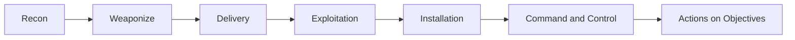
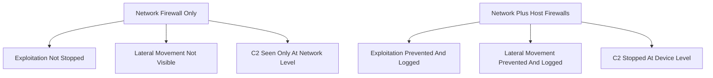

> **Goal of this section:**
> You'll understand how we build a multi-layered defense strategy (Defense in Depth) on endpoints, and you'll get to know each defensive tool that maps to the stages of the Kill Chain, from preventing the initial exploitation to detecting post-compromise activity.

## Table of Contents
- [Introduction](#introduction)
- [Why One Layer Is Never Enough](#why-one-layer-is-never-enough)
- [Preventing Exploitation](#preventing-exploitation)
  - [Network Scanning and Software Inventory](#network-scanning-and-software-inventory)
  - [Continuous Vulnerability Scanning](#continuous-vulnerability-scanning)
  - [Patching](#patching)
  - [Anti-Exploitation](#anti-exploitation)
  - [Windows Defender Exploit Guard](#windows-defender-exploit-guard)
- [Virtualization-Based Security](#virtualization-based-security)
  - [Windows Credential Guard](#windows-credential-guard)
  - [Microsoft Defender Application Guard](#microsoft-defender-application-guard)
- [Host Firewalls](#host-firewalls)
- [Preventing Installation](#preventing-installation)
  - [Antivirus](#antivirus)
  - [Application Control](#application-control)
  - [Application Control Bypass Methods](#application-control-bypass-methods)
  - [File Integrity Monitoring](#file-integrity-monitoring)
  - [Catching Persistence](#catching-persistence)
  - [Privileged Access Workstations](#privileged-access-workstations)
  - [Windows Permissions and Privileges](#windows-permissions-and-privileges)
- [Command and Control Defenses](#command-and-control-defenses)
  - [EDR: Endpoint Detection and Response](#edr-endpoint-detection-and-response)
- [Actions on Objectives Defenses](#actions-on-objectives-defenses)
  - [Data Loss Prevention](#data-loss-prevention)
  - [User and Entity Behavior Analysis](#user-and-entity-behavior-analysis)
  - [Audit Policies and Logging](#audit-policies-and-logging)
- [Summary Table: Kill Chain vs Defenses](#summary-table-kill-chain-vs-defenses)
- [Key Notes](#key-notes)
- [Summary](#summary)

## Introduction

In this section, we'll talk about "Endpoint Defense In Depth," meaning how we protect endpoints (such as laptops, servers, and devices) using more than one defensive layer at the same time. The core idea is that a single layer of defense is never enough against a skilled attacker. We need multiple layers, with each layer covering a specific stage of the attack.

We'll use the **Kill Chain** perspective to understand exactly where each defensive tool operates and what kind of attack it stops or detects. The ultimate goal is to make the attacker face a "trap" at every step, which slows them down and gives us more time to catch them before they reach their objective.

## Why One Layer Is Never Enough

Imagine you have a house with just one door and no fences, cameras, or alarm systems. If someone breaks the door, they're in and can roam the whole house easily. The same applies to endpoint security. If you rely only on antivirus, for example, and the attacker manages to get past it, there's nothing else to stop them.

That's why the **Defense in Depth** strategy is built on the principle that each defensive layer covers the weakness of the layer before it. If something fails at prevention, there's another layer that detects that something went wrong.

Each of these stages has its own dedicated defensive tools, and we'll explain them one by one.

## Preventing Exploitation

This stage focuses on preventing the attacker from exploiting any vulnerability in the system in the first place. There are four main tools here: Network Scanning, Vulnerability Scanning, Patching, and Anti-Exploitation.

### Network Scanning and Software Inventory

The first step in preventing any exploitation is knowing what's actually running in your environment. You can't protect something you don't know exists! There are two ways to collect this information:

- **Inventory Systems**: they periodically log in to every machine, build a list of installed software, and store it in a central database.
- **Network Scanning**: using tools such as **Nmap**, you probe machines over the network itself, see which ports are open, grab the banners of running services, and try to guess the operating system.

Combining both methods gives us a complete picture of our attack surface so we can reduce it.

### Continuous Vulnerability Scanning

Cyber threats change incredibly fast, and a server that's secure today might have a critical vulnerability tomorrow! This is where **Vulnerability Scanners** come in: they track the software versions on every machine and help prioritize patching.

There are two types of scans:

1. **Unauthenticated Scans**: they try to gather information by interacting with the machine without logging in, and they are very limited in the information they can get.
2. **Authenticated Scans**: they actually log in to the machine to find out exactly which versions are installed, which gives much higher accuracy.

### Patching

**Patching** is the number one way to prevent exploitation. According to the **CIS Top 20 Version 7** list, knowing your software (#2) and Continuous Patching (#3) are among the most important controls.

It's important to understand that patching isn't just for applications; it must include:
- Operating system updates
- Server software updates
- Updates to prevent client-side exploits as well

> [!NOTE]
> Some updates require a reboot, which can cause temporary service downtime. You need a clear policy for when it's worth stopping work to apply a patch quickly, especially in the case of a critical vulnerability (Emergency Patch).

### Anti-Exploitation

If a user does open a file containing an exploit (such as a malicious PDF file), how will we even know it happened? This is where **Anti-Exploitation** tools come in, such as:

- **EMET** (Enhanced Mitigation Experience Toolkit): it ran on Windows up to version 8.1 / Server 2012 R2.
- **Exploit Guard**: the modern replacement in Windows 10 and later.

The big advantage of these tools is that they don't just stop the exploit; they also create a **Log** of the exploitation attempt. So even if the attack was stopped, the security team (SOC) knows that an attack attempt took place.

### Windows Defender Exploit Guard

Exploit Guard is the replacement for EMET in Windows 10+ and consists of 4 main components:

| Feature | Function | Required License |
|--------|---------|------------------|
| Exploit Protection | Granular protection for applications and logging of any exploitation attempt | Home/Professional |
| Controlled Folder Access | Prevents ransomware from encrypting files in "Protected Folders" | Home/Professional |
| Network Protection | Blocks connections to malicious websites using SmartScreen | Enterprise E3 |
| Attack Surface Reduction | Blocks common attack tactics delivered through email, scripts, and Office | Enterprise E5 |

## Virtualization-Based Security

### Windows Credential Guard

Available in Windows 10+ Enterprise and Server 2016+. It isolates credentials in memory using the hardware's own virtualization technology. The main goal is to prevent tools like **Mimikatz** from reaching the real lsass.exe process and stealing passwords.

It requires the following:
- UEFI Native Mode
- 64-bit Windows
- SLAT (Second Layer Address Translation)
- Virtualization (VT or AMD-V)

> [!IMPORTANT]
> Even if the attacker reaches the highest possible privilege (Administrator), Credential Guard prevents them from reading the real LSA process, which makes credential dumping significantly harder.

### Microsoft Defender Application Guard

It uses the same Hyper-V isolation idea, but here it is applied to:

- **MS Edge Browser**: any untrusted website opens in an isolated environment.
- **Office Applications**: any Office file coming from the internet or a suspicious location opens inside a separate virtual machine.

## Host Firewalls

**Host Firewalls** can be among the most powerful tools for detecting and preventing attacks, even though they aren't the most exciting technology. They can block:

- Exploitation
- Lateral Movement
- Command and Control (C2)
- Exfiltration

Their main problem is that they generate a huge amount of data, so you need a very precise logging policy that focuses only on sensitive ports such as HTTP/HTTPS, SMB, and SSH.

The big benefit of a host firewall is that it turns every machine into a "Security Sensor" in its own right. So if a machine tries to communicate abnormally with another machine on the same subnet over SMB, a clear log is recorded describing exactly that attempt.

## Preventing Installation

This stage focuses on preventing malware from being installed, even if the attacker has gotten past the exploitation stage.

### Antivirus

**Antivirus** is one of the oldest protection tools. Traditionally, it relied on **Signatures**, meaning it only recognized known malicious files. The problem is that it fails against:

- Unknown malware (Zero-Day)
- Obfuscated malware
- Polymorphic malware

Modern products have become **Signatureless** and rely on machine learning, meaning they recognize the characteristics of a malicious file instead of looking for a specific signature.

> [!TIP]
> If you find a virus with an unusual name that you've never seen before in your environment, or one located somewhere abnormal, treat it as a signal for a deep investigation, even if the name looks ordinary, like "trojan.generic".

### Application Control

One of the best tools for both prevention and detection. The core idea is that it works with an allow list of programs that are permitted to run, and anything not on the list is blocked, or at least logged.

Enforcement methods:
- **Name-based**: by name
- **Path-based**: by path
- **Signature-based**: by digital signature
- **Hash-based**: by hash

Examples: **AppLocker/WDAC** on Windows, **Gatekeeper** on macOS, **AppArmor/SELinux** on Linux.

### Application Control Bypass Methods

Unfortunately, application control isn't a 100% perfect solution. Attackers get around it in ways such as:

| Bypass Method | Explanation |
|------------------|-------|
| Malicious Scripts | Some solutions don't consider scripts to be "programs," so they ignore them |
| Living off the Land | Using tools that already exist on the system, such as rundll32.exe |
| Code Injection | Injecting malicious code into a running process that is already allowed |
| Path-based Bypass | If the attacker can overwrite an allowed file in the same path |
| Hash/Signature Bypass | Possible in theory, but requires an enormous effort (Google used 6,610 years of CPU time to produce a SHA1 collision) |

### File Integrity Monitoring

**FIM** periodically monitors files and folders to make sure there are no unexpected modifications. It tracks:

- The hash and size
- The owner/group
- Permissions
- Any new files that were added

A practical example: if an attacker exploits a WordPress site and drops a malicious PHP file (a web shell) in `/var/www/html/`, FIM will detect that new file immediately, because the site's files aren't supposed to change much.

### Catching Persistence

Persistence is the attacker's way of keeping their access to the system. The most common **ASEPs** (Auto Start Extensibility Points):

- Autorun Items
- Malicious Services
- Scheduled Tasks
- Browser Extensions
- Stealing valid credentials

> [!TIP]
> The free **Sysinternals Autoruns** tool helps a lot in discovering the various ASEPs, and it supports digital signature verification and VirusTotal lookups.

### Privileged Access Workstations

The **PAWS** principle is simple: a highly privileged user (such as an admin) must use a completely separate machine for administrative tasks and should never use their admin account from their regular machine. Why? Because if the regular machine is compromised, the hacker gets the administrative credentials too, which gives them the first step toward privilege escalation.

### Windows Permissions and Privileges

**Permissions** control who can read/write specific files and folders, which is very important for preventing privilege escalation by blocking writes to core system files.

**Privileges** control what a user can do after logging in, such as:
- Loading drivers
- Debugging processes
- Backing up and restoring files

## Command and Control Defenses

### EDR: Endpoint Detection and Response

**EDR** is like a "Flight Data Recorder" for every endpoint. It records almost everything: processes, services, DLLs, files, registry keys, and network connections. Its main advantages are that it:

1. Provides huge visibility into all activity on the machine
2. Correlates the data and builds a timeline
3. **The "R" (Response)**: lets the analyst take immediate action, such as isolating the machine, deleting files, or running an investigation script

Among the best-known products: Carbon Black, CrowdStrike, SentinelOne, Cybereason.

> [!NOTE]
> There's a newer category called **XDR** that adds network data alongside endpoint data.

## Actions on Objectives Defenses

### Data Loss Prevention

**DLP** focuses on preventing sensitive data leakage during the Discovery, Collection, and Exfiltration stages. It uses rules to recognize patterns such as Social Security numbers or credit card data.

3 main use cases:
1. **Non-malicious Insider**: preventing unintentional employee mistakes
2. **Malicious Insider**: detecting an employee who intends to steal or destroy data
3. **Malicious Outsider**: preventing an external attacker from exporting data

### User and Entity Behavior Analysis

**UEBA** relies on data science and statistics to detect abnormal behavior (anomalies). The core assumption: something unusual is more likely to be malicious, but not everything unusual is necessarily malicious; human expertise is needed to tell the difference.

### Audit Policies and Logging

Centralized **Logging** is one of the most important defensive tools of all. It includes:

- **Event Logs**: a record of every event that occurred
- **Audit Policies**: they control what gets logged and what doesn't

We'll cover this topic in more detail in the upcoming modules.

## Summary Table: Kill Chain vs Defenses

| Kill Chain Stage | Defensive Tools |
|----------------------|-------------------|
| Exploitation | Network Scanning, Vulnerability Scanning, Patching, Anti-Exploitation |
| Installation | Hardening, Antivirus, FIM, PAWS, Application Control |
| Command & Control | Host Firewalls, HIDS/HIPS, EDR |
| Actions on Objectives | Auditing, UEBA, Encryption, Logging, DLP |

## Key Notes

> [!WARNING]
> Antivirus is never a perfect solution against skilled attackers, but that's no reason to get rid of it — it still provides strong protection against everyday commodity malware.

> [!IMPORTANT]
> Application control only prevents files from being executed, not from being written to the hard disk. In other words, a malicious file can be written to the machine, but it won't be able to run.

> [!TIP]
> The more "traps" you add at each stage of the Kill Chain, the more the attacker is forced to slow down, which gives you more time to catch them.

## Summary

- Defense in Depth means multiple layers of protection, not relying on a single tool
- The exploitation stage is prevented with scanning, patching, and anti-exploitation
- The installation stage is prevented with AV, application control, FIM, and PAWS
- The C2 stage is prevented/detected with host firewalls and EDR
- The Actions on Objectives stage is prevented with DLP, UEBA, and logging
- Every defensive tool has strengths and weaknesses, and no single tool is enough on its own

