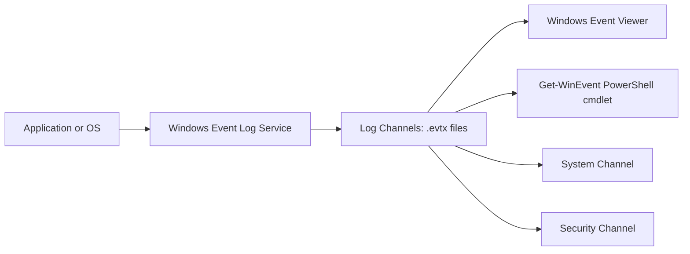
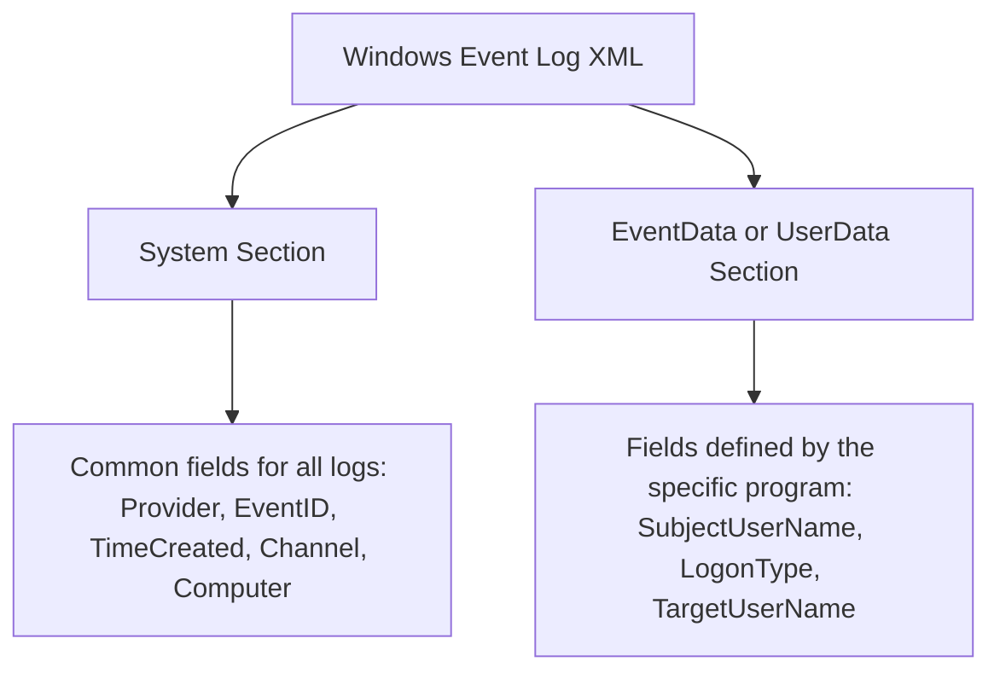
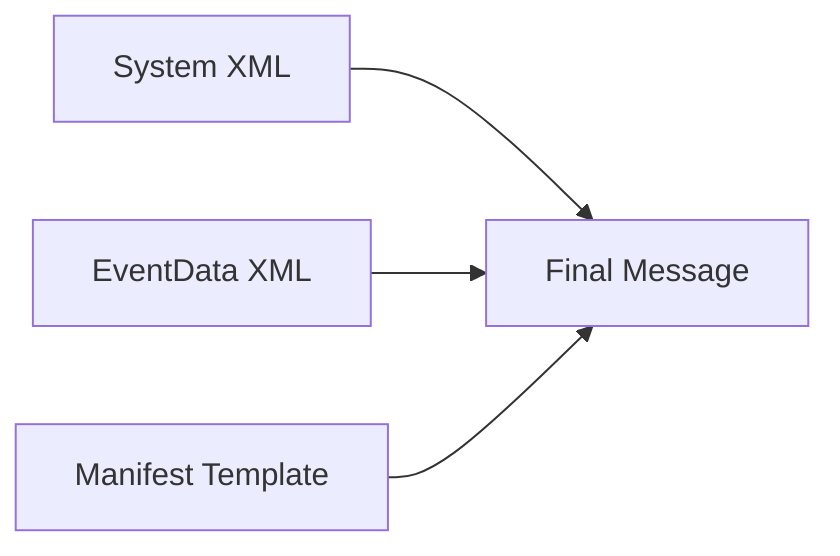

> **Goal of this section:**  
> We'll understand how Windows writes its logs in a completely different way from Linux, learn what a Log Channel is and how the XML structure of Windows Events works under the hood, and also learn which channels are the most important to collect as a SOC Analyst.

## Table of Contents
- [Introduction](#introduction)
- [Why Understanding Log Collection Matters](#why-understanding-log-collection-matters)
- [How Windows Event Logging Works](#how-windows-event-logging-works)
- [The Log Path in Windows](#the-log-path-in-windows)
- [Deciding What Gets Logged](#deciding-what-gets-logged)
- [The Windows Log Breakdown](#the-windows-log-breakdown)
- [The Same Log in Different Views](#the-same-log-in-different-views)
- [The Core Sections of Any Windows Log](#the-core-sections-of-any-windows-log)
- [Windows Event Templates](#windows-event-templates)
- [Putting the Pieces Together](#putting-the-pieces-together)
- [Important Channels to Collect](#important-channels-to-collect)
- [Section Summary](#section-summary)

## Introduction

In this section we'll talk about something very fundamental to any SOC Analyst's work: understanding how logs are generated and collected from endpoints. We'll focus specifically on Windows, because it's a bit more complex than Linux. This isn't a small detail; if you don't understand how a log is written and where it came from, you won't be able to interpret it correctly while investigating a security incident, and you might even miss important information because the channel holding the evidence isn't being collected in the first place.

## Why Understanding Log Collection Matters

Many analysts think log collection is "someone else's job," such as the SIEM Engineering team, but that's the wrong way to think about it. When you understand how a log was written and what its source is, you'll be able to:

- Triage faster during an incident.
- Properly understand the tools available to you.
- Interpret any event you see with more confidence, because you understand where it comes from.

> [!NOTE]
> Interpreting logs isn't something that happens once a month... it happens every day in SOC work, so investing in understanding them will pay off for you in the long run.

## How Windows Event Logging Works

Windows uses a completely different approach from Linux for recording logs. The core idea:

- The OS and all applications write their logs to something called a **Log Channel**.
- Each channel is actually a file in **.evtx** format, which is **XML** encoded in binary.
- That means **you can't open the file with a regular text editor**, the way you can with Linux files, which are plain text.
- The main tool for reading .evtx files is the **Windows Event Viewer**.
- In the Event Viewer, you'll find the channels on the left side. The best known are **Application**, **Security**, and **System**, but there are many other lesser-known channels that are very useful for security.

### A Simple Analogy

Imagine every application on your machine is an employee sending a report to a central office (the Windows Event Log Service). That office sorts the reports by type and puts them in different drawers (the channels), and each drawer is a separate .evtx file.

> [!IMPORTANT]
> Not all applications write to the Windows Event Log. Some programs prefer to write their logs to regular text files or somewhere else entirely, so you need to know how each application you monitor behaves.

## The Log Path in Windows

In the following diagram, we'll see a log's journey from the moment it's written until it shows up in our viewing tool:



The steps in brief:

1. The message is sent by the application or the OS itself.
2. The message reaches the **Windows Event Log Service**.
3. This service uses the attached metadata to decide which channel will receive the message.
4. Each channel is stored in a separate .evtx file under the path: `C:\Windows\System32\winevt\Logs`.
5. You can read these files with the Windows Event Viewer, the **Get-WinEvent** cmdlet in PowerShell, or third-party forensic tools.

## Deciding What Gets Logged

Not everything is logged automatically; there are settings that control this:

### Windows Audit Policies

This is the main mechanism that controls which events get logged, such as:

- Logon/Logoff events.
- Object Access.
- Creating new users or modifying groups (Group Management).
- Choosing whether to log on success, on failure, or both.

### Third-Party Add-ons Like Sysmon

**Sysmon** is a third-party tool that adds extra logging details, such as:

- Process Creation.
- Network Connections.
- Many other details that aren't available in the default Audit Policy.

### Custom Scripts

You can write a PowerShell script that creates a custom channel and sends any text to it, which makes it easy for the log agent to pick up whatever information you want directly.

### The Applications Themselves

If an application doesn't write to the Windows Event Log, the settings depend entirely on the program's own capabilities. For network services such as web servers or DNS servers, for example, it's best to make sure logging is enabled with all the important fields, or to capture the information from the network itself with a tool like **Zeek** or **Suricata**.

## The Windows Log Breakdown

Every log in any channel comes with metadata that's very important for interpretation:

| Field | Meaning | Example |
|------|--------|---------|
| Level | The message's severity level (Verbose, Informational, Warning, Error, Critical) | Most logs are Informational |
| Source (Provider) | The program that wrote the log | Microsoft-Windows-Security-Auditing |
| EventID | A unique number identifying the event type within the same channel | 4624 = successful login |
| Task Category | An additional description of the event, defined by the source itself | Logon |

> [!TIP]
> The EventID isn't unique across all of Windows; it's only unique within the same channel. So EventID 1, for example, can mean something completely different in another channel than it does in Security.

## The Same Log in Different Views

One of the most important things to understand: a Windows Event is actually **XML**, but it can be displayed in different ways in the Event Viewer:

1. **General/Message View** — the easy-to-read format; this is what an analyst usually sees.
2. **Friendly View** — removes the XML tags but stays close to the original structure.
3. **XML View** — the real, complete format, with all the tags and raw data.

The idea is that the **Message** you see in the General tab was built from the XML data using a text template. The problem is that this Message View is **very hard for the SIEM to interpret automatically**, because it's unstructured free text, unlike XML, which is structured and easy to parse.

> [!WARNING]
> If the SIEM receives only the Message View without the XML fields, you'll have a hard time with automated parsing, and that could make you miss important alerts because the fields aren't available for fast searching.

## The Core Sections of Any Windows Log

When you view any Windows Event in XML format, it's divided into two main sections:

### System Section

This is the part shared by all Windows logs regardless of their type, and it contains things like:

- Provider Name and Guid.
- EventID.
- TimeCreated.
- Channel and Computer.

### EventData / UserData Section

This is the part defined by the program writing the log, and it can differ completely from one EventID to another, for example:

- SubjectUserSid, SubjectUserName.
- TargetUserName, TargetDomainName.
- LogonType.



## Windows Event Templates

To understand how the message was built in the first place, we can use PowerShell to view the template of any EventID:

```powershell
Get-WinEvent -ListProvider * | Select name
$provider = Get-WinEvent -ListProvider Microsoft-Windows-Security-Auditing
$provider.events | Where-Object {$_.id -eq 4624} | select id,template,description | fl
```

The first command lists all the providers on the system. The second selects the Security log's provider. The third pulls out the template and description of EventID 4624 (successful login).

> [!NOTE]
> You may get more than one output for the same command, because the same EventID can have more than one message format depending on the fields available at the time of the event.

## Putting the Pieces Together

The final message that appears in the General tab is made up of three things combined:

1. **System XML** — the shared data.
2. **EventData XML** — the event-specific data.
3. **Instrumentation Manifest Template** — the text template that turns placeholders (like %1) into readable field names such as "Security ID" or "Account Name".



The final message you see in the General tab is easy for a human to read, but it **was never designed for the SIEM to parse automatically**. If you try to write a regular expression to extract fields from the message, you'll run into lots of problems because of the conditional, unstructured nature of this format.

## Important Channels to Collect

There are common channels everyone collects, and other lesser-known channels that are very useful for detection:

### Commonly Collected Channels

- **Application**
- **Security**
- **System**

### Lesser-Known but Very Useful Channels

| Channel | Value |
|------|--------|
| PowerShell/Operational | Logs the commands run in PowerShell; very important because many attacks use PowerShell in-memory |
| Security-Mitigations (Kernel/User Mode) | EMET and Exploit Guard logs, such as Attack Surface Reduction and Controlled Folder Access |
| Code Integrity/Operational | Windows Defender Application Control logs for executables, dlls, and drivers |
| AppLocker (EXE/DLL, MSI/Script) | Logs Application Control violations |
| Windows Defender/Operational | Logs of viruses detected by Windows Defender |
| Windows Firewall with Advanced Security/Firewall | Logs firewall changes |
| Sysmon/Operational | If you have Sysmon installed, you should collect this channel right away |

> [!IMPORTANT]
> Collecting only Application, Security, and System is never enough to build a complete picture of endpoint security. Any additional logging (such as Sysmon or PowerShell logging) will generate data in other channels that need to be collected too.

## Section Summary

- Windows logging is much more complex than Linux because it relies on **Log Channels** and an **XML structure** in **.evtx** format.
- The Windows Event Log Service is responsible for routing messages to the different channels.
- The Audit Policy is the main tool that determines what gets logged, and it can be supplemented with tools like **Sysmon** or custom scripts.
- Every log consists of two sections: **System** (shared) and **EventData/UserData** (event-specific).
- The message you see in the Event Viewer is built from XML + a template, and it isn't suitable for automated parsing.
- You need to collect more than just Application/Security/System to cover modern attacks such as PowerShell-based attacks or Application Control bypasses.

