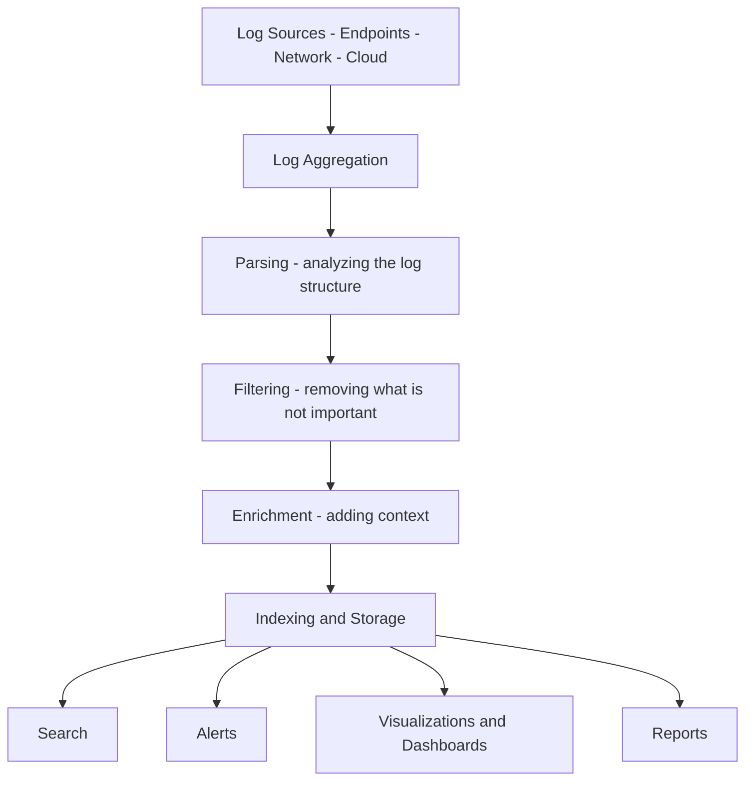
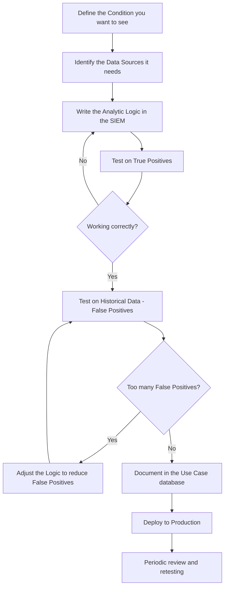
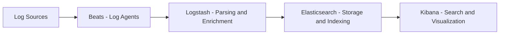
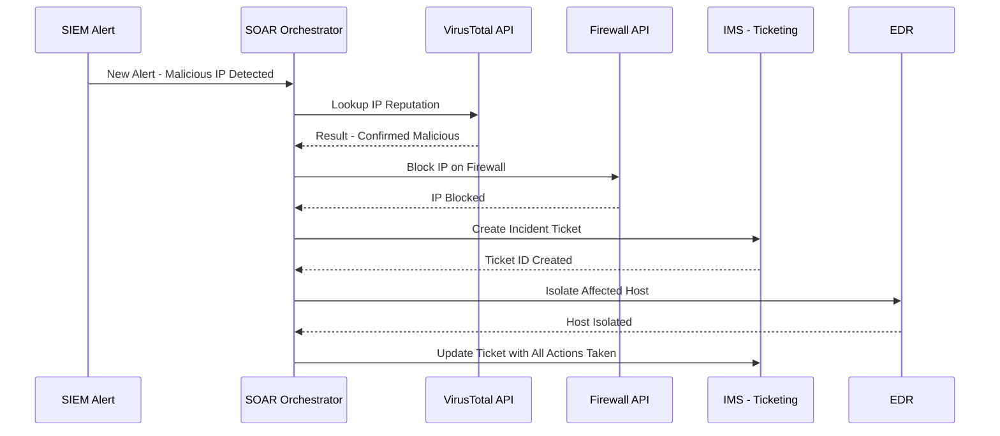
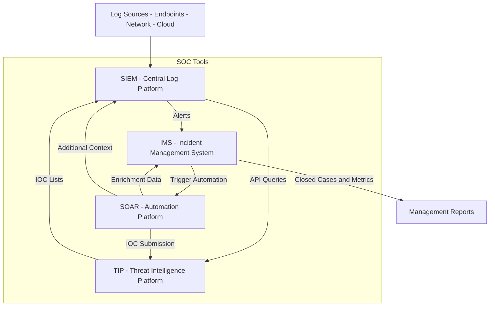

> **The goal of this section:**  
> We'll learn how the SIEM works as the log-aggregation hub of the SOC, how SOAR automates repetitive tasks and takes the load off analysts, and how all these tools integrate with each other so we can build an effective SOC.
---

## Table of Contents
- [Introduction](#introduction)
- [What Is a SIEM and Why Do We Need It](#what-is-a-siem-and-why-do-we-need-it)
- [Core SIEM Functions](#core-siem-functions)
- [Features of a Good SIEM](#features-of-a-good-siem)
- [Examples of SIEM Products](#examples-of-siem-products)
- [SIEM Use Cases](#siem-use-cases)
- [How to Build a New Use Case](#how-to-build-a-new-use-case)
- [Documenting Use Cases](#documenting-use-cases)
- [The Elastic Stack as a Lab SIEM](#the-elastic-stack-as-a-lab-siem)
- [Searching in Kibana](#searching-in-kibana)
- [Automation and Orchestration](#automation-and-orchestration)
- [SOAR Platforms](#soar-platforms)
- [Benefits of SOAR in the SOC](#benefits-of-soar-in-the-soc)
- [How All the Tools Integrate](#how-all-the-tools-integrate)
- [Storing Unstructured Information](#storing-unstructured-information)
-[Summary](#Summary)
---

## Introduction

In a modern SOC, data comes from everywhere: Firewalls, Endpoints, Network Sensors, Applications, etc. The problem isn't that the data doesn't exist; the problem is that there's a huge amount of it and it isn't organized.

This is where the **SIEM** (Security Information and Event Management) comes in, acting as the "nerve center" for all the organization's security data. Alongside it comes **SOAR** (Security Orchestration, Automation, and Response), which automates responses and investigations.

This section will help you understand:
- What exactly the SIEM does and what to look for in a good SIEM
- What Use Cases are and how to build them
- The difference between Automation and Orchestration
- How SOAR changes the way work is done in the SOC

---

## What Is a SIEM and Why Do We Need It

Imagine you work in a SOC and you have:
- 500 Servers sending Logs
- 2000 Desktops sending Windows Event Logs
- 10 Firewalls sending Traffic Logs
- IDS/IPS sending Alerts

Without a tool that collects all of this in one place, you'd have to open 10+ different tools to investigate any Alert. That's practically impossible.

The **SIEM** is the solution: it collects all these Logs in one place, analyzes them, and raises Alerts when it finds something suspicious.

> [!IMPORTANT]
> The SIEM isn't just a tool for storing Logs — it's the core hub for Detection and Investigation in any professional SOC. Without it, the Analyst is working blind.

---

## Core SIEM Functions

The SIEM runs every Log it receives through a sequence of steps:



### 1. Log Aggregation

The first step: the SIEM receives Logs from all the different sources. This is done through:
- **Agents** installed on each device
- **Syslog** for Network devices
- **APIs** for Cloud Services

### 2. Parsing

Every Log Source writes in a different way. The SIEM has to understand the structure of each Log and extract the important Fields from it, such as:
- `source_ip`
- `destination_ip`
- `username`
- `event_type`
- `timestamp`

### 3. Filtering

Not every Log matters for Security. The SIEM gets rid of the Noise so the Analyst doesn't waste time on things that don't matter.

### 4. Enrichment

This is one of the most important SIEM steps! Instead of the Log being just:
```
source_ip=1.2.3.4, domain=evil.com
```

After Enrichment, it becomes:
```
source_ip=1.2.3.4
domain=evil.com
domain_age=3 days
reputation=malicious
geo_location=Russia
user=ahmed.hassan
user_role=Finance Manager
```

Enrichment adds context that helps the Analyst make a decision much faster.

### 5. Indexing and Storage

The SIEM stores Logs in a Database in a way that lets you search them quickly. Indexing is like a book's index — without it, you'd have to read every page to find the information.

### 6. Search, Alerts, Visualizations, Reports

The final Output of the SIEM:
- **Search**: you can ask it "Who logged in from an external IP?"
- **Alerts**: when a certain condition occurs, it sends you a notification
- **Dashboards**: charts that show Traffic and Incidents
- **Reports**: periodic reports for Management

---

## Features of a Good SIEM

When you're choosing a SIEM for your organization, these are the things to look at:

| Feature | Why It Matters |
|--------|----------|
| Fast Search Capability | The Analyst needs quick answers while investigating |
| Expressive Query Language | So you can ask complex questions easily |
| Multiple Visualization Types | Turning data into easy-to-understand Charts |
| Well-Designed UI | The Analyst spends the whole day in this tool |
| Flexible Alerting Options | Defining when and how you get notified about Incidents |
| Log Enrichment and Correlation | Adding context to Logs automatically |
| API Integration | Connecting the SIEM to other tools such as SOAR |
| High-Performance Ingestion | Ingesting millions of Logs per second |
| Multi-Format Log Compatibility | Support for all the different Log formats |

> [!TIP]
> When choosing a SIEM, you must actually try the product before buying. Many products look good on paper, but the actual implementation turns out to be difficult. Ask about the weaknesses, not just the strengths!

---

## Examples of SIEM Products

There are many options on the market:

| Product | Company | Notes |
|--------|--------|---------|
| Splunk | Splunk Inc. | The most widely used, expensive |
| QRadar | IBM | Common in large enterprises |
| ArcSight | Micro Focus | Old but widely deployed |
| LogRhythm | LogRhythm | Easy to use |
| Elastic SIEM | Elastic | Open Source at its core |
| Microsoft Sentinel | Microsoft | Cloud-Native on Azure |
| Chronicle | Google | Cloud-Native on GCP |

> [!NOTE]
> In this Course's Lab, we'll use the **Elastic Stack** (Elasticsearch + Logstash + Kibana) as the SIEM. It isn't a full commercial SIEM, but it teaches you the core concepts.

---

## SIEM Use Cases

### What Is a Use Case?

A **Use Case** is formal documentation of a specific thing you want the SIEM to do, and it includes:
- The Condition it will check for
- Why that condition matters
- What Action is required when it occurs
- The Data Sources it needs
- How to reduce False Positives

### Examples of Common Use Cases

```
Use Case 1: Brute Force Login Detection
- Condition: more than 10 Failed Logins in one minute from the same IP
- Significance: could be a Brute Force attack
- Action: Alert + Block IP automatically

Use Case 2: Suspicious Upload Volume
- Condition: a User uploaded more than 500MB at an unusual time (for example, 2 AM)
- Significance: could be Data Exfiltration
- Action: Alert + immediate investigation

Use Case 3: New Admin Account Created
- Condition: a new account is created and added to the Administrators Group
- Significance: could be Persistence by an Attacker
- Action: immediate Alert + investigation
```

> [!WARNING]
> A Use Case isn't just the Rule in the SIEM! It's complete documentation that covers the Logic, the Response, and False Positive Reduction. Many SOCs create Rules without documentation, and later nobody understands why the Rule exists!

---

## How to Build a New Use Case



### The Steps in Detail

**Step 1: Define the Condition**
You need to be very specific. Not "something suspicious in Login," but "more than 10 Failed Logins in 60 seconds from the same Source IP against the same Target Account."

**Step 2: Identify the Data Sources**
Which Logs will you use? Windows Security Logs? Linux auth.log? Firewall Logs? All of this has to be clear.

**Step 3: Test on True Positives**
Simulate the attack in a Test environment and make sure the Rule works correctly.

**Step 4: Test on Historical Data**
Run the Rule against old Logs and see how many False Positives come up. If there are a lot, the Rule needs adjusting.

**Step 5: Documentation**
Write down all the details in the Use Case database.

> [!IMPORTANT]
> A Use Case isn't something you do once and you're done! The Environment changes, Software gets updated, and Attackers change their tactics. You need to retest Use Cases periodically using Purple Team Testing or Security Validation Tools.

---

## Documenting Use Cases

### Important Fields in Use Case Documentation

| Field | Description |
|----------|-------|
| **Name** | A clear, descriptive name for the Use Case |
| **Description** | A short description of the Use Case |
| **Problem Statement** | The security problem it solves |
| **Goals** | What this Use Case aims to achieve |
| **Requirements** | The Data Sources and Configurations needed |
| **Primary Data Source** | The main source of Logs |
| **Secondary Data Sources** | Additional supporting sources |
| **Analytic Logic** | The Query or Rule in detail |
| **References** | External references (MITRE ATT&CK, CVEs, etc.) |
| **Suggested Analysis Steps** | Investigation steps when the Alert fires |
| **False Positive Reduction** | How to reduce False Positives |
| **MITRE ATT&CK Mapping** | Mapping the Use Case to Techniques in MITRE |
| **Compliance Support** | The Regulations the Use Case helps with |

### Where Do You Store Use Cases?

The available options:
- **Ticketing Systems** such as Jira or ServiceNow
- **Excel Spreadsheets** (simple but hard for Collaboration)
- **Wiki Software** such as Confluence or MediaWiki
- **Git Repositories** (the best, because they have Version Control)

> [!TIP]
> Use a Git Repository to store Use Cases. It gives you a complete Version History of every change, so you know who changed what, when, and why.

---

## The Elastic Stack as a Lab SIEM

### Elastic Stack Components



### Details of Each Component

**Beats**
These are Lightweight Agents installed on the Endpoints that send the Logs. There are different types:
- `Filebeat`: for shipping Log Files
- `Winlogbeat`: for Windows Event Logs
- `Packetbeat`: for Network Traffic

**Logstash**
Receives the Logs, does Parsing and Enrichment on them, and sends them to Elasticsearch.

**Elasticsearch**
This is the Database that stores the Logs. Logs are stored as JSON Documents in Indexes. It isn't a traditional Database with Tables and Columns; it's a Document Store that can be searched extremely fast.

**Kibana**
The Frontend the Analyst works with. It lets you do:
- Search across the Logs
- Dashboards and charts
- Alerts
- Reports

---

## Searching in Kibana

### The Discover Tab

The Discover Tab is the main place for Search. It consists of:
- **Time Picker**: to set the time range
- **Index Selector**: to choose the set of Logs
- **Search Bar**: to write the Query
- **Histogram**: a chart showing how the Logs are distributed over time
- **Field List**: a list of all available Fields
- **Document View**: the detailed view of the Logs

### KQL (Kibana Query Language) Examples

```kql
# Search for any Log that contains a specific word
error

# Search in a specific Field
response:404

# Search with a numeric condition
destination_port > 1024

# Search with two conditions together (AND)
response:404 and destination_port:80

# Search with either of two conditions (OR)
response:404 or response:500

# Search for multiple values of the same Field
response:(200 or 404 or 500)

# Search for a specific IP
source_ip:192.168.1.100

# Search within a time range
@timestamp >= "2024-01-01" and @timestamp <= "2024-01-31"
```

> [!TIP]
> Always narrow down your search! Instead of searching for "ahmed" across all Logs, search for `username:ahmed and log_type:authentication`. This saves a huge amount of time and doesn't bog down the SIEM.

> [!NOTE]
> The SIEM isn't like Google! The SIEM searches specific Fields that have been indexed. If you run an open-ended Search without specifying the Field and the Index, it will be very slow and may not return correct results.

---

## Automation and Orchestration

### The Fundamental Difference

**Automation** is: automating one specific task.
Example: "When an Alert fires, automatically look up this IP on VirusTotal."

**Orchestration** is: linking a set of Automated Tasks together into a complete Workflow.
Example: "When an Alert fires, look it up on VirusTotal; if the result is Malicious, Block the IP, send a Ticket to the Analyst, and isolate the machine from the Network."



### Benefits of Automation in the SOC

| Benefit | Explanation |
|---------|-------|
| **Standardization** | Every Incident is handled the same way |
| **Speed** | The response happens in seconds, not hours |
| **Capacity** | Analysts can handle more Alerts |
| **Reduced Fatigue** | They don't have to do the same repetitive tasks |
| **Faster Onboarding** | New Analysts learn faster |
| **Consistency** | Nothing gets forgotten |

> [!IMPORTANT]
> Automation isn't a replacement for the Analyst — it's a force multiplier! Automation handles the repetitive mechanical tasks, and the Analyst focuses on Analysis and the hard decisions.

---

## SOAR Platforms

### Commercial Products

| Product | Company |
|--------|--------|
| Splunk SOAR | Splunk |
| Palo Alto Cortex XSOAR | Palo Alto Networks |
| Siemplify | Google |
| FortiSOAR | Fortinet |
| Swimlane | Swimlane |
| D3 XGEN SOAR | D3 Security |

### Free Tools

| Tool | Description |
|--------|-------|
| **IBM Node-RED** | A free Flow-Based Programming Tool |
| **StackStorm** | Open Source Event-Driven Automation |
| **n8n.io** | Low-Code Workflow Automation |
| **Huginn** | Open Source Agent Automation |
| **Cortex** | A free companion to TheHive |

> [!NOTE]
> Cortex is the free Automation tool that comes with TheHive. It lets you run Automated Enrichment on the Observables in Tickets automatically.

---

## Benefits of SOAR in the SOC

### Examples of SOAR Tasks

**1. For a Phishing Email:**
```
Alert: A suspicious Email arrived
SOAR Action:
  1. Extract all URLs from the Email
  2. Check each URL on VirusTotal
  3. Check the Sender Domain on AbuseIPDB
  4. If Malicious: Delete Email from all Inboxes
  5. Reset Password for the User if they opened it
  6. Create a Ticket in the IMS
  7. Notify the Security Team
```

**2. For a Malware Detection:**
```
Alert: Antivirus detected Malware
SOAR Action:
  1. Isolate the machine from the Network
  2. Collect Forensic Evidence from the machine
  3. Check the Hash on VirusTotal
  4. Search for the same Hash on the other machines
  5. Create an Incident Ticket
  6. Notify the IT Team with a Reimaging request
```

**3. For a Suspicious Login:**
```
Alert: Login from a new country
SOAR Action:
  1. Look up the User's Login History
  2. Check the IP against the GeoIP Database
  3. Check the IP against Threat Intel Feeds
  4. If suspicious: Force Password Reset
  5. Send an Email to the User for verification
  6. Create a Ticket for Review
```

---

## How All the Tools Integrate



### How the Integration Works

**SIEM → IMS:**
When the SIEM raises an Alert, it sends it to the IMS (such as TheHive) to create a Ticket for the Analyst to handle.

**SIEM ↔ TIP:**
The SIEM queries the TIP about IOCs (such as IPs and Domains) to know whether the Traffic is dangerous. At the same time, the SIEM sends new IOCs to the TIP.

**IMS → SOAR:**
When an Incident arrives in the IMS, the SOAR kicks in automatically and performs the first investigation steps.

**SOAR ↔ Everything:**
SOAR is the link between all the tools — it automates the Data Flow and lets each tool feed on the other tools' data.

---

## Storing Unstructured Information

The SOC needs more than just Security Tools. It needs a place to store:
- **Runbooks and Playbooks**: the steps for handling each type of Incident
- **Onboarding Materials**: for training new Analysts
- **Scripts and Custom Code**: code the Team writes
- **Meeting Notes and team decisions**
- **Lessons Learned from every Incident**

### Available Options

| Type | Tool | Best Use |
|-------|--------|----------------|
| Wiki | Confluence / MediaWiki | Documentation and procedures |
| Notes | OneNote / Notion | Meeting notes |
| Code | Git / GitHub | Scripts and SOAR Playbooks |
| Files | SharePoint | Files and documents |

> [!TIP]
> Use **Git** for all the SOC's Code and Automation Scripts. It gives you Version History, you know who changed what, and you can roll back to an old version if something breaks. Code without Version Control is a disaster.

> [!NOTE]
> The most important thing when choosing a documentation tool is that it's **simple enough** for the team to actually use. The perfect tool that nobody uses is less useful than an ordinary tool the whole team writes in.

---

## Summary
### Key Points

- The **SIEM** is the nerve center of the SOC: it collects, analyzes, stores, and raises Alerts on Logs
- The SIEM goes through these steps: Aggregation → Parsing → Filtering → Enrichment → Indexing → Output
- A **Use Case** is formal documentation of what you want the SIEM to detect, not just the Rule
- Use Cases must be built methodically: Define → Test → Document → Maintain
- **Automation** is automating a single task, and **Orchestration** is linking tasks together
- **SOAR** takes repetitive tasks off the Analysts so they can focus on analysis
- All SOC tools (SIEM, IMS, TIP, SOAR) must integrate with each other to be effective
