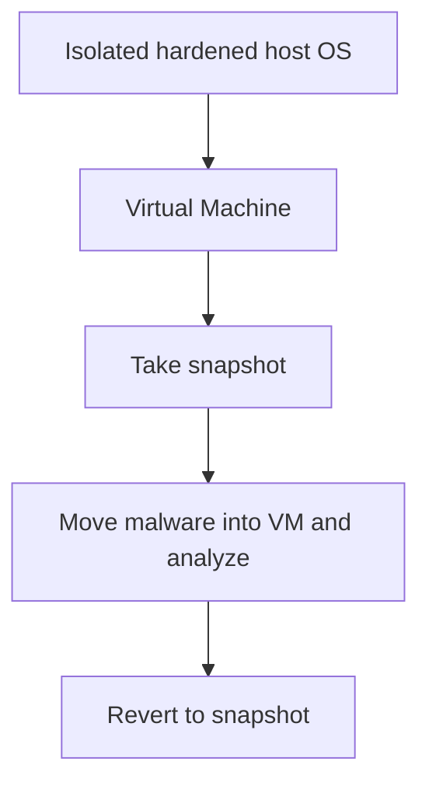
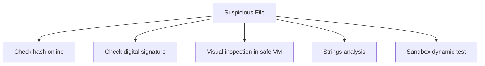

> **The goal of this section:**  
> We'll understand how to handle suspicious files safely, which safe analysis environment to choose, and how to move malicious files without putting anyone at risk. We'll get to know the most common file types that get weaponized, and finally we'll learn quick ways to tell a benign file from a malicious one, such as Hashing, Digital Signatures, and Static/Dynamic Analysis.

## Table of Contents
- [Introduction](#introduction)
- [Safely Handling Malicious Files](#safely-handling-malicious-files)
- [Moving Malicious Files Safely](#moving-malicious-files-safely)
- [Which File Types Can Be Dangerous?](#which-file-types-can-be-dangerous)
- [Executables](#executables)
- [Scripts](#scripts)
- [Microsoft Office Documents](#microsoft-office-documents)
- [Rich Text Format (.rtf)](#rich-text-format-rtf)
- [PDF Files](#pdf-files)
- [Miscellaneous Files as an Exploitation Vector](#miscellaneous-files-as-an-exploitation-vector)
- [Quick Triage: Benign vs. Malicious Files](#quick-triage-benign-vs-malicious-files)
- [Hashing](#hashing)
- [Digital Signatures](#digital-signatures)
- [Does a Digital Signature Guarantee Safety?](#does-a-digital-signature-guarantee-safety)
- [Visual Inspection](#visual-inspection)
- [Detecting Malicious Scripts](#detecting-malicious-scripts)
- [Files That Indirectly Contribute to Malicious Behavior](#files-that-indirectly-contribute-to-malicious-behavior)
- [Section Summary](#section-summary)

## Introduction

One of the most important tasks you'll face as a member of the Blue Team is deciding whether a particular file is malicious or not. In the previous section we talked about how to identify a file's type, but now we'll go deeper and talk about **quick triage** and how to handle these files with complete safety, without infecting ourselves or anyone else.

## Safely Handling Malicious Files

### Basic Rules for Malware Analysis

1. **Don't use a system that has important data on it** — never use your main machine.
2. **Use a system disconnected from the network**, or at least a network completely separate from anything you care about.
3. **Use a secure, Hardened Host Operating System** — Linux is preferred because it's a less common target than Windows.
4. **Analyze the Malware inside a Virtual Machine**:
   - Choose the VM carefully! Try to make the operating system **incompatible** with what the virus is supposed to attack (example: analyze Windows viruses on Linux) to get an extra layer of safety.
   - Take a **Snapshot** before you start.
   - Move the Malware into the VM and start the analysis.
   - Revert to the Snapshot when you're done.



> [!IMPORTANT]
> The main goal is to investigate the file without getting infected yourself. The best answer here: use an operating system that **can't even execute the code** you're analyzing (unless you're deliberately doing Dynamic Analysis).

### Choosing the Right Operating System

| Suspicious File | Recommended Analysis System | Reason |
|------|--------|---------|
| Windows Executable, PowerShell, VBS, Office docs, Batch files | Linux | These formats simply don't run on Linux |
| Bash Scripts, ELF Binaries | Windows | Their content means nothing to Windows |
| JavaScript, PDF (dangerous on both) | Linux | The exploit is usually designed assuming the victim is running Windows |

> [!TIP]
> It's hard (but not impossible) for an attacker to write an exploit that works on more than one operating system at the same time. That's why, even if the format (like PDF) is dangerous on both, using Linux for analysis provides an extra layer of protection.

## Moving Malicious Files Safely

### Problems We Want to Avoid

1. Clicking the file by mistake (Accidental Clicking).
2. The AV detecting and deleting it before you finish the analysis.
3. Putting someone else at risk if they find the file later and don't know it's dangerous.

### The Solution: Zip the File with a Password

The correct way is to put the file in a **Zip archive with the password "infected"**. This method:

- Prevents accidental clicks.
- Stops the AV from recognizing the content and deleting it.
- Lets anyone who finds the file later know immediately that it's dangerous.

> [!WARNING]
> The wrong way is to move the file with a regular Copy/Paste or Drag and Drop in its executable state. No matter how careful you are, a wrong Tab Complete or a small slip could run the file by mistake and spread the infection.

## Which File Types Can Be Dangerous?

The unfortunate truth is that **almost any file type can be weaponized**, but some are easier than others. The most common types:

| Type | Examples |
|------|--------|
| Executables | Windows/Linux programs, libraries, drivers |
| Scripts | Bash, batch, VBS, Office macros, JavaScript, Python, PowerShell |
| Documents | Office, RTF, PDF (either through an exploit or by abusing the format's own "features") |
| Other | Icons, pictures, video, fonts, email |

## Executables

One of the most common forms of malicious files, but **not just .exe files**!

### Other "PE" Formats

All of these formats share the same Format and Magic Bytes as an .exe file:

```
.acm, .ax, .cpl, .dll, .drv, .efi, .mui, .ocx, .scr, .sys, .tsp
```

### Other Formats

| Type | Examples |
|------|--------|
| Installers | .msi, .msp |
| Self-Extracting Archives | .sfx, .sea |
| Java Applications | .jar |

> [!IMPORTANT]
> You probably already block the .exe format in email and at the Proxy, but that's not enough. Attackers use these less familiar formats as an alternative precisely to get past the filters.

## Scripts

Just as dangerous as any Executable, but with a Lower Profile as far as Filters are concerned.

### Common Formats

```
ps1, vbs, js, bat, wsf, hta, bash
```

Languages like **Python, Ruby, Perl** also count here.

### Their Advantages for the Attacker

- Windows runs them natively through **cscript.exe** and **wscript.exe**.
- **Application Control** rarely blocks them.
- They're easy to hide inside other formats such as Office or PDF.

## Microsoft Office Documents

One of the most common attack methods, because companies use these documents every day, so they can't be blocked completely.

### The Two Main Types

| Type | Format | Notes |
|------|--------|---------|
| Pre-Office 2007 | .doc, .xls | Binary Format, preferred by attackers because it has no "x" in the name and makes it easier to hide Macros |
| Post-Office 2007 | .docx, .xlsx | XML Format; if they contain Macros, they end in "m", like .docm, .xlsm |

> [!NOTE]
> Post-2007 Office documents are actually **ZIP files**; you can change the extension, extract them, and see their internal components.

### Ways to Weaponize an Office Document

1. **Malicious Link** — the hardest to detect, because many benign documents contain Links.
2. **Embedded Object** — embedding a malicious file (exe, script) inside the document itself.
3. **A direct exploit against Office itself** — rarer, but very dangerous when it happens.
4. **The Macro** — runs automatically (Autorun) when the document is opened, if the user agrees to enable it.

> [!TIP]
> Microsoft announced that it would block Macros from running automatically in documents downloaded from the internet starting with **Office Version 2203**, which is a big step in the right direction.

## Rich Text Format (.rtf)

Many people think RTF is less dangerous than Office documents, but **that's not true at all**.

### Characteristics

- It can contain Embedded files and links.
- **It doesn't support Macros** — but that doesn't mean it's safe.
- You might find a .doc file named .rtf and vice versa; Word will open them either way.

### How to Tell Them Apart Easily

Since the RTF format is entirely Printable Text, you can easily identify it with hexdump. Its Magic Bytes are **{\rtf1**, unlike Office documents, which start with **PK** because they're ZIP files.

### Examples of Real Exploits

| CVE | Description |
|------|--------|
| CVE-2017-0199 | Runs a malicious script as soon as the document is opened, without any warning to the user |
| April 2018 attack | Used 4 different exploits inside a single RTF to download a RAT, Keylogger, Trojan, or Password Stealer |

> [!WARNING]
> If you see the Magic Bytes of a **Windows Executable** inside an RTF file, that's something you should never see in an ordinary email document, and it's a very clear danger indicator.

## PDF Files

One of the most commonly targeted formats, because every company uses it.

### Ways to Weaponize a PDF

- Links to malicious websites.
- Embedded Files.
- **JavaScript** or **Flash** that can run automatically when the document is opened.
- Direct exploits against **Adobe Reader**.

> [!TIP]
> Most of the malicious PDF files you'll encounter in practice are simply links to Phishing sites that try to imitate Microsoft Office 365 login pages. The fastest way to extract these links **without opening the file** is to run the **strings** command and grep for the word "http".

## Miscellaneous Files as an Exploitation Vector

### Can an Image, Video, or Font Be Dangerous?

Yes! Although it's much rarer and harder to detect. The only way here is to find a vulnerability in **the Reader itself** (the program that opens that format).

### Real Examples

| CVE | Description |
|------|--------|
| CVE-2018-8475 | Remote code execution as soon as the user views an image |
| CVE-2018-1010 | Remote code execution just by rendering a specific Font |
| CVE-2010-2568 | The LNK vulnerability used by the famous Stuxnet virus |
| CVE-2020-1349 | Code execution just by previewing an email in the Outlook Preview Pane |

> [!IMPORTANT]
> **Shortcut (.lnk)** files are also used as an indirect way to run a script. The attacker can point the shortcut at a program like cmd.exe or PowerShell and pass it Arguments containing encoded commands that download and run Malware.

## Quick Triage: Benign vs. Malicious Files

### Quick Steps for an Initial Check

1. **Look up the Hash online** — for example, on VirusTotal.
2. **Verify the Digital Signature** — if there is one.
3. **Visual Inspection** — open the document in a safe environment.
4. **Check the Strings** — look for anything that's out of place, such as:
   - The phrase "MZ...This program cannot be run in DOS mode" inside a file that isn't an .exe.
   - A script hidden inside an image.
   - Strange links inside a PDF.
5. **Scripts** — are there garbled/random (Obfuscated) variable names?
6. **The ultimate solution** — test the file in a Sandbox and see what actually happens.



## Hashing

### The Basic Idea

**Hashing** is one of the fastest ways to detect something malicious. You can feed any sequence of Bytes, no matter how long, into a Hash algorithm (such as **md5, sha1, sha256**) and get a unique "Fingerprint" out of it.

### Properties of a Good Hash

- **One-way** — you can't derive the Input from the Output.
- It's hard to find **Collisions** (two different inputs that produce the same Output).

### Example

```
MD5    = 7E4E84B9D84E4AAD5B4AD4A5E6708C99
SHA1   = 002153184A13BCB7F7BF0EB8D4053D76DD442B16
SHA256 = 3AAD58CACA4CC2230FFED4F033317856D255C042F1ABD0D7E37229C2444BC1DD
```

### Limitations of Hash Verification

| Result | Meaning |
|------|--------|
| The Hash is known and marked as "not malicious" | Not a definitive guarantee; the AV Vendors may not have discovered how dangerous it is yet |
| The Hash is completely unknown | Not proof of malice, but suspicious in itself, because most common software has already been uploaded to VirusTotal |

> [!NOTE]
> If the file was uploaded to VirusTotal long ago and is still marked as "clean," that's the strongest indicator that it really is clean. But if it was uploaded recently, the verdict may change after 24-48 hours once the Vendors update their rules.

> [!TIP]
> You can send **just the Hash** (not the whole file) to VirusTotal with complete safety, because that won't leak any sensitive information about you or the file's content — unless someone has already uploaded the same file from a known user account.

## Digital Signatures

### The Idea

**Code Signing** gives you a stronger guarantee than the Hash alone, because it proves:

1. **Integrity** — the file hasn't changed since it was created.
2. **Authenticity** — the identity of whoever created the program.

### How Authenticode (Microsoft's Algorithm) Works

1. The developer obtains a Certificate from a trusted issuer (Certificate Authority).
2. A Hash of the program is generated and then encrypted with the Private Key.
3. The signature and certificate details are appended to the end of the program file.
4. The user verifies it using the Public Key found in the **Trusted Publisher Certificate Store**.

> [!IMPORTANT]
> Any modification to the program or the signature itself will completely invalidate the signature. If a file is signed by Microsoft, the likelihood of it being malicious is very low. But if it's signed by an unknown company, that doesn't tell you much beyond giving you a starting point for the investigation.

### The Sigcheck Tool

One of the best **Sysinternals** tools for quickly verifying a signature. It gives you:

- Signature and Hash verification.
- Developer details.
- Multiple Hash formats.
- An Entropy measurement.
- VirusTotal results directly.

> [!WARNING]
> Even a legitimate program like **calc.exe** can be classified as "Unsafe" by just one vendor based on AI Detection. This is a living example that AV isn't perfect and can produce both False Positives and False Negatives.

## Does a Digital Signature Guarantee Safety?

**Not at all!** The main ways an attacker can get a valid signature:

1. **Getting their own certificate and signing the Malware with it** — the signer details will be an unknown company/person.
2. **Stealing someone else's certificate** — example: **HermeticWiper** in 2022 was signed with a genuinely valid certificate belonging to Hermetica Digital Ltd.
3. **Creating a Hash Collision** — carried out in practice in 2009 against the weak MD5 algorithm.

> [!NOTE]
> Research showed that 189 Malware samples used 11 different digitally signed certificates, and that a signature (even an invalid one) can cause AV engines to wrongly classify a known malicious program as clean.

## Visual Inspection

Sometimes all you need is to **open the file** in a safe environment. The problem isn't "what to do" but "how to do it safely."

### The Safe Solution

Since you don't know whether the document contains an exploit or just a link/macro that needs enabling, it's best to assume it will infect you immediately, and use:

- A **Malware Detonation Engine** that generates a Screenshot for you.
- A **Virtual Machine** that can be Reverted after the check.
- Free online tools such as **malwr.com** or **hybrid-analysis.com** if you're not worried about uploading the sample publicly.

## Detecting Malicious Scripts

### Signs of a Suspicious Script

- The content is **very simple and minimal** — limited to downloading and running additional code from a link, especially if the domain is strange.
- **Heavy Obfuscation** — completely unintelligible function and variable names.

> [!TIP]
> Malicious scripts are usually Minimal to slip past automated scanning tools, and it's very easy for the human eye to notice that code has been Obfuscated, even when the automated tools miss it.

## Files That Indirectly Contribute to Malicious Behavior

### The Idea

Not all "malicious" files are directly malicious; some of them hide **instructions for Malware that's already running**. Images, for example, are used to pass Configuration data or C2 (Command and Control) commands.

### The Two Main Methods

| Method | Description |
|------|--------|
| Steganography | Encoding the message inside the image data itself; very hard to detect |
| Metadata Fields | Storing plain text (URLs, IPs) in the image's normal Metadata fields (such as the camera location or GPS) |

> [!IMPORTANT]
> There's no legitimate reason for JavaScript or Visual Basic code to be stored inside an image's Metadata, so if you discover something like that with the **strings** command, it's an immediate sign that something is wrong.

## Section Summary

- Always use an **isolated, hardened system** and a VM that supports **Snapshot/Revert** when analyzing any suspicious file.
- Move malicious files in a **ZIP archive protected with the password "infected"** to protect yourself and others.
- **Executables** aren't just .exe; many PE formats such as .cpl, .scr, .dll can be just as malicious.
- **Scripts** have a lower profile than Executables and often get past Application Control.
- **Office documents** are exploited through links, Embedded Objects, exploits, or Macros.
- **RTF** is less well known but just as dangerous as Office documents, and it's easy to identify by its Magic Bytes.
- **PDF** files often contain Phishing links and can run JavaScript or Flash automatically.
- Rare files such as images and fonts can be dangerous if there's a vulnerability in the Reader itself.
- **Hashing** is a quick method but not 100% reliable; a Hash known as "clean" may change later.
- A **digital signature** gives you a stronger guarantee, but not a complete one, because it can be stolen, forged, or defeated by a Collision.
- Visual inspection, Strings analysis, and Sandbox testing are all essential tools for quick triage.

