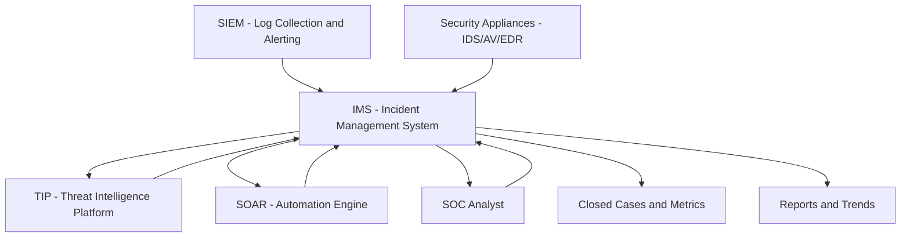
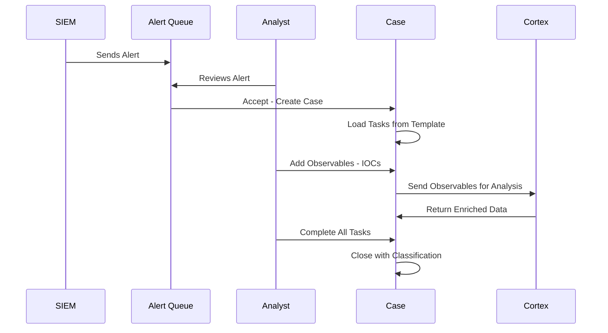
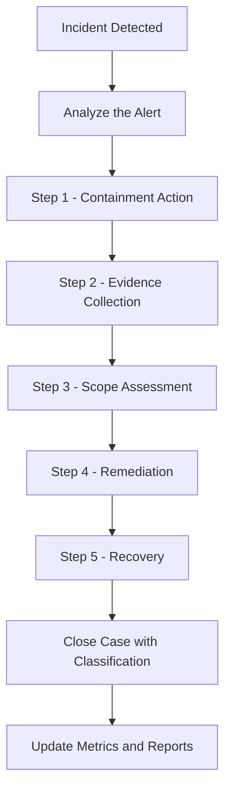
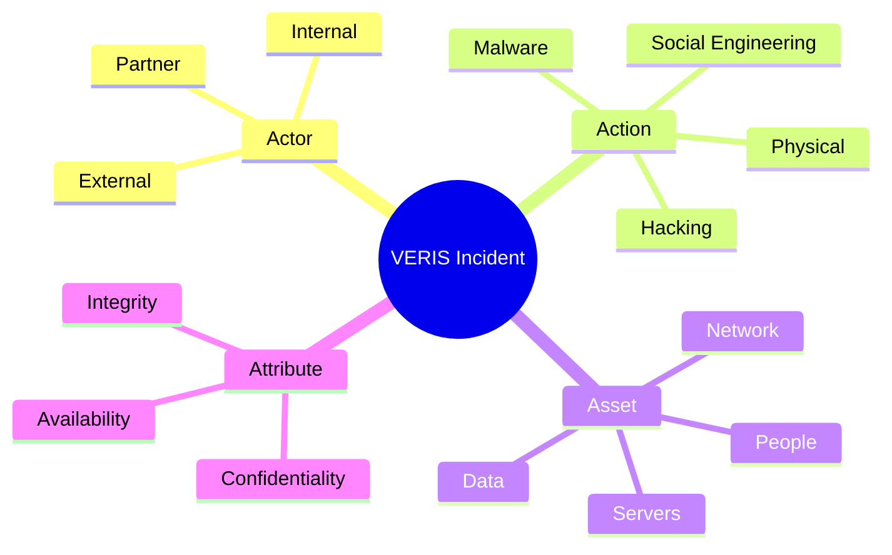

> **Goal of this section:**  
> You'll understand what an Incident Management System is and why it's one of the most important tools in the SOC, and you'll learn how Playbooks work and how to use TheHive as a practical IMS.

---

## Table of Contents

- [Introduction](#introduction)
- [SOC Data Organization](#soc-data-organization)
- [Tools for SOC Data Organization](#tools-for-soc-data-organization)
- [Incident Management System IMS](#incident-management-system-ims)
- [IMS Systems View](#ims-systems-view)
- [IMS Features](#ims-features)
- [Playbooks](#playbooks)
- [Creating Successful Playbooks](#creating-successful-playbooks)
- [Incident Categorization Frameworks](#incident-categorization-frameworks)
- [VERIS Framework](#veris-framework)
- [US-CERT Categorization](#us-cert-categorization)
- [Tips for Successful Categorization](#tips-for-successful-categorization)
- [TheHive as IMS](#thehive-as-ims)
- [TheHive Workflow](#thehive-workflow)
- [TheHive Case and Task Assignment](#thehive-case-and-task-assignment)
- [TheHive Observable Entry](#thehive-observable-entry)
- [TheHive Case Closure](#thehive-case-closure)
- [Diagrams](#diagrams)
- [Comparison Tables](#comparison-tables)
- [Key Notes](#key-notes)
- [Summary](#summary)

---

## Introduction

A SOC isn't just people looking at alerts; it's a complete system of tools that help organize, track, and analyze incidents.

In this section we'll talk about **how the SOC stores and manages data**, and the most important tools it uses — first among them the **Incident Management System (IMS)**.

If an incident happens and there's no system to track it, it will get lost in the noise. The IMS is the "logbook" where everything gets recorded.

---

## SOC Data Organization

The SOC needs to solve **6 core problems** in organizing data:

1. **Alert Queueing** — how alerts are queued and current incidents are tracked
2. **Threat Intelligence** — collecting, organizing, and updating threat information
3. **Log Management** — storing, viewing, correlating, searching, and alerting on logs
4. **Automation** — automating investigation actions
5. **Code Repositories** — storing scripts and Playbooks
6. **Unstructured Data Storage** — storing documents and general knowledge

> [!IMPORTANT]
> This isn't a theoretical breakdown — each of these points is handled by a different tool. If one tool isn't working properly, the whole SOC suffers.

---

## Tools for SOC Data Organization

The SOC needs a set of tools that integrate with each other:

| Tool | Full Name | Function |
|--------|-------------|---------|
| **IMS / SIRP** | Incident Management System | Tracking incidents and managing cases |
| **TIP** | Threat Intelligence Platform | Storing IOCs and threat information |
| **SIEM** | Security Information and Event Management | Collecting, searching, and alerting on logs |
| **SOAR** | Security Orchestration, Automation and Response | Automating investigation and response |
| **Knowledge DB** | Knowledge Database / Repos | Documentation, scripts, and Playbooks |

### How Do These Tools Integrate with Each Other?

- The **SIEM** collects logs and generates alerts
- The **IMS** receives alerts and turns them into cases
- The **TIP** stores the IOCs related to each case
- The **SOAR** automates repetitive actions
- The **Knowledge DB** stores how to respond to each type of incident

> [!NOTE]
> In practice, many vendors combine more than one function in a single tool. For example, Splunk SOAR merges SIEM and SOAR together.

---

## Incident Management System IMS

The **IMS** is the system where the Blue Team records all the details of the investigation and the actions taken during the incident.

### IMS Options

You have **3 main options**:

1. **Traditional Ticketing Solutions** — such as Help Desk Tickets (not ideal, but it works)
2. **SIEM Built-in Solutions** — the SIEM itself provides case management
3. **Security-Tailored IMS** — tools designed specifically for security teams
   - **Commercial**: plenty available, but choose carefully
   - **Open-source**: fewer options, but there are excellent solutions such as **TheHive**

### Why Is This Choice So Important?

> [!WARNING]
> Analysts will use the IMS for long hours every day. If the interface is difficult or slow, that affects morale and efficiency. Test the tool thoroughly before you commit to it!

**Does commercial have to be better?** No! There are paid tools with a bad interface and open-source tools with an excellent one. The interface and user experience matter more than the price tag.

---

## IMS Systems View

How the IMS handles data:

**The Input:**
- Alert logs directly from the SIEM
- Or alerts from security appliances

**The Internal Process:**
- The alert is turned into a **Case**
- **Tasks** are added to the case (from the Playbook)
- The analyst works on the tasks
- **Observables (IOCs)** are added to the case

**The Output:**
- **Closed Cases** along with their categorization
- **Metrics** on attack types and response time
- **IOCs** are passed on to the TIP

---

## IMS Features

### The Core Features That Must Be There

**Obvious features:**
- Tracking case status
- Adding notes and comments
- Linking cases to IOCs

**Less obvious but very important features:**

| Feature | Why It Matters |
|---------|---------|
| **Playbook-oriented Workflow** | Ensures every analyst follows the same steps |
| **Automation Integration** | Saves the analyst time on repetitive actions |
| **Rich Text Notes** | Screenshots and clear formatting in reports |
| **TIP Integration** | Links IOCs to the case automatically |
| **Keyboard Navigation** | Working fast without a mouse = a lot of time saved |
| **Built-in Knowledge Base** | The information sits right next to the analyst while they work |
| **Workflow Customization** | The tool adapts to the processes, not the other way around |
| **Mass Close/Open/Edit** | If 100 alerts are False Positives, you close them in one click |

> [!TIP]
> Keyboard navigation may seem trivial, but if an analyst opens 50 cases a day, the difference between mouse and keyboard can save a full hour every day!

---

## Playbooks

### What Is a Playbook?

A **Playbook** is a **defined, ordered set of steps** the analyst follows when facing a specific type of incident.

**Practical example — a Playbook for a Malicious Email Wave:**

```
[Receive a wave of malicious emails]
          |
          v
[Block all the URLs found in the emails]
          |
          v
[Check the Proxy Logs: who clicked the links?]
          |
          v
[Reset passwords for affected users]
          |
          v
[Delete the emails from all inboxes]
```

### Why Do Playbooks Matter?

1. **Consistency** — every analyst responds the same way
2. **Completeness** — you won't forget an important step
3. **Training** — a new analyst can work efficiently from day one
4. **Measurement** — you can see which steps take time

> [!NOTE]
> Playbooks don't have to be identical for every incident. Some steps are **mandatory** and some are **optional**, depending on the situation.

---

## Creating Successful Playbooks

### The 5 Steps to a Successful Playbook

**Step 1 — Careful planning:**
- What are you trying to achieve?
- What's the fastest and best way to do it?

**Step 2 — Choosing and ordering the steps:**
- Start with containment before investigation
- Too many, too dense = not practical to follow

**Step 3 — Classifying the steps:**
- Mandatory or optional

**Step 4 — Implementing it in the IMS or SOAR:**
- Turn the steps into tasks inside the system

**Step 5 — Continuous review:**
- A Playbook isn't static — it has to be updated with every new lesson learned

> [!TIP]
> Use a tool like **ATC RE&CT** from GitHub to generate ideas for response actions.

---

## Incident Categorization Frameworks

When you close a case, you need to categorize it. **Categorization** helps with:
- Understanding the most common types of attacks
- Measuring SOC performance
- Justifying budget and resources

### Framework Options

**Option 1 — VERIS:**
- Very detailed
- Used by the Verizon DBIR
- Suited to large organizations

**Option 2 — US-CERT:**
- Moderately detailed
- Suited to government and enterprise
- Uses the NCISS score from 0 to 100

**Option 3 — Custom:**
- Many companies build their own framework
- Flexible, but hard to compare with others

> [!NOTE]
> There's no perfect framework. The best one is the one your team will use regularly and accurately.

---

## VERIS Framework

**VERIS (Vocabulary for Event Recording and Incident Sharing)** categorizes an incident along **4 dimensions (the 4 A's)**:

| Dimension | Question | Examples |
|--------|--------|---------|
| **Actor** | Who carried out the attack? | External, Internal, Partner |
| **Action** | What did they do? | Malware, Hacking, Social, Physical |
| **Asset** | What was affected? | Servers, People, Data, Network |
| **Attribute** | How was it affected? | Confidentiality, Integrity, Availability |

**Practical example:**
> An employee inside the company (Actor = Internal) leaked customer data (Action = Misuse) from a database (Asset = Data), affecting confidentiality (Attribute = Confidentiality)

---

## US-CERT Categorization

**NCISS (National Cyber Incident Scoring System)** gives you a **score from 0 to 100** based on:

| Category | Examples |
|-------|---------|
| **Functional Impact** | From "no impact" to "complete loss of control" |
| **Information Impact** | From "no leak" to "destruction of critical systems" |
| **Recoverability** | From "regular recovery" to "not recoverable" |
| **Attack Vectors** | Web, Phishing, External Media, Impersonation |
| **Actor Characterization** | Who the attacker is and their skill level |

**The score result:**

| Range | Level |
|--------|---------|
| Very high | Emergency |
| High | Severe / High |
| Medium | Medium |
| Low | Low / Baseline |

---

## Tips for Successful Categorization

**Begin with the end in mind:**
- What questions do you want to answer 6 months from now?
- Turn those questions into measurable metrics

**Examples of useful metrics:**

| Goal | Metric |
|-------|-----------|
| Knowing the most common attack vectors | Categorizing every case by delivery vector |
| Measuring the pressure on the team | Average queue length |
| Tracking phishing | Number of reported + blocked emails + incidents |
| Measuring response speed | Average dwell time |
| Measuring incident impact | Number of critical incidents and their impact |

> [!IMPORTANT]
> Every metric must have a **threshold for action**. If you don't know what you'll do when the number reaches a certain level, that metric isn't useful.

---

## TheHive as IMS

**TheHive** is an open-source IMS tool that we use in this course.

### TheHive's Core Components

| Component | Description |
|--------|-------|
| **Alert** | An alert coming from the SIEM |
| **Case** | The incident we're working on |
| **Case Template** | The predefined Playbook |
| **Task** | A single step of the Playbook |
| **Worklog** | The notes and observations on each task |
| **Observable** | An IOC linked to the case (IP, Domain, Hash) |
| **Cortex** | The automation engine that enriches observables |

> [!NOTE]
> TheHive integrates with MISP (Threat Intelligence Platform) automatically, so IOCs are shared between the two tools.

---

## TheHive Workflow

How TheHive works, step by step:

1. The **SIEM** sends an **Alert** to TheHive
2. The alert appears in the **Alert Queue**
3. The analyst decides:
   - **Reject it** = False Positive
   - **Accept it** = it's turned into a **Case**
4. The case is populated with **Tasks** from the Case Template (Playbook)
5. The analyst works on the tasks one after another
6. Each task has a **Worklog** for notes
7. **Observables (IOCs)** are added to the case
8. **Cortex** analyzes the observables and adds context
9. Once all the mandatory tasks are done, the case is closed

---

## TheHive Case and Task Assignment

### The Difference Between a Traditional IMS and TheHive

In most IMS tools, the whole case is assigned to one person. If the case is complex, that person gets stuck.

In **TheHive**, you can assign each task to a different person:

```
Case (owned by Analyst 1)
├── Task 1 → Analyst 1 (easy)
├── Task 2 → Analyst 2 (complex - Malware Analysis)
├── Task 3 → Analyst 1
├── Task 4 → Analyst 1
├── Task 5 → Analyst 1
└── Task 6 → Analyst 2 (Memory Forensics)
```

**The benefit:**
- A new analyst can work efficiently, and a senior steps in for the complex tasks
- Better **Load Balancing**
- Easier shift handovers
- The new analyst learns from the senior's worklogs

> [!TIP]
> A Tierless SOC benefits even more from task-level assignment, because it lets everyone collaborate on the same incident.

---

## TheHive Observable Entry

An **Observable** is any IOC or data related to the case, such as:
- IP Address
- Domain Name
- URL
- File Hash (MD5, SHA256)
- Email Address
- Username

**The "is IOC" flag:**
- If this observable was actually seen in the environment = **IOC**
- If it's just data related to the investigation = a regular observable

**The "Has Been Sighted" checkbox:**
- If this IOC was actually seen in the organization = check it

**Cortex** then takes these observables and enriches them from sources such as:
- VirusTotal
- Shodan
- Passive DNS
- MaxMind GeoIP

---

## TheHive Case Closure

When you finish all the mandatory tasks, you close the case with the following information:

1. **True / False Positive** — was it a real attack?
2. **Categories** — the classification of the incident type
3. **Summary** — a summary of what happened and how it was resolved

**Important information in the summary:**
- Delivery Vector (how did the attack arrive?)
- Detection Method (how did we detect it?)
- Impact (what was affected?)
- Systems Affected (which systems were affected?)

> [!IMPORTANT]
> Case closure isn't just closing a ticket — it's **data** that accumulates over time and gives you a deep understanding of the nature of the attacks the organization faces.

---

## Diagrams

### The IMS in the Context of SOC Tools



---

### TheHive Workflow



---

### The Playbook Flow



---

### The VERIS 4 A's



---

## Comparison Tables

### Comparing IMS Options

| Type | Advantages | Disadvantages | Example |
|-------|---------|--------|------|
| **Traditional Ticketing** | Already exists in the company | Not designed for security | ServiceNow, Jira |
| **SIEM Built-in** | Direct integration with the SIEM | Limited features | Splunk ES Cases |
| **Security-Tailored IMS** | Designed specifically for the SOC | Cost or setup complexity | TheHive, XSOAR |

---

### VERIS vs US-CERT Comparison

| Criterion | VERIS | US-CERT |
|---------|-------|---------|
| **Level of detail** | Very high | Medium |
| **Ease of use** | Hard - many options | Easier |
| **Suited to** | Enterprise, Research | Government, Enterprise |
| **Final result** | Detailed categorization | Score from 0 to 100 |
| **Reference** | Verizon DBIR | NIST SP800-61 |

---

### Observable Types in TheHive

| Type | Example | Use |
|-------|--------|-----------|
| **IP Address** | 192.168.1.1 | Linking to a C2 server |
| **Domain** | evil-domain.com | Tracking phishing |
| **URL** | http://evil.com/malware | The delivery vector |
| **Hash MD5/SHA256** | d41d8cd... | Identifying the malware |
| **Email** | attacker@evil.com | The phishing source |
| **Filename** | invoice.exe | The malware's name |
| **Username** | compromised_user | The affected account |

---

## Key Notes

> [!IMPORTANT]
> Choosing the IMS is **one of the most important decisions** affecting the SOC. Analysts will use it every day. Choose carefully and test it thoroughly before committing.

> [!WARNING]
> If the IMS has no **TIP Integration**, linking IOCs to cases will be a painful manual process. This is a mandatory feature.

> [!NOTE]
> Playbooks aren't static — they need to be reviewed and updated regularly. A Playbook from 2 years ago may be outdated and fail to handle new tactics.

> [!TIP]
> When you choose a categorization framework, start with the questions you want to answer. If you want to know "what's the most common delivery vector?", then you need to categorize the vector in every case.

> [!IMPORTANT]
> Cortex in TheHive is the automation engine — it automatically enriches observables from VirusTotal and other sources. That saves the analyst an enormous amount of time.

---

## Summary 

### Key Points

- The SOC needs **6 types of data organization** — from Alert Queueing to Unstructured Storage
- The core tools are: **IMS, TIP, SIEM, SOAR, Knowledge DB**
- The **IMS** is the heart where all the investigation details are recorded
- A **Playbook** is an organized set of steps for responding to each type of incident
- **Categorization** is important for measuring and improving performance
- **TheHive** allows task-level assignment, which makes collaboration easier
- **Observables** are the IOCs linked to each case
- **Cortex** enriches observables automatically
- **Case Closure** generates valuable **Metrics** for the SOC

