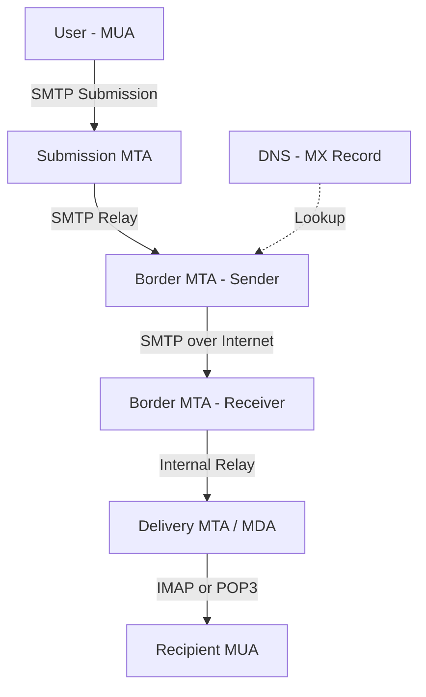
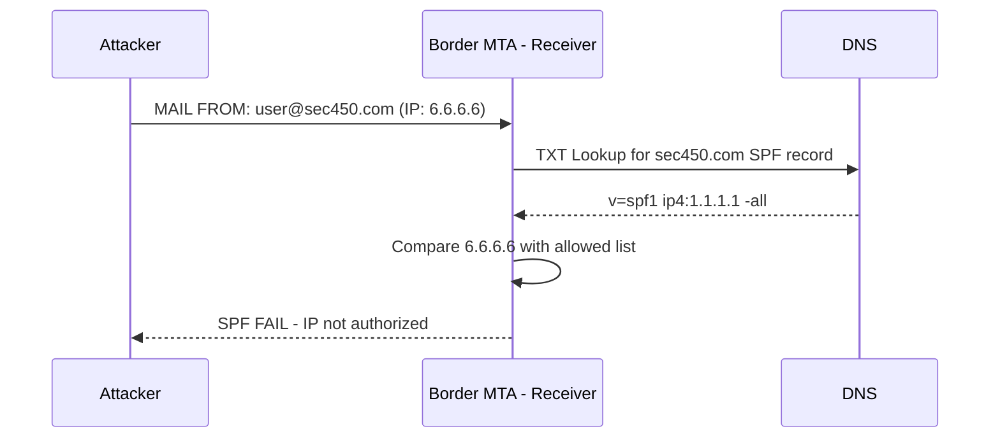
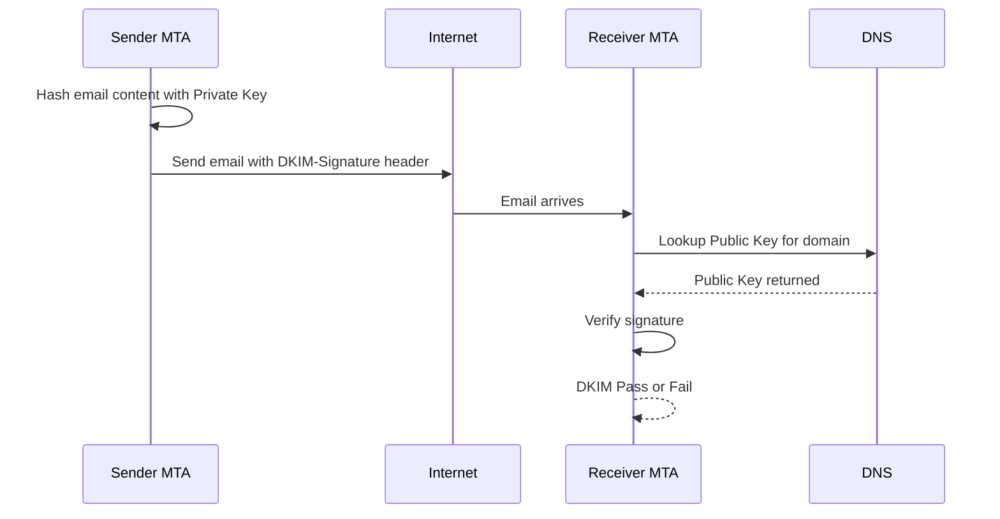
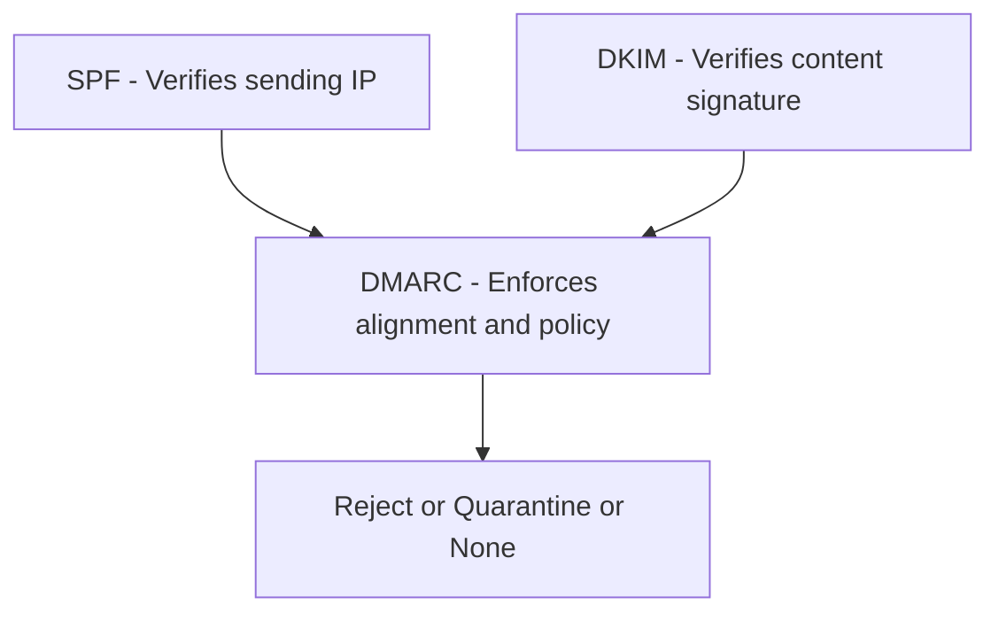

> **The goal of this section:**
> We'll understand how Email is sent across the Internet from the moment you write it until it arrives, how attackers manipulate Email through Spoofing, and how we protect ourselves with SPF, DKIM, and DMARC.

---

## Table of Contents

- [Introduction](#introduction)
- [Email Delivery Infrastructure](#email-delivery-infrastructure)
- [MUA MTA MDA](#mua-mta-mda)
- [SMTP Protocol](#smtp-protocol)
- [Email Headers](#email-headers)
- [Tracing an Email](#tracing-an-email)
- [Email Spoofing](#email-spoofing)
- [SPF - Sender Policy Framework](#spf---sender-policy-framework)
- [DKIM - Domain Keys Identified Mail](#dkim---domain-keys-identified-mail)
- [DMARC](#dmarc)
- [Diagrams](#diagrams)
- [Comparison Tables](#comparison-tables)
- [Key Notes](#key-notes)
- [Summary](#summary)

---

## Introduction

Email is one of the most attacked Protocols, and one of the most common Vectors used for Phishing and Spam. That's why you need to understand:

- How Email is sent, step by step
- Who is responsible for each step (MUA, MTA, MDA)
- How to read Email Headers and trace an email's source
- Why SMTP is easy to manipulate
- How SPF, DKIM, and DMARC protect against Spoofing

---

## Email Delivery Infrastructure

### The Basic Idea

When you send an email, it isn't as simple as it looks. The email goes through 3 main stages:

1. **Submission** — sending the email from your device to your provider's SMTP Server
2. **Relay** — passing the email from one Server to the next across the Internet
3. **Receiving** — receiving the email and storing it in the inbox

### A Simple Analogy

Imagine you're sending a letter through regular mail:
- **You** = the MUA (you write and send)
- **The post office in your city** = the MTA (it receives the letter and sends it on)
- **The post office in the recipient's city** = the second MTA (it receives it)
- **The mail carrier** = the MDA (delivers it to the recipient's mailbox)

---

## MUA MTA MDA

### MUA — Message User Agent

The MUA is the program you use as a User to send and receive email.

Examples:
- **Gmail** (Web Interface)
- **Microsoft Outlook** (Thick Client)
- **Thunderbird** (Open Source Client)

The MUA sends the email to an SMTP Server using the SMTP Protocol (or sometimes Submission Port 587).

### MTA — Message Transfer Agent

The MTA is the Server responsible for receiving the email from the MUA and passing it across the Internet to the next Server.

Types of MTA:
- **Submission MTA** — the first Server that receives the email from the MUA
- **Intermediate MTA** — intermediate Servers inside the organization
- **Border MTA** — the last Server in the sending organization (and the first one in the receiving organization)

The Border MTA is very important because:
- It represents the boundary between the two organizations
- Its IP can't be spoofed because the connection uses TCP
- It's the one that checks the SPF records

### MDA — Message Delivery Agent

The MDA is the Server responsible for storing the email in the recipient's inbox.

After the MDA stores the email, the recipient's MUA retrieves it using IMAP or POP3.

> **Important note:** The last MTA and the MDA usually run on the same Server, but in the Standards they're different entities.

---

## SMTP Protocol

### What Is SMTP?

**SMTP (Simple Mail Transfer Protocol)** is the main protocol for transferring email between Servers. It's a simple, ASCII-based text protocol, which means you can even work with it using telnet!

### Basic Commands

```
EHLO mail.sec450.com          <-- identifies the sending Server
MAIL FROM:<user@sec450.com>   <-- the sender's address
RCPT TO:<student@gmail.com>   <-- the recipient's address
DATA                          <-- start of the email content
To: student@gmail.com
From: user@sec450.com
Subject: Hello from SEC450
[email body here]
.                             <-- a dot alone on a line = end of the email
```

### Status Codes

The Server replies with 3-digit codes, like HTTP:
- **250** = Success
- **421** = Service temporarily unavailable
- **550** = Mailbox not found

### Why Is SMTP Dangerous?

Because SMTP was written in **1982**, when Security wasn't a consideration. The result:
- You can put any address in `MAIL FROM` without verification
- The next Server won't ask "Who are you?"
- That's what makes Email Spoofing so easy!

---

## Email Headers

### Types of Headers

An email consists of 3 parts:

#### 1. Trace Headers
These are the Headers each MTA adds as the email passes through it. They contain:
- The names of the sending and receiving Servers
- The IP Address
- The timestamp

#### 2. Message Headers
These are the Headers the user or the MUA writes:
- `From:` the sender's address
- `To:` the recipient's address
- `Subject:` the email's subject
- `Date:` the date and time

#### 3. Email Body
The actual content of the email, which can be:
- Plaintext
- HTML
- Base64 Encoded Attachments

### A Practical Example of Headers

```
Return-Path: <user1@gmail.com>
Received: from Lenovo ([10.20.30.40])
         by smtp.gmail.com;
         Tue, 27 Nov 2018 04:59:28 -0800 (PST)
From: <user1@gmail.com>
To: <user2@gmail.com>
Subject: Subject goes here
Date: Tue, 27 Nov 2018 07:59:26 -0500
X-Mailer: Microsoft Outlook 16.0
```

---

## Tracing an Email

### How Do You Trace an Email's Source?

Received Headers are arranged in **Reverse Chronological Order**, which means:
- **The bottom line** = the first Server the email was sent from
- **The top line** = the last Server that received it

### Received Header Format

```
Received: from [sending Server name] ([IP Address])
          by [receiving Server name]
          ; [date and time]
```

A real example:
```
Received:
from zeus.colombiaredes.info (zeus.colombiaredes.info. [213.239.232.149])
by mx.google.com
with ESMTP id 922034ljg.134.2020.07.19.03.26.52
for <user1234@gmail.com>;
Sun, 19 Jul 2020 03:26:53 -0700 (PDT)
```

### Reading the Received Header

| Part | Meaning |
|-------|--------|
| `from zeus.colombiaredes.info` | The EHLO string the sending Server introduced itself with |
| `[213.239.232.149]` | The real IP that sent it — **cannot be spoofed** (TCP) |
| `by mx.google.com` | The Server that wrote this Header |
| `Sun, 19 Jul 2020` | The timestamp |

### Why Can't the IP Be Spoofed?

Because SMTP runs over **TCP**, and TCP requires a two-way Handshake (SYN → SYN-ACK → ACK). You can't complete that using a spoofed IP.

---

## Email Spoofing

### The Core Problem

SMTP was defined in RFC 821 in 1982 and doesn't require Authentication at all. Anyone can do this:

```
MAIL FROM:<ceo@yourcompany.com>   <-- completely spoofed!
RCPT TO:<employee@yourcompany.com>
DATA
From: CEO <ceo@yourcompany.com>
Subject: Urgent! Transfer $50,000 immediately!
...
```

And the Server may accept it without question!

### Two Types of Spoofing

#### 1. Direct Injection
The attacker connects directly to the recipient's Border MTA and sends the email without going through the sender's real SMTP Server.

#### 2. From Address Manipulation
The RFC distinguishes between the **Envelope From** (which SPF checks) and the **Header From** (which the user sees). The attacker can make the two different!

---

## SPF - Sender Policy Framework

### The Idea

**SPF** lets the Domain owner publish, in DNS, a list of the IP Addresses allowed to send email on behalf of that Domain.

### How Does It Work?

1. The Domain owner adds a **TXT Record** in DNS like this:
   ```
   sec450.com IN TXT "v=spf1 ip4:1.1.1.1 -all"
   ```
2. When the Receiving Border MTA receives an email from `user@sec450.com`
3. It does a DNS Lookup for the TXT Record of `sec450.com`
4. It compares the IP the email came from against the list
5. If the IP isn't on the list = **SPF Fail**

### SPF Check Results

| Result | Meaning |
|---------|--------|
| `Pass` | The IP is on the allowed list |
| `Fail` | The IP isn't allowed; most likely a spoofed email |
| `Softfail` | Not officially allowed, but treated with suspicion rather than outright rejected |
| `Neutral` | No clear policy |
| `None` | No SPF Record at all |

### Where the SPF Result Appears in the Headers

**Location 1:** `Authentication-Results` header
```
Authentication-Results: spf=pass (sender IP is 1.2.3.4)
smtp.mailfrom=sec450.com;
```

**Location 2:** `Received-SPF` header
```
Received-SPF: Pass (protection.outlook.com: domain of
sec450.com designates 1.2.3.4 as permitted sender)
receiver=protection.outlook.com; client-ip=1.2.3.4;
```

---

## DKIM - Domain Keys Identified Mail

### Why Isn't SPF Enough?

SPF only checks the **Envelope From** (the sending path), not the content of the email itself. If the attacker manages to steal an allowed IP, SPF will pass!

### The Idea

**DKIM** uses a **Digital Signature** to prove that the email really left the sending organization's MTA and wasn't changed along the way.

### How Does It Work?

**On the sender's side:**
1. The Domain owner creates a **Key Pair** (Private Key + Public Key)
2. The Public Key is published in DNS as a TXT Record
3. The Private Key is kept on the Border MTA
4. Every time an email is sent, the MTA Hashes part of it (the Selector) and signs it with the Private Key
5. The Signature is added to the email in a Header called `DKIM-Signature`

**On the recipient's side:**
1. The Receiving MTA sees the `DKIM-Signature` in the email
2. It does a DNS Lookup to fetch the Public Key
3. It Hashes the same part
4. It decrypts the Signature with the Public Key
5. If the Hashes match = **DKIM Pass**

### The Takeaway

Always look in the `Authentication-Results` header for:
```
dkim=pass
```

If it's `dkim=fail` or `dkim=none` = there's a problem!

---

## DMARC - Domain-based Message Authentication, Reporting & Conformance

### The Problem DMARC Solves

Even if SPF and DKIM work perfectly, there's a gap! An email has **a second From Address**:

- **RFC5321.MailFrom** (Envelope From) = the one SPF checks
- **RFC5322.From** (Header From) = the one the user sees in the Email Client

The attacker can send the email from `hacker@legit.com` (to pass SPF), but make the Header From appear to the user as `ceo@yourcompany.com`!

### How Does DMARC Solve This?

**DMARC** requires **Alignment**, meaning the RFC5322.From must match:
- The RFC5321.MailFrom that SPF verified, **or**
- The Domain that DKIM signed from

### DMARC Policy Actions

When DMARC fails, the Domain owner can say:
- `p=none` — just generate a report, don't do anything
- `p=quarantine` — put the email in the Spam Folder
- `p=reject` — reject the email completely

### An Extra Feature: Reporting

DMARC makes it possible for recipients to send **reports** to the Domain owner when someone tries to spoof email in their name — something that wasn't possible before!

---

## Diagrams

### The Email's Journey from Sender to Recipient



### How SPF Works



### How DKIM Works



### Comparing the Three Standards



---

## Comparison Tables

### MUA vs MTA vs MDA Comparison

| Component | Full Name | Role | Examples |
|---------|-------------|-------|--------|
| MUA | Message User Agent | Writes and reads email | Gmail, Outlook, Thunderbird |
| MTA | Message Transfer Agent | Moves email between Servers | Postfix, Exchange, Sendmail |
| MDA | Message Delivery Agent | Stores email in the Mailbox | Dovecot, Exchange Store |

### SPF vs DKIM vs DMARC Comparison

| Criterion | What It Verifies | Where It's Published | What It Doesn't Protect Against |
|---------|--------------|-----------|--------------|
| SPF | The sender's IP Address | DNS TXT Record | Doesn't verify the content |
| DKIM | The content signature | DNS TXT Record (Public Key) | Doesn't verify the Header From |
| DMARC | Alignment between SPF/DKIM and the Header From | DNS TXT Record | Doesn't guarantee the email's content is safe |

### SPF Results and How to Interpret Them

| Result | Interpretation | Suggested Action |
|---------|---------|----------------|
| Pass | The IP is officially allowed | Accept the email |
| Fail | The IP isn't allowed | Reject or put in Spam |
| Softfail | The IP isn't on the list, but the Policy isn't strict | Treat with caution |
| Neutral | Not specified | Accept with reservation |
| None | No SPF Record | Accept with reservation |

---

## Key Notes

> [!IMPORTANT]
> Received Headers are written in **Reverse Chronological Order** — read them from **bottom to top** to trace the email's path from its source.

> [!WARNING]
> SMTP doesn't natively verify the sender's identity. Without SPF, DKIM, and DMARC, anyone can send email in your name!

> [!NOTE]
> The IP Address in the Received Header (the one inside the square brackets) can't be spoofed because SMTP runs over TCP, which requires a Two-Way Handshake.

> [!TIP]
> When you analyze a suspicious email, the first thing to check is the `Authentication-Results` header. If it's `spf=fail` or `dkim=fail`, the email is most likely spoofed.

> [!WARNING]
> Even if SPF, DKIM, and DMARC all Pass, that doesn't mean the email's content is safe! If an employee's account is compromised, the attacker can send a genuine email that passes all the Checks.

> [!IMPORTANT]
> The `Return-Path` is what SPF checks, not the `From` you see in the Email Client. This difference is the gap DMARC was designed to close.

---

## Summary 

### Key Points

- Email goes through 3 stages: Submission → Relay → Receiving
- The MUA is the program the user works with
- The MTA is the Server that moves the email
- The MDA is the Server that stores the email
- SMTP is a simple text protocol written in 1982 without Authentication
- Received Headers are written from bottom to top (Reverse Chronological)
- The IP in the Received Header can't be spoofed (TCP Protocol)
- SPF checks the IP Address against a list in DNS
- DKIM uses a Digital Signature to verify the content
- DMARC adds Alignment between the Header From and SPF/DKIM
- DMARC gives the Domain owner Reporting capability

