> **Goal of this section:**
> You'll understand how attackers abuse DNS in their attacks and how to detect malicious DNS by analyzing logs and traffic. You'll also learn the most common attack techniques, such as DNS Tunneling and IDN Spoofing, and how to deal with them.
---

## Table of Contents

- [Introduction](#introduction)
- [DNS Traffic Flow and Analysis Considerations](#dns-traffic-flow-and-analysis-considerations)
- [Connecting IP Addresses to Domains Safely](#connecting-ip-addresses-to-domains-safely)
- [Detection Technique in General](#detection-technique-in-general)
- [Detecting Malicious DNS - Normal DNS Abuse](#detecting-malicious-dns---normal-dns-abuse)
  - [TLD Analysis](#tld-analysis)
  - [Domain Reputation](#domain-reputation)
  - [Domain Age](#domain-age)
  - [Domain Randomness and Length](#domain-randomness-and-length)
  - [ASN Enrichment](#asn-enrichment)
  - [Geolocation Enrichment](#geolocation-enrichment)
- [DNS-Based Attacker Tricks](#dns-based-attacker-tricks)
  - [Unauthorized DNS Server Use](#unauthorized-dns-server-use)
  - [Shared Hosting Problem](#shared-hosting-problem)
  - [DNS Record Modification](#dns-record-modification)
  - [DNS Tunneling](#dns-tunneling)
  - [Blockchain DNS](#blockchain-dns)
  - [Internationalized Domain Names IDNs](#internationalized-domain-names-idns)
- [The Future of DNS - DoT DoH DNSSEC](#the-future-of-dns---dot-doh-dnssec)
- [Summary](#summary)

---

## Introduction

DNS is one of the most abused protocols in cyberattacks. The reason is simple: **everything on the internet goes through DNS**. Attackers know very well that organizations must allow DNS traffic for the network to work, so they exploit that to achieve their goals.

In this module we'll cover **two parts**:

1. **Normal DNS Abuse**: when DNS works normally but resolves the names of malicious sites — and how to detect that.
2. **Abnormal DNS Tricks**: when attackers turn DNS itself into an attack tool — such as Tunneling and IDN Spoofing.

---

## DNS Traffic Flow and Analysis Considerations

### Where Do You Collect DNS Logs?

This is a very important question, because the sensor's location determines what you'll see.

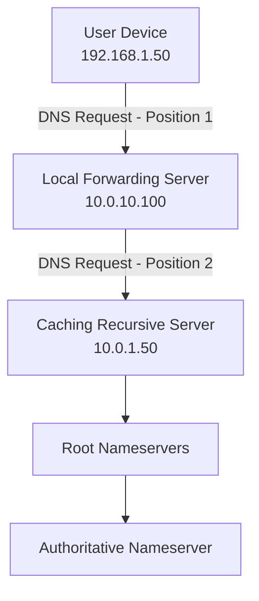

### The Problem with Choosing a Collection Point

| Collection Point | Available Information | The Problem |
|------------|-----------------|---------|
| At the client (Position 1) | The device's real Source IP | Sometimes hard to implement |
| At the Forwarding Server (Position 2) | The Source IP is the Forwarding Server, not the original device | **You won't know which device made the request** |
| At the Caching Server | Same problem as Position 2 | Worse |

> [!WARNING]
> If you collect DNS logs from the Caching Server or from a point far from the client, **you won't be able to identify the original infected device**, because the Forwarding Server resends the request with its own Source IP.

### Questions You Need to Answer

1. **What exactly are you collecting?** Only the requests, or the responses too?
   - If you don't collect the responses, **you won't know which IP the domain resolved to** — and that's a very important piece of information.

2. **Do you see DNS that doesn't go through your servers?**
   - If malware makes DNS requests directly to an external server and you're not logging network traffic, **you won't see it**.

3. **Do you have your own Passive DNS database?**
   - You can keep a history of IP-to-domain mappings to review if something happens.

> [!TIP]
> Even if you don't know which device made the DNS request, if you have the IP the domain resolved to, search the Firewall and NetFlow logs for who talked to that IP — you'll most likely find the infected device.

---

## Connecting IP Addresses to Domains Safely

When you're investigating an incident and want to know which IP a particular domain resolved to (or vice versa), you have 3 options:

### Option 1: Use Your Own Data

**This is always the best option** — go back to your own logs (DNS Logs, Proxy Logs, EDR, Sysmon).

- **Why**: it gives you the correct answer **at the time of the attack**, not the current answer, which may have changed.
- **Safety**: it doesn't let the attacker know you're investigating.

### Option 2: Use Third-Party Passive DNS

Sites like VirusTotal keep a history of DNS resolutions.

> [!WARNING]
> If you go to VirusTotal and search for a domain or IP belonging to the attacker, **VirusTotal will record that someone from your IP searched for that domain**. This could reveal that you're investigating.

### Option 3: Make a New DNS Request

Use `dig`, `nslookup`, or a site like `centralops.net`.

```bash
# On Linux
dig @8.8.8.8 malicious-domain.com

# Or
nslookup malicious-domain.com
```

> [!IMPORTANT]
> The new DNS request may remain in the logs of the attacker's nameserver. Only use this option if you don't need to stay anonymous.

### Comparison

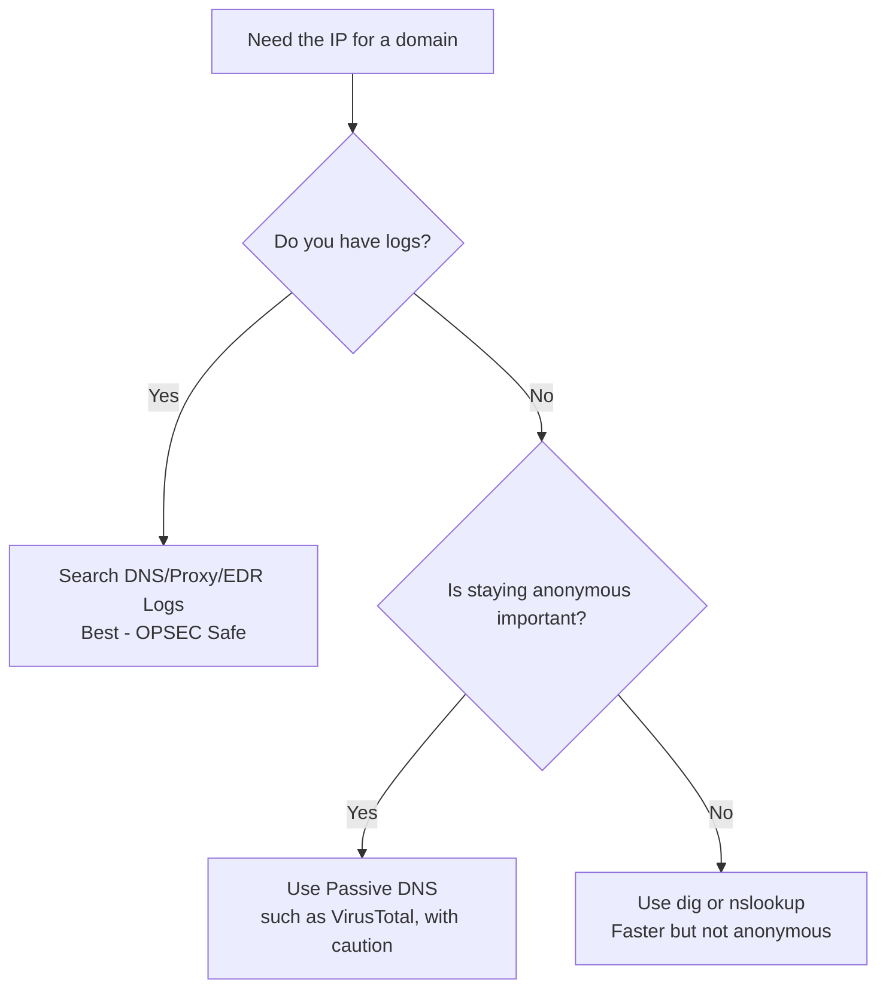

---

## Detection Technique in General

Before we talk about specific detection methods, there's a general methodology you need to understand:

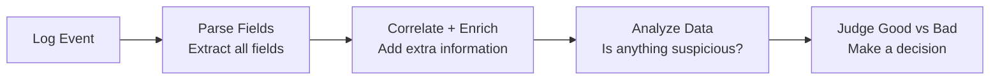

### A Practical Example

Say you have a DNS log containing:
```
domain = xyzsite.com
query_type = A
source_ip = 10.0.10.3
```

That alone isn't enough. But if the SIEM adds:
- **Status**: Newly observed domain (the first time we've seen it)
- **Top 1M Rank**: Unranked (not among the top one million sites)
- **Domain Created**: Less than 7 days ago
- **User**: Kyle (Domain Admin)

Suddenly the picture changes completely — these are clear warning signs.

> [!NOTE]
> Enrichment is what turns an ordinary log into a useful alert. Without enrichment, you'll drown in noise.

---

## Detecting Malicious DNS - Normal DNS Abuse

### TLD Analysis

The Top-Level Domain (the last part of the domain, such as `.com` or `.net`) can be an important indicator.

**Why do attackers like certain TLDs?**

- **Free**: such as `.tk`, `.ml`, `.ga`, `.cf` — the attacker doesn't need to pay anything.
- **Less oversight**: some TLDs managed by small countries don't have the same level of verification.
- **Easy to create lookalike domains**: to deceive people.

#### What Should You Do?

1. **Immediate alert** on TLDs known to be dangerous, such as `.tk`, `.bazar`, `.bit`.
2. **Parse the TLD** as a separate field in the SIEM and use it in Threat Hunting.

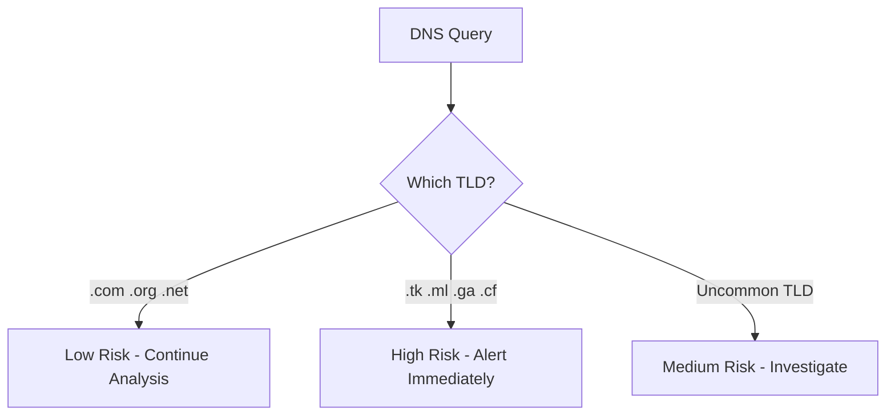

---

### Domain Reputation

**Reputation** is a site's rating based on its past behavior.

#### Reputation Check Tools

| Tool | Strengths |
|--------|---------|
| VirusTotal | Aggregates results from 70+ AV engines |
| Google Safe Browsing | Accurate for phishing sites |
| Talos Intelligence | Very strong for email threats |
| RiskIQ Community | Passive DNS + Context |
| ThreatCrowd | Free Open Source Threat Intel |

#### The Strategy

1. **Block immediately**: sites with a dangerous or Medium+ Risk rating.
2. **Splash Page**: for uncategorized sites — a warning page shown to the user before they continue.
3. **Visualization**: build a dashboard of who has the most hits on dangerous sites.

> [!WARNING]
> **Don't trust reputation results blindly**. Attackers can create a clean site, register it with every reputation service, and then turn it into a malicious site. Reputation takes time to update.

---

### Domain Age

**The simple rule**: new sites are more likely to be malicious.

Attackers register the domain very close to the attack date in order to:
- Reduce the time during which the domain could be reported.
- Avoid reputation databases.

#### How Do You Find a Domain's Age?

```bash
# Use whois
$ whois sec450.com | grep -i creation
Creation Date: 2018-06-29T09:38:23Z
```

Or use:
- **Centralops.net**
- **Who.is**
- **domain_stats tool** by Mark Baggett (does it at scale)

#### Strategies

1. **Alert on new domains**: set a threshold, for example "less than 30 days."
2. **New To You Domains**: even if a domain is old on the internet, it may be new to your network — the SIEM can keep a history of every domain the network has visited.

> [!TIP]
> "New To You" domains are sometimes more important than the domain's actual age. A domain that's years old but that no one in your company has ever visited, and suddenly Ahmed in Finance visits it — that's worth investigating.

---

### Domain Randomness and Length

**Domain Generation Algorithms (DGA)** are a technique malware uses to connect to Command and Control without being blocked.

#### How Does a DGA Work?

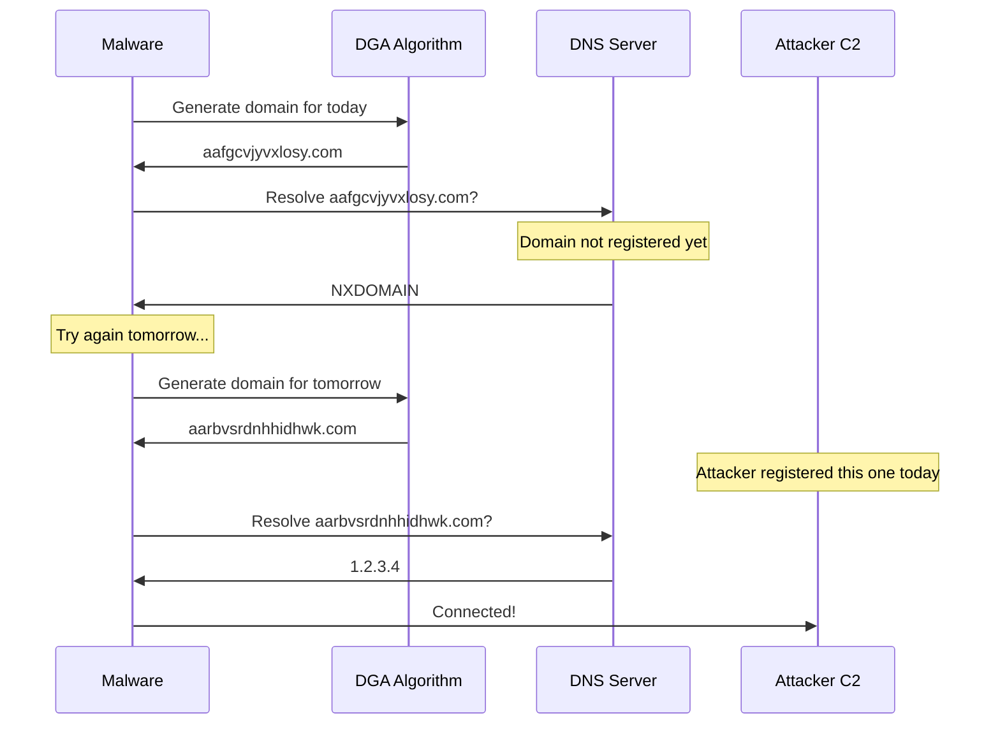

#### Why Are DGA Domains Hard to Block?

- The domain changes every day.
- Only the attacker knows the algorithm, so they register the right domain on the right day.
- Without knowing the algorithm, you can't predict the next domain.

#### How Do You Detect a DGA?

- Long random domains such as: `aafgcvjyvxlosy.com`, `aarbvsrdnhhidhwk.com`
- The SIEM can calculate the domain's **Entropy** (degree of randomness) and alert if it's high.

> [!NOTE]
> An important exception: CDN subdomains and some cloud services use subdomains that look random, but the parent domain is well known (such as `*.cloudfront.net`). Focus on the parent domain, not the subdomain.

---

### ASN Enrichment

The **Autonomous System Number (ASN)** is a number that tells you which organization owns a group of IP addresses.

#### A Practical Example

| Alert | IP | ASN | Conclusion |
|---------|--------|---------|-----------|
| ChromeSetup.exe downloaded | 216.58.x.x | Google LLC | Most likely a legitimate download |
| ChromeSetup.exe downloaded | 195.x.x.x | ASN4134 (Top Botnet ASN) | Malware disguised as Chrome! |

#### Use in the SIEM

Add the ASN as an enrichment field to every log that contains an external IP, then create a rule like:
```
IF file_download AND asn IN (top_10_malicious_asns) THEN Alert
```

---

### Geolocation Enrichment

**Geolocation** lets the SIEM know which country the traffic is coming from or going to.

#### When Is It Useful?

- **Small regional organizations**: if it's a local Egyptian company, there's no reason for connections to come from Russia or North Korea to the VPN Portal.
- **Less common protocols**: SSH or FTP traffic going to an unexpected country.

#### When Is It Hard to Use?

- CDN networks (such as Cloudflare and Cloudfront) have traffic spread across the whole world.
- Large companies have employees everywhere.

> [!NOTE]
> Even if Geolocation isn't useful for analytics, maps help present the SOC's work to management in a visual, convincing way.

---

## DNS-Based Attacker Tricks

### Unauthorized DNS Server Use

Instead of using the company's DNS server (which is monitored), the attacker or malware uses an external DNS server directly.

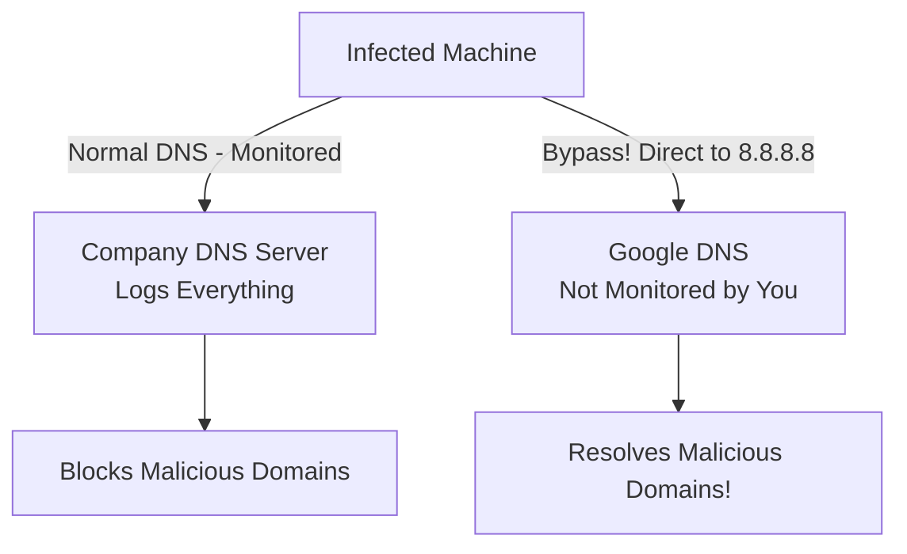

#### The Solution

1. **Block**: use the Firewall to block any UDP port 53 traffic to any IP other than the approved DNS servers.
2. **Log**: log any outbound attempt on port 53 to an external IP.
3. **Alert**: if there's a Firewall deny for port 53 traffic, that's highly suspicious.

#### Evidence Sources

- **Firewall Logs**: blocks or allows of DNS traffic.
- **NetFlow/Network Metadata**: UDP port 53 from inside the network to the outside.
- **Host Firewall Logs**: the same idea, but at the device level.
- **IDS Alerts**: you may have a rule for External DNS Usage.
- **EDR**: records all DNS traffic for every process on the device.

> [!WARNING]
> DoH (DNS over HTTPS) makes DNS bypass harder to detect, because the traffic looks like ordinary HTTPS on port 443.

---

### Shared Hosting Problem

**The scenario**: you saw an alert that `cuzb.com` was resolved, and after some research you found its IP is `91.195.240.79`. When you checked who else is hosted on the same IP, you found **5,857 other sites**.

**The question**: what do you do? Block only the domain, or the IP (which hurts 5,856 other sites)?

#### The Practical Answer

1. **Search the logs first**: who in your environment is talking to this IP, and for which domain?
2. **Shared Hosting ≠ important sites**: large sites and real businesses usually don't use shared hosting.
3. **Block both**: it's usually safe to block the domain and the IP together, after reviewing the logs.

> [!TIP]
> **Always check the logs before you block**. Statements like "I'll block this IP right now" without a review can break something important.

---

### DNS Record Modification

This is one of the most dangerous attacks — if the attacker manages to get access to your DNS admin.

#### Attack 1: Domain Shadowing

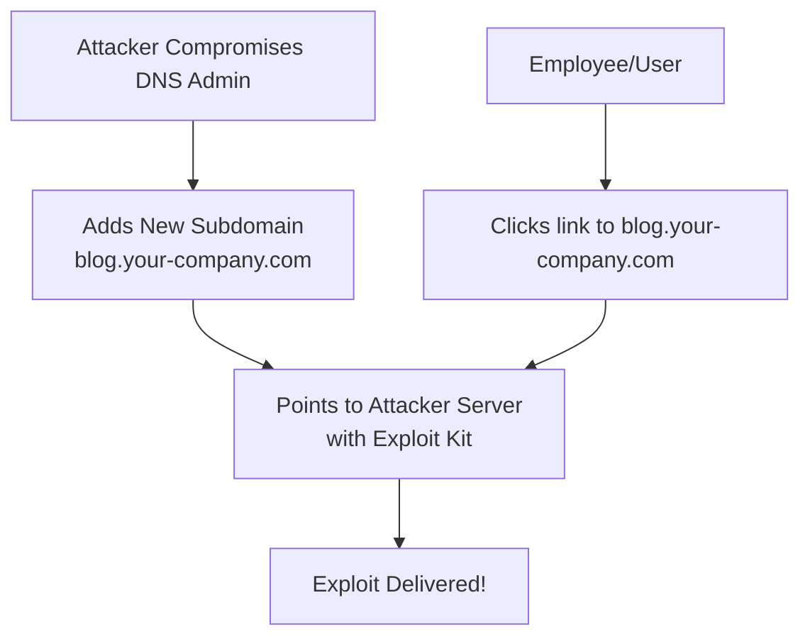

**Why is it dangerous?**
- The domain `blog.your-company.com` looks very legitimate.
- Employees and customers will trust it more.

#### Attack 2: Traffic Interception (the most dangerous)

1. The attacker **clones** your site (a VPN Portal, for example) on their server.
2. They change your company domain's **A Record** to point to their server.
3. Employees enter credentials on the fake site — the attacker relays them to the real site (Transparent Proxy), so the login works.
4. The attacker steals the credentials without anyone noticing.

**Why is it hard to detect?**
- The attacker can obtain a **real TLS certificate** for your domain if they control the DNS (because the Certificate Authority verifies through a DNS TXT Record).

#### Protection

- **Multi-Factor Authentication** for everyone who can modify DNS records.
- **DNS Change Detection** — an immediate alert for any change to DNS records.
- **DNS CAA Records** — specify which Certificate Authorities are allowed to issue certificates for your domain.

---

### DNS Tunneling

**The core idea**: the DNS protocol allows sending and receiving text. An attacker can use this to send encoded data in DNS queries instead of IP addresses.

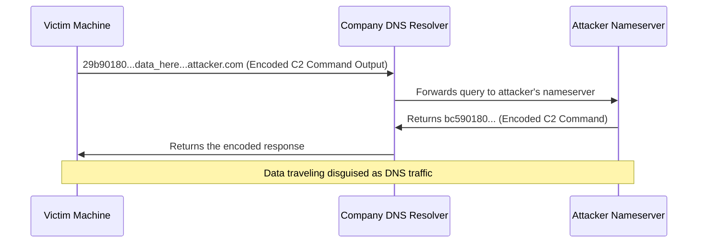

#### Why Is It So Dangerous?

- **It always works**: every network has to allow DNS traffic — you can't block it entirely.
- **Even if you block external DNS**: tunneling works through your company's DNS resolver, which performs recursion to the internet.

#### Types of DNS Tunneling

| Type | Description |
|-------|-------|
| CNAME Tunneling | Data in the CNAME query/response |
| TXT Record Tunneling | Uses TXT records (the most common) |
| NULL Record Tunneling | Uses the NULL query type (rare and highly suspicious) |

#### How Do You Detect DNS Tunneling?

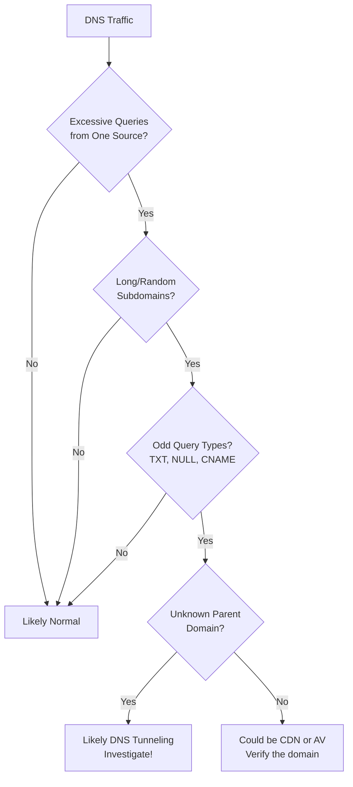

#### Signs of DNS Tunneling

- Large volumes of queries to the same domain from a single device.
- Long subdomains that look encoded (Base64, Hex).
- Use of uncommon query types such as NULL.
- Encoded data in TXT responses.

#### Common False Positives

- **Sophos AV**: uses DNS tunneling to perform file reputation checks.
- **CDN Services**: such as CloudFront, which has subdomains that look random.
- **DNS Hijacking Tests**: security testing tools.

**The difference**: false positives usually have a well-known parent domain and a reasonable volume of traffic.

---

### Blockchain DNS

Attackers use Blockchain DNS to create domains that **can't be taken down** by any regulatory authority.

#### The Problem for Defenders

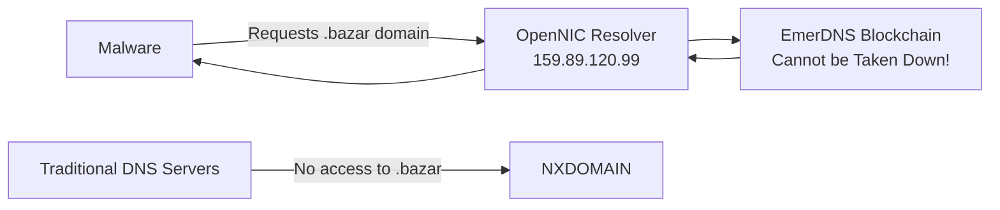

#### Blockchain DNS TLDs

| TLD | Original Purpose |
|-----|------------|
| `.bazar` | Marketplace (heavily used by malware) |
| `.coin` | Digital Currency |
| `.lib` | Knowledge and Freedom |
| `.emc` | Emercoin Project |

#### How Do You Protect Yourself?

- Monitor any DNS requests for unusual TLDs such as `.bazar`.
- Block any use of OpenNIC resolvers on your network.
- Look for endpoints trying to connect to non-standard DNS servers.

---

### Internationalized Domain Names IDNs

**The attack**: attackers use characters from other languages that look exactly like English letters to create a domain that looks like a real one.

#### The Classic Example

| Displayed Domain | Real Domain | The Different Character |
|--------------|---------------|-------------|
| `youtube.com` | `xn--yutube-wqf.com` | The "о" is a Cyrillic letter, not English |
| `facebook.com` | `xn--fcebook-xxx.com` | The "a" may be Cyrillic |

These three characters look identical:
- **О** (Cyrillic)
- **O** (English)
- **Ο** (Greek)

This is called a **Homoglyph Attack**.

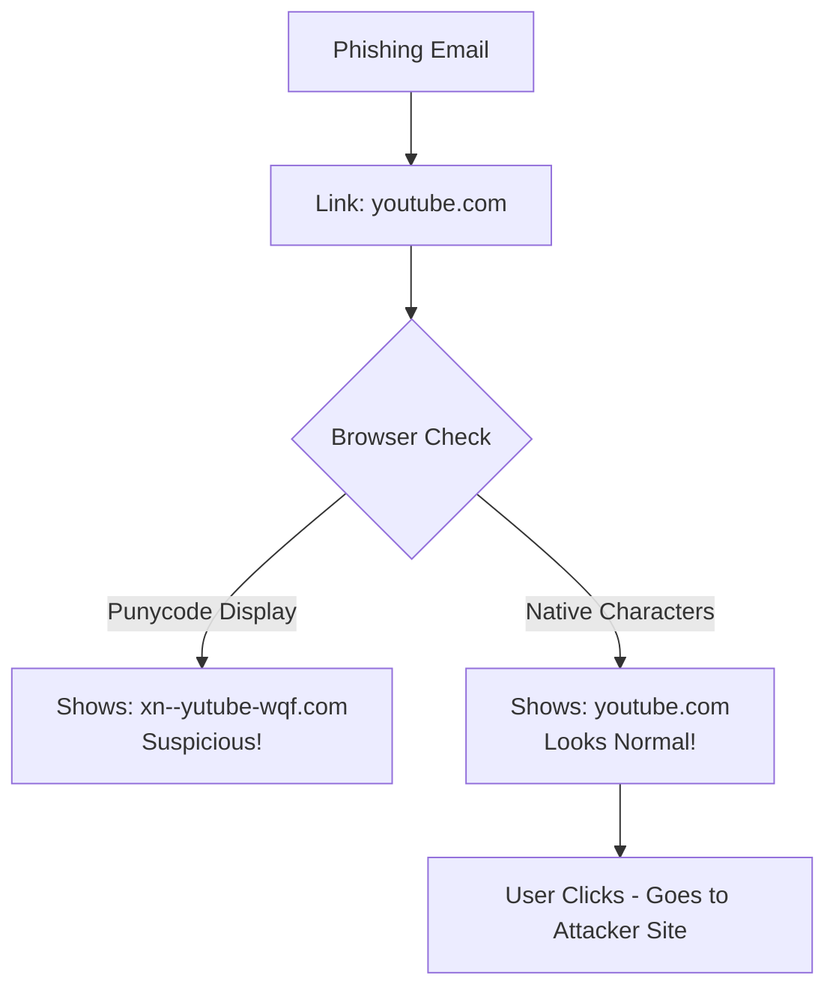

#### Punycode

DNS converts the IDN to Punycode (ASCII only), and that's what shows up in the logs.

**Punycode's telltale sign**: it always starts with `xn--`

```
xn--yutube-wqf.com
^   ^      ^ ^
|   |      | |
prefix      | Encoded non-ASCII chars
        ASCII chars
```

#### How Do You Detect It?

Search the DNS logs for any domain that starts with `xn--`:

```bash
# In a SIEM query
dns.query: "xn--*"
```

> [!WARNING]
> Not every IDN domain is malicious. Many people use IDNs for legitimate reasons (non-English languages). But if the domain resembles a well-known brand, such as `xn--yutube-xxx.com`, that's suspicious.

---

## The Future of DNS - DoT DoH DNSSEC

DNS is evolving, and with it come new problems for the Blue Team.

### Comparing the Types

| Protocol | Port | Encryption | Easy to Block? | Impact on the SOC |
|-----------|--------|---------|------------|-----------------|
| DNS Classic | UDP 53 | No | Yes | Full visibility |
| DNS over TLS (DoT) | TCP 853 | Yes | Yes | Hard to see content |
| DNS over HTTPS (DoH) | TCP 443 | Yes | Very hard | Invisible in HTTPS traffic |
| DNSSEC | Any | Integrity only | Not blocked | Adds no visibility |

### DNS over HTTPS (DoH) - The Biggest Challenge

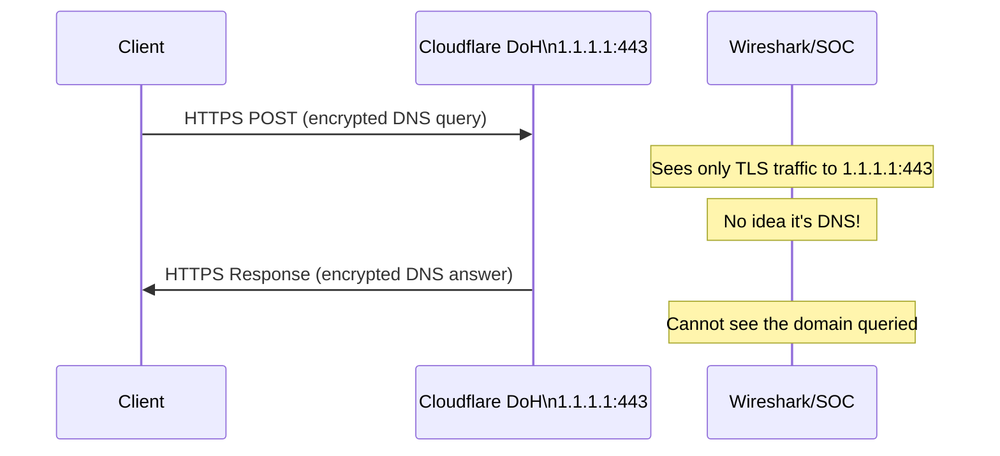

#### How Should the Blue Team Handle DoH?

1. **Decrypt (the best option)**: use TLS Inspection to see DoH traffic.
2. **Disable**: set up DNS canary domains — browsers such as Firefox check for them and disable DoH if they find that record.
3. **Log**: use an internal DoH resolver that logs every request.
4. **Block IPs**: block the known IPs of DoH services, such as `1.1.1.1`, `8.8.8.8`, `9.9.9.9`, on port 443.

> [!IMPORTANT]
> DoH over TLS 1.3 is much harder to detect, because even the certificate details aren't visible without decryption. The future demands TLS Inspection as a requirement, not an option.

### What Does DoH Look Like in Wireshark?

If you can perform TLS decryption, DoH will appear as:
- An **HTTP/2 POST request** (not UDP DNS).
- The MIME type: `application/dns-message`.
- The Transaction ID: `0x0000` (unlike regular DNS).
- Headers separate from the data (an HTTP/2 feature).

---

## Summary

### Summary of Malicious DNS Detection Methods

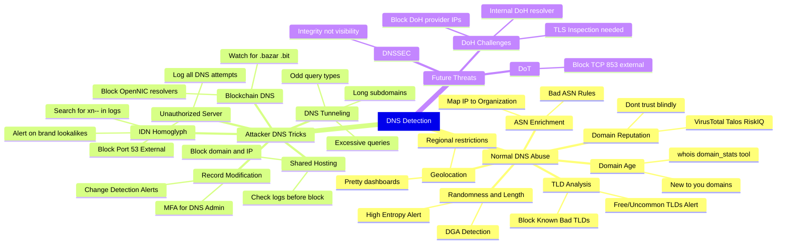

### Key Concepts

| Concept | Quick Definition |
|---------|--------------|
| Passive DNS | Using existing DNS records instead of making new queries |
| DGA | Domain Generation Algorithm - malware that generates random domains daily |
| DNS Tunneling | Smuggling data through the DNS protocol |
| IDN | Internationalized Domain Name - domains with non-English characters |
| Punycode | The ASCII encoding of an IDN, starts with `xn--` |
| Homoglyph Attack | Using characters from other languages that resemble English ones to deceive |
| DoH | DNS over HTTPS - encrypted DNS on port 443 |
| DoT | DNS over TLS - encrypted DNS on port 853 |
| DNSSEC | DNS Security Extensions - guarantees integrity, not confidentiality |
| ASN | Autonomous System Number - a number that identifies the owner of a group of IPs |


