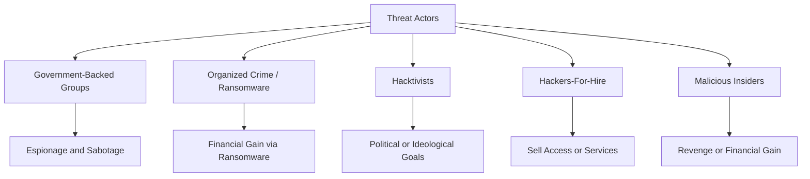
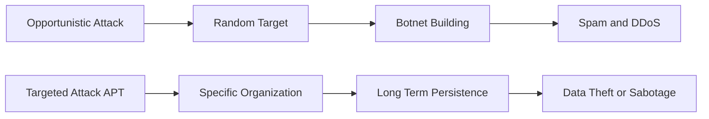
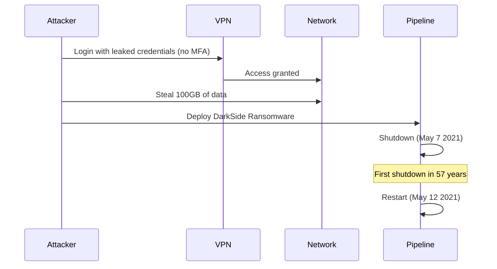
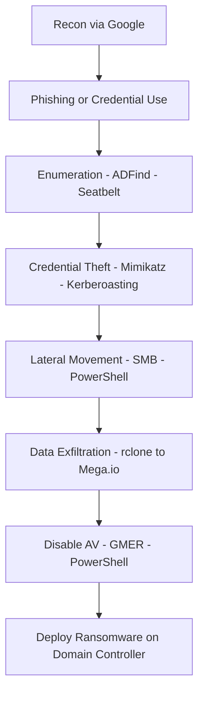

> **Goal of this section:**
> We'll learn who is attacking us, why they attack us, and how, so we know how to build the right defense against every type of attacker.
---

## Table of Contents
- [Introduction](#introduction)
- [Who Is Attacking Us](#who-is-attacking-us)
- [Government-Backed Groups](#government-backed-groups)
- [Ransomware and Organized Crime](#ransomware-and-organized-crime)
- [Hacktivism](#hacktivism)
- [Hackers-For-Hire and Malicious Insiders](#hackers-for-hire-and-malicious-insiders)
- [Two Types of Attacks: Targeted vs Opportunistic](#two-types-of-attacks-targeted-vs-opportunistic)
- [Know Your Enemy: Opportunistic Attackers](#know-your-enemy-opportunistic-attackers)
- [Know Your Enemy: Targeted Attackers (APTs)](#know-your-enemy-targeted-attackers-apts)
- [Attack Group Naming Conventions](#attack-group-naming-conventions)
- [Case Study: Mirai Botnet](#case-study-mirai-botnet)
- [Case Study: Colonial Pipeline Attack](#case-study-colonial-pipeline-attack)
- [Case Study: Conti Ransomware Playbook](#case-study-conti-ransomware-playbook)
- [Case Study: SolarWinds 2020](#case-study-solarwinds-2020)
- [Diagrams](#diagrams)
- [Comparison Tables](#comparison-tables)
- [Key Notes](#key-notes)
- [Summary](#summary)

---

## Introduction

As Sun Tzu said in his book "The Art of War":

> "If you know the enemy and know yourself, you need not fear the result of a hundred battles."

These words aren't just philosophy; they are the foundation of Cyber Defense. You can't defend something without knowing who is attacking it and how.

In the SOC, the Analyst needs to understand:
- **Who** the Threat Actor is
- **Why** they attack (the Motivation)
- **How** they attack (the TTPs — Tactics, Techniques, and Procedures)

---

## Who Is Attacking Us

In the world of Cybersecurity, there isn't just one attacker. There are very different types of Threat Actors, and each type has a different style and goal.

### The main types:

1. **Government-Backed Groups** (nation-states and governments)
2. **Ransomware / Organized Crime** (organized criminal gangs)
3. **Hacktivists** (political or ideological activists)
4. **Hackers-For-Hire** (mercenaries)
5. **Malicious Insiders** (employees inside the company)

---

## Government-Backed Groups

### Who are they?

Countries such as Russia, China, Iran, North Korea, the United States, and others fund highly specialized hacker groups to carry out espionage or sabotage operations.

### Their characteristics:

- **The most sophisticated and dangerous** in terms of Capabilities
- They use **Zero-Day Exploits** — vulnerabilities unknown even to the companies that make the software
- They use **Rootkits** to hide themselves
- Their goal: **long-term espionage** or **disrupting infrastructure**

### A historical example:

- **APT1 Report (2012)**: The first official report to link a Chinese hacker group (Unit 61398) to organized espionage operations against American companies.

> [!IMPORTANT]
> You won't necessarily see Government-Backed Groups very often, but when they do show up, they are extremely dangerous and hard to detect.

---

## Ransomware and Organized Crime

### Who are they?

Organized crime gangs whose main goal is **money**. They use Ransomware as an extortion tool.

### The "Double Extortion" tactic:

1. They steal the data first
2. Then they encrypt the systems
3. They demand money to decrypt them
4. If you refuse to pay, they threaten to publish the data publicly

### Example groups:

| Group | Note |
|----------|---------|
| **REvil** | Some of its members were arrested in Russia (January 2022) |
| **Conti** | An affiliate leaked the entire Playbook (2021) |
| **DarkSide** | Responsible for the Colonial Pipeline attack |
| **CLOP** | Known for Supply Chain Attacks |
| **Magecart** | Specializes in stealing Credit Card data |

---

## Hacktivism

### Who are they?

Activists who use Hacking as a way to express a political or ideological position.

### Their common goals:

- **DDoS** — taking down a specific organization's service
- **Site Defacement** — altering the official website of a company or government
- **Data Theft and Release** — stealing confidential data and publishing it
- **Doxing** — publishing personal information about individuals
- **Reputation Damage** — harming an organization's reputation

### Examples:

- **Anonymous**: A well-known group that carried out "OpRussia" during the 2022 invasion of Ukraine
- **LulzSec**: A hacking group that was active in 2011
- **The Verkada breach (2021)**: A group hacked thousands of cameras at Tesla, hospitals, prisons, and more

> [!WARNING]
> Hacktivists are hard to track — they launch surprise strikes with no prior warning, and they meet on the Dark Web and in encrypted Chats.

---

## Hackers-For-Hire and Malicious Insiders

### Hackers-For-Hire

People who sell hacking services as if it were a Business.

**Their services:**
- **Ransomware-as-a-Service (RaaS)**: They sell Ransomware code to buyers
- **Exploit-as-a-Service**: They sell ready-made exploits
- **Initial Access Brokers**: They breach companies and sell the Access to other parties

### Malicious Insiders

Employees inside the company who cause deliberate harm.

**Their motives:**
- **Money** — selling data or Credentials
- **Intellectual property theft** — such as Formulas or Source Code
- **Revenge** — an employee who is angry at the company

**A real example:**
The Punjab National Bank breach in India — an employee used his access to the SWIFT system and stole **$1.8 billion**.

> [!NOTE]
> To deal with Malicious Insiders, tools such as **DLP (Data Loss Prevention)** and **UEBA (User and Entity Behavior Analytics)** are used.

---

## Two Types of Attacks: Targeted vs Opportunistic

The most important distinction you need to understand as an Analyst:

| Characteristic | Opportunistic | Targeted |
|---------|--------------|---------|
| **Target** | Any possible victim | You specifically |
| **Scope** | A single user or a single device | The entire company |
| **Severity** | Relatively low | Very high |
| **Examples** | Botnets, Spam, Trojans | Nation-State, APT, Ransomware |
| **Tools** | Ready-made and available to everyone | Custom-built and specially developed |
| **Response** | Routine | Urgent and strategic |

> [!IMPORTANT]
> Any attack that looks like it could shut down the whole company must immediately be treated as a Targeted Attack, and the urgent response must begin.

---

## Know Your Enemy: Opportunistic Attackers

### Who are they?

Attackers with no specific target — they hit whoever they can.

### Their strategy:

- Compromise as many devices as possible and turn them into a **Botnet**
- Use the Botnet for:
  - **DDoS Attacks**
  - **Spam Campaigns**
  - **Cryptocurrency Mining**
  - **Credential Stuffing**

### Their common tactics:

- **Phishing Waves**: Sending millions of suspicious emails in the hope that someone opens one
- **Web Drive-By Downloads**: Websites that automatically download Malware when someone visits them
- **Exploit Kits**: Automated tools that look for browser vulnerabilities and exploit them
- **FakeAV / Popups**: Fake warnings that trick the user into installing malicious software

---

## Know Your Enemy: Targeted Attackers (APTs)

### What does APT mean?

**APT = Advanced Persistent Threat**

### Their characteristics:

- **Advanced**: They use highly sophisticated tools, sometimes Zero-Days
- **Persistent**: They stay in the network for a long time (months, sometimes years)
- **Threat**: Their danger is real and their goal is clear

### Their tactics:

- **Spear-Phishing**: Emails personalized with the recipient's name and job title
- **Watering Hole Attacks**: They compromise a website that the Target and the company's employees visit
- **Supply Chain Attacks**: They attack the company's software vendor (such as SolarWinds)
- **Social Engineering**: Manipulating employees to obtain information or Access
- **Zero-Day Exploits**: Unknown vulnerabilities that sell for a very high price on the black market

---

## Attack Group Naming Conventions

### The problem:

Every security company names groups in its own way. The same group can have 5 different names.

### Naming style table:

| Company | Naming style | Example |
|--------|--------------|-------|
| **Microsoft** | Natural or chemical elements | NOBELIUM, HAFNIUM |
| **Mandiant** | APT + number, FIN + number, UNC + number | APT28, FIN7 |
| **CrowdStrike** | Adjective + animal (animal = the group's nationality) | FANCY BEAR, COZY BEAR |
| **Kaspersky** | No fixed pattern | Varies from case to case |

### A practical example:

**APT28** = **Strontium** (Microsoft) = **Fancy Bear** (CrowdStrike) = **Sofacy** (Kaspersky)

They're all the same Russian group!

> [!TIP]
> Your Threat Intelligence Platform (such as MISP) should help you link the different names to the same group through Tags and Aliases.

---

## Case Study: Mirai Botnet

### What is Mirai?

Malware with freely available source code that took over **IoT Devices** (cameras, routers, NAS) and turned them into a massive Botnet.

### How did it work?

- It exploited devices with **Default Passwords** or **known vulnerabilities**
- It turned millions of weak devices into Bots
- It used them for:
  - Extremely large **DDoS Attacks**
  - **Mass Scanning** for vulnerabilities such as Log4Shell
  - **Spam** and **Fraud**

### The lesson learned:

> Weak IoT Devices = a massive Attack Surface. Every camera with a Default Password = a potential threat.

---

## Case Study: Colonial Pipeline Attack

### What is Colonial Pipeline?

The largest fuel pipeline in the United States — it supplies the East Coast.

### Attack Timeline:

| Date | Event |
|--------|-------|
| April 2020 | Credentials for an old VPN account stolen and leaked on the Dark Web |
| May 7, 2021 | Ransomware activated; the entire pipeline shut down |
| May 10, 2021 | The FBI confirms the use of **DarkSide Ransomware** |
| May 12, 2021 | Service restarted |
| June 7, 2021 | The US government recovers part of the ransom |

### How did the attack happen?

1. A **leaked password** on the Dark Web for an old VPN Account
2. That Account **had no MFA** and should have been disabled
3. The hackers entered the network and stole **100 GB** of data
4. They launched the Ransomware

### The impact:

- The entire pipeline was shut down for the first time in 57 years
- Fuel shortages on the East Coast
- 87% of gas stations in Virginia ran out of fuel
- Disruption to airline flights

> [!WARNING]
> **The most important lesson from Colonial Pipeline:**
> One password + no MFA + an Account that was never disabled = a disaster worth billions of dollars.

---

## Case Study: Conti Ransomware Playbook

### What happened?

In September 2021, a member of the **Conti** group leaked the entire **Attack Playbook**.

### What did we discover?

That the group doesn't use Zero-Days or extraordinary techniques — it uses **free, publicly available** tools!

### Attack steps according to the Playbook:

1. **Recon**: Using Google to research the company and its revenue
2. **Enumeration**: Enumerating Users, Groups, and the Domain using ordinary Windows commands
3. **Credential Access**: Kerberoasting, Mimikatz, Brute Force
4. **Lateral Movement**: PowerShell, SMB, ADFind
5. **Data Exfiltration**: Uploading the data to Mega.io using rclone
6. **Disable AV**: Disabling security software using GMER and PowerShell
7. **Deploy Ransomware**: Deploying the Ransomware on the Domain Controller

### Tools used:

| Tool | Purpose |
|--------|--------|
| **ADFind** | Active Directory Enumeration |
| **Mimikatz** | Stealing Credentials from memory |
| **Cobalt Strike** | Command & Control |
| **AnyDesk / Atera** | Remote Persistence |
| **GMER** | Disabling security software |
| **rclone** | Uploading the stolen data |
| **SMBAutoBrute** | Brute Force against SMB |

> [!IMPORTANT]
> If you see **AnyDesk**, **Cobalt Strike**, or **ADFind** in your environment without a clear reason, that's a very big **Red Flag**.

---

## Case Study: SolarWinds 2020

### What happened?

In December 2020, it was discovered that **SolarWinds Orion** (network monitoring software used by thousands of companies and governments) had been compromised since **2019**.

### Timeline:

| Date | Event |
|--------|-------|
| September 2019 | Initial compromise of SolarWinds |
| February 2020 | The **SUNBURST** Backdoor is planted |
| March 2020 | Attacks on victims begin |
| May - December 2020 | Hands-on access to targeted networks |
| December 13, 2020 | The attack is discovered and announced |

### Why is it so dangerous?

1. **Supply Chain Attack**: The hackers didn't attack the victims directly — they attacked the Vendor the victims trusted
2. **Meticulous OPSEC**: Each victim had different IOCs (a different Domain, a different IP)
3. **Golden SAML Attack**: They stole the SAML Signing Keys and forged Tokens to access the Cloud

### The victims:

Microsoft, Intel, NVIDIA, FireEye, and dozens of US government departments.

---

## Diagrams

### Map of attacker types

---

### Targeted vs Opportunistic comparison

---

### Colonial Pipeline attack Timeline

---

### Conti Attack Playbook steps

---

## Comparison Tables

### Threat Actor types compared

| Type | Motive | Severity | Detection |
|-------|--------|---------|---------|
| Government-Backed | Espionage or sabotage | Very high | Very difficult |
| Ransomware Groups | Money | High | Moderate |
| Hacktivists | Ideology | Medium | Moderate |
| Hackers-For-Hire | Money | Medium to high | Moderate |
| Malicious Insiders | Money or revenge | Medium | Difficult |

---

### Naming styles across different companies

| Company | Naming style | Example for APT28 |
|--------|--------------|--------------|
| Microsoft | Natural elements or phenomena | STRONTIUM |
| Mandiant | APT + number | APT28 |
| CrowdStrike | Adjective + animal | FANCY BEAR |
| Kaspersky | A unique name | Sofacy |

---

### Targeted vs Opportunistic comparison

| Criterion | Opportunistic | Targeted (APT) |
|--------|--------------|----------------|
| Target | Any victim | A specific company |
| Preparation | Lower | Very high |
| Tools | Generic and widely available | Custom and sophisticated |
| Duration | Short | Months or years |
| Scope | A single user | The entire company |
| Example | Mirai Botnet | SolarWinds |

---

## Key Notes

> [!NOTE]
> You won't see Government-Backed Groups often in day-to-day SOC work, but when they appear, they are unexpected and hard to detect.

> [!WARNING]
> If you find any of these tools in your environment without a reason: **ADFind, Mimikatz, Cobalt Strike, AnyDesk, rclone** — that's an immediate Red Flag.

> [!IMPORTANT]
> Colonial Pipeline was breached because of a single leaked password on an old VPN Account without MFA. Weak Account Management = disaster.

> [!TIP]
> Use your Threat Intelligence Platform (MISP, for example) to link the different group names used by different Vendors under a single Tag.

> [!IMPORTANT]
> The Conti Playbook Leak proved that attackers don't have to be experts — free tools and organized steps are enough to destroy entire companies.

---

## Summary 

### Key points summary:

- Threat Actors fall into five main types: Government-Backed, Ransomware, Hacktivists, Hackers-For-Hire, Malicious Insiders
- APTs are the most dangerous because they stay in the network for a long time (Persistent)
- The difference between Targeted and Opportunistic is the **target** and the **scope**
- Every Vendor gives the same group a different name — you need to track them all
- The Conti Playbook revealed that hackers use free tools, just in an organized way
- Colonial Pipeline = a lesson in Account management and MFA
