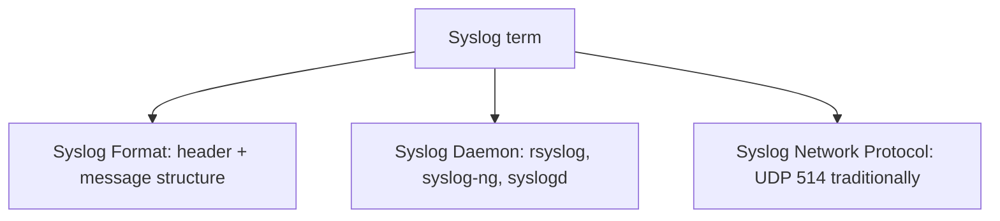
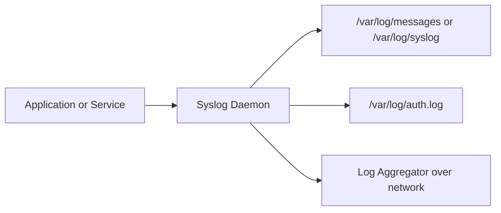

> **Goal of this section:**
> We will understand how Linux writes its logs differently from Windows, distinguish between the Syslog format, the Syslog daemon, and the Syslog network protocol, learn what Facility and Severity mean, and get to know the Systemd Journal and the most important log files to collect in any Linux environment.

## Table of Contents
- [Introduction](#introduction)
- [Linux Logging Overview](#linux-logging-overview)
- [Clarifying the Term Syslog](#clarifying-the-term-syslog)
- [The Syslog Log Format](#the-syslog-log-format)
- [The Syslog Network Protocol](#the-syslog-network-protocol)
- [Syslog Daemons](#syslog-daemons)
- [Facility and Severity](#facility-and-severity)
- [The Traditional Log Path in Linux](#the-traditional-log-path-in-linux)
- [The Most Important Log Files in Linux](#the-most-important-log-files-in-linux)
- [The Systemd Journal](#the-systemd-journal)
- [Additional Command-Line Logging Tools](#additional-command-line-logging-tools)
- [Summary](#Summary)

## Introduction

After understanding how Windows handles logging in a complex, organized way through XML and Channels, we now come to a completely different system: **Linux**. Linux logging is simpler in form, but that simplicity comes at a price: the logs aren't organized the same way, which makes parsing them and extracting information from them much harder during an investigation.

## Linux Logging Overview

At first glance, the simplicity of Linux logging seems very convenient compared to the complexity of Windows, but the irony is that this same simplicity is what makes extracting meaning from the logs harder.

The key points you need to understand:

- The logs written by the OS are in **Syslog format**.
- Traditionally, these logs were stored in **Plaintext** files instead of the Channels we saw in Windows.
- A newer service called **journald** has started replacing the plaintext files on some systems with a more organized binary format, similar to Windows.
- Linux **doesn't use Event IDs** like Windows, so there is no standardization of events.
- Instead, each message is classified by **Facility** (the message's source) and **Severity** (its importance).
- The format of each message can be completely different from one program to another.
- Messages can be sent over **UDP** or **TCP**, and they can also be encrypted.

> [!NOTE]
> This concept applies not only to Linux but to all Unix-like systems in general, even though we use the term "Linux logging" for simplicity.

### Why Is Parsing Hard in Linux?

The core problem is that the message content is **not structured and not labeled with an Event ID** like in Windows, so any attempt to extract fields automatically usually relies on a complex set of **Regular Expressions**.

## Clarifying the Term Syslog

One of the most confusing things for people is that the word **Syslog** is used to refer to more than one thing at the same time. We need to distinguish between three different meanings:

1. **Syslog Format** — The way the log text itself is supposed to be written.
2. **Syslog Daemon** — The program that handles writing the text files or forwarding the logs, such as **Rsyslog**, **Syslog-ng**, or **Syslogd**.
3. **Syslog Network Protocol** — The network protocol the traffic is sent over, which traditionally used **UDP Port 514**.



> [!TIP]
> When you hear the word "Syslog" in any technical conversation, ask yourself: does it mean the Format, the Daemon, or the Protocol? This will help you understand what's being said correctly.

## The Syslog Log Format

**Syslog** is the old standard for logging on *nix systems and has been in use since the 1980s.

The general format:

```
<time> <hostname> <log_source> [<PID>]: <message>
```

A real example:

```
Dec 11 16:41:40 ubuntu dhclient[64507]: DHCPACK of 192.168.42.147 from 192.168.42.254
```

Breaking down this example:

| Part | Value | Explanation |
|------|--------|---------|
| Timestamp | Dec 11 16:41:40 | Notice that the year is missing |
| Hostname | ubuntu | The name of the machine that wrote the log |
| Log Source | dhclient | The name of the program |
| PID | 64507 | The ID of the process that wrote the message |
| Message | DHCPACK of 192.168.42.147 from 192.168.42.254 | The free text after the header |

### The Core Problem with This Format

The standard only defines the content of the **Header**. Anything after the colon (:) is completely free-form and depends on the program writing it. The result:

- Free text is easy for a human to read, but it means you need regex to parse it.
- Sometimes the message comes in a structured format such as **CSV**, **Key-Value pairs**, or **JSON**, which makes automatic parsing much easier.

### The Official Syslog Standards

- **RFC 3164** — The old BSD-style version, which is still the one most commonly used.
- **RFC 5424** — A newer version that adds more detail to the header, but it is very rarely used in practice.

> [!IMPORTANT]
> Although RFC 5424 is officially the newer one, most of the Syslog you'll see in the real world is still compatible with the old RFC 3164 format.

## The Syslog Network Protocol

If the system sends messages over the network to a Log Collector, this happens according to specific standards:

- By default, it is sent unencrypted over **UDP Port 514**.
- The theoretical maximum message size over **UDP is 1K**.
- The maximum size over **TCP is 4K**.
- If you use **TCP**, you can also use **TLS Encryption** to secure the connection.

### Standards Related to Syslog Transport

| RFC | Function |
|------|--------|
| RFC 3195 | Syslog transport over TCP |
| RFC 5425 | TLS Transport Mapping for Syslog |
| RFC 5426 | Sending Syslog messages over UDP |
| RFC 5484 | Signing Syslog messages (Signed messages) |
| RFC 6012 | Sending Syslog over Datagram TLS (encrypted UDP) |

> [!WARNING]
> The default and most common method still sends messages **unencrypted over UDP Port 514**, which means anyone on the same network can see the content of the logs if encryption isn't enabled.

## Syslog Daemons

The daemon is the program responsible for receiving, writing, and forwarding logs. There are 3 main options:

### Syslogd
The original program from 1980, still used in some distributions.

### Syslog-ng
Introduced in 1998 as an improvement on syslogd, it offers easier filtering configuration and has a free version and a Premium version.

### Rsyslog
Introduced in 2004 as an alternative to syslog-ng, the Linux version is free, and it is also available as an agent for Windows.

Both **syslog-ng** and **rsyslog** support:

- Very granular filtering.
- Multiple transport protocols.
- Format conversion.
- Sending directly to Log Brokers such as **RabbitMQ** or **Kafka**.
- Output directly to databases such as **MySQL**, **MongoDB**, **Elasticsearch**, or even **Hadoop HDFS**.

## Facility and Severity

Instead of relying on Event IDs like Windows, Linux classifies messages using **Facility** and **Severity**.

### Facility — The Message's Source

The Facility indicates the source of the message (not the exact program). Examples include:

| Facility | Number | Description |
|------|--------|---------|
| kern | 0 | Kernel messages |
| user | 1 | User-level messages |
| mail | 2 | Mail system messages |
| daemon | 3 | Daemon messages |
| auth | 4 | Authorization messages |
| authpriv | 10 | Private security/authorization messages |
| local0 – local7 | 16-23 | Reserved for miscellaneous uses, such as services not already in the list |

### Severity — The Message's Importance

| Severity | Number | Description |
|------|--------|---------|
| emerg | 0 | Emergency, the system is unusable |
| alert | 1 | Action must be taken immediately |
| crit | 2 | Critical condition |
| err | 3 | Error condition |
| warning | 4 | Warning |
| notice | 5 | Normal but significant condition |
| info | 6 | Informational message |
| debug | 7 | Debugging messages |

### Calculating the Priority

The formula:

```
Priority = Facility * 8 + Severity
```

Examples:

- `<0>` = kernel.emergency
- `<38>` = auth.info
- `<191>` = local7.debug

> [!NOTE]
> The lower the Priority number, the more important the message. This Priority only appears when the message is sent over the network, because the Facility and Severity aren't written explicitly inside the message text itself.

## The Traditional Log Path in Linux



The idea in short:

1. Messages are sent from the various applications to the **Syslog Daemon** (such as rsyslog or syslog-ng).
2. The daemon uses the **Facility** and **Severity** to decide which file the message will be logged to, usually inside the **/var/log** directory.
3. Each message is written with the standard header (time, hostname, program).
4. The daemon can also send a copy of the same data over the network to any Log Aggregator specified in the configuration.

## The Most Important Log Files in Linux

### System Logs

| File | Description |
|------|--------|
| /var/log/auth.log (Ubuntu) or /var/log/secure (Red Hat) | Login attempts (sshd, sudo, su) |
| /var/log/syslog (Ubuntu) or /var/log/messages (Red Hat) | General system activity, the closest thing to the System log in Windows |
| /var/log/kern.log | Kernel messages (very numerous and noisy, usually of low security value) |

### Application Logs

| File | Description |
|------|--------|
| /var/log/audit/audit.log | Auditd logs for the enabled rules |
| /var/log/audit/ufw.log | Firewall logs if UFW is used |
| /var/log/apache2 or httpd/access.log | Apache webserver interactions |
| /var/log/httpd/mysqld.log | MySQL interactions |

> [!TIP]
> Every Linux distribution handles logging a little differently, so you need to review the practices specific to the distribution you're using.

## The Systemd Journal

A newer approach to solving the problems of traditional Syslog:

- **systemd-journald** is a service that runs in the background and receives logs securely.
- It stores the data in `/var/log/journal/[machineid]/`.
- It uses a **structured binary** format, similar to Windows EVTX.
- The content of the Journal is mostly text, but it can contain binary data too.
- It allows custom fields in a structured format, unlike traditional Syslog.

### The journalctl Command

To view the content of the Journal, you use:

```bash
journalctl
```

Or, if you only want to see the logs of a specific service, you use `-u` (short for unit):

```bash
journalctl -u suricata
```

Example output:

```
-- Logs begin at Sun 2018-06-03 11:39:37 PDT, end at Sun 2019-12-01 08:42:44 PST. --
Nov 23 22:15:09 ubuntu systemd[1]: Starting LSB: Next Generation IDS/IPS...
Nov 23 22:15:09 ubuntu suricata[34399]: Starting suricata in IDS (af-packet) mode... done.
```

> [!IMPORTANT]
> If the system you're working on supports the Journal, your Log Agent must support extracting messages from it to make sure they reach the SIEM.

## Additional Command-Line Logging Tools

Logging options in Linux generally fall into 3 main categories:

### 1. Built-in Logging — auditd

**auditd** is a service that is available and ready to use in almost every Linux/Unix distribution. Its advantage is that it is already installed, but its drawback is that its output is somewhat complex and harder to interpret or configure compared to other solutions.

### 2. Third-Party Tools — Sysmon for Linux

The famous free **Sysmon** tool for Windows is now also available for **Linux**, and it provides almost the same level of detail.

### 3. Scripts and One-off Logging

It's very easy to write a custom script that uses the system's logging service. The **logger** command lets you send a single one-off message directly to Syslog:

```bash
logger "This is a custom log message"
```

## Summary

- Linux logging looks simpler than Windows, but parsing is harder because there are no Event IDs and no fixed structure.
- Messages are written in **Syslog** format, which has a standard header (time, hostname, source) followed by free text.
- The word "Syslog" has 3 meanings: **Format**, **Daemon**, and **Network Protocol**, and you need to distinguish between them.
- Classification relies on **Facility** (the source) and **Severity** (the importance), and the Priority is calculated with the formula: Facility × 8 + Severity.
- The traditional path: Application → Syslog Daemon → files in /var/log or sending over the network.
- The **Systemd Journal** is a modern evolution that uses a structured binary format like Windows EVTX.
- Tools such as **auditd**, **Sysmon for Linux**, and the **logger command** provide additional flexibility in logging.
