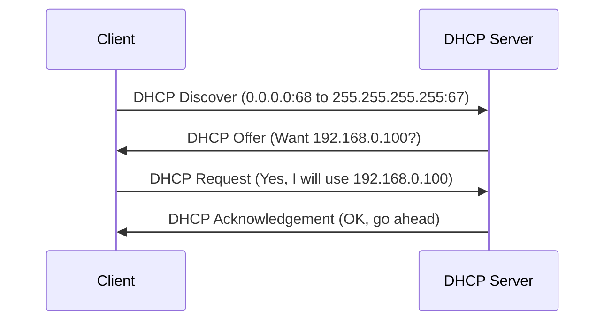
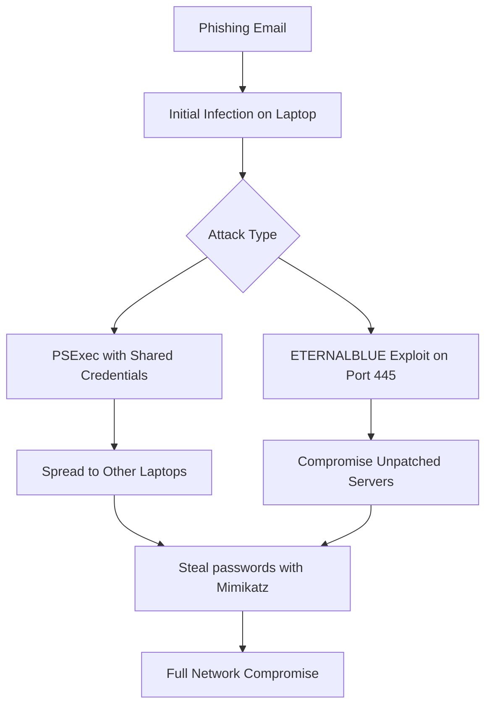
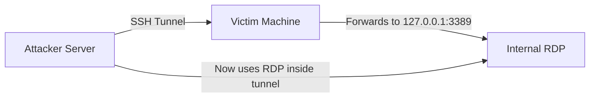
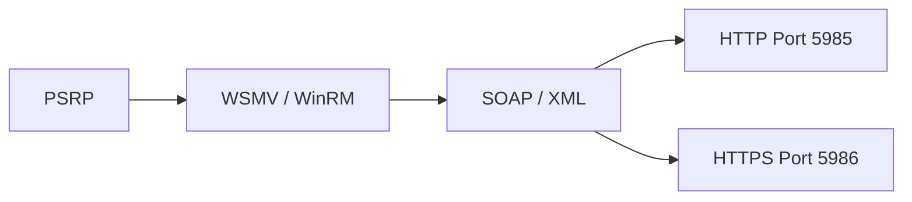
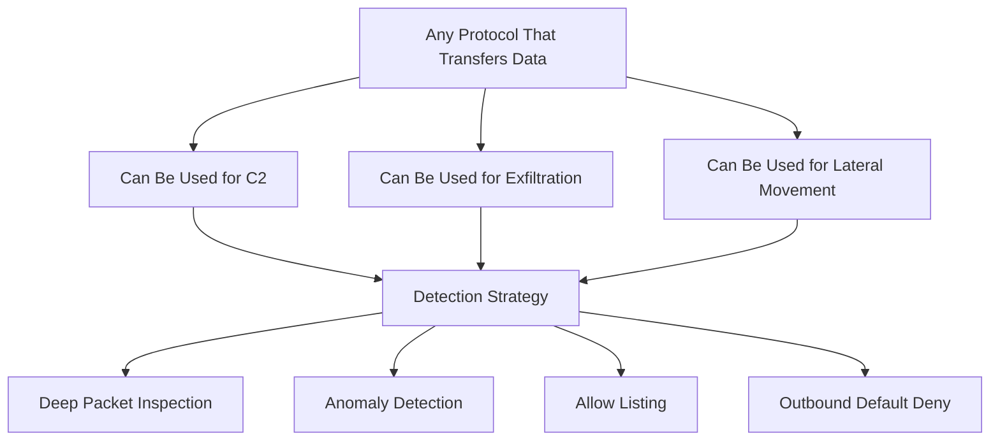

> **Goal of this section:**
> We'll learn how common protocols such as DHCP, SMB, SSH, RDP, FTP, and ICMP can turn from everyday work tools into weapons in attackers' hands, and how to monitor them and use them to protect the network.

---

## Table of Contents
- [Introduction](#introduction)
- [DHCP for Defenders](#dhcp-for-defenders)
- [SMB - Server Message Block](#smb---server-message-block)
- [SSH - Friend and Foe](#ssh---friend-and-foe)
- [RDP and VNC](#rdp-and-vnc)
- [PowerShell Remoting](#powershell-remoting)
- [FTP - Legacy Danger](#ftp---legacy-danger)
- [Evil ICMP](#evil-icmp)
- [Remote Access Tools](#remote-access-tools)
- [Is Any Protocol Safe](#is-any-protocol-safe)
- [Summary](#summary)

---

## Introduction

When we talk about Network Security, most people think of the Firewall, the IDS, and the Antivirus. But the truth is that the ordinary Protocols we use every day — such as DHCP, which hands out IPs, or SMB, which we use to share files — are the very same ones attackers use for Lateral Movement and Exfiltration.

The Blue Team needs to understand every protocol from two angles:
1. **What is its original purpose?**
2. **How can it be abused?**

---

## DHCP for Defenders

### What is DHCP?

DHCP (Dynamic Host Configuration Protocol) is the protocol that automatically gives every Device on the network an IP Address. Without it, everyone would have to set their IP manually.

### Why does DHCP matter to the Analyst?

When an Alert fires on a specific IP, the first question the Analyst asks is: **"Who was holding this IP at the time of the incident?"**

DHCP Logs are the link between:
```
IP Address  →  Hostname (Computer Name)  →  User/Owner
```

### Using DHCP to detect Rogue Devices

DHCP records 3 important pieces of information for every Device that connects to the network:

| Information | Security use |
|----------|-----------------|
| Hostname | Matching it against the company's approved naming convention |
| IP Address | Linking it to other Logs |
| MAC Address | Identifying the manufacturer through the OUI |

### The MAC Address OUI

The OUI (Organizationally Unique Identifier) is the first 3 octets of the MAC Address. It identifies who manufactured the Device.

**Example:**
```
MAC Address: 11:22:33:44:55:66
OUI:         11:22:33  →  Dell, HP, Lenovo, etc.
```

If the company uses only Dell laptops and a MAC shows up with an OUI belonging to Raspberry Pi — that's a big Alarm!

### The DHCP process - the DORA Process



**The steps:**
1. **Discover** — The Client sends a Broadcast saying "I need an IP"
2. **Offer** — The Server offers an IP
3. **Request** — The Client accepts the offer
4. **Acknowledge** — The Server confirms and grants the Lease

> [!NOTE]
> DHCP runs over UDP. The Discover and Request come from Port 68, and the Offer and Acknowledge come from Port 67.

> [!WARNING]
> The Hostname and MAC Address are Self-Reported — meaning the Device itself provides them. A clever attacker can use MAC Spoofing to impersonate a Device that actually exists.

---

## SMB - Server Message Block

### What is SMB?

SMB (Server Message Block) is the protocol that enables Windows File Sharing. It runs on **Port 445** by default.

On Linux, the same function is provided by **Samba**.

### Why is SMB so dangerous?

> [!IMPORTANT]
> SMB doesn't just share files. It gives the attacker the ability to Execute any Command on the Remote Machine if they have Admin Credentials.

**The dangerous equation:**
```
Shared Admin Password + No Firewall Segmentation + Port 445 Open
= Full Network Compromise from a single Machine!
```

### SMB versions

| Version | Operating system | Status |
|---------|-------------|--------|
| CIFS | Windows NT 4.0 | Very dangerous |
| SMB1 | Windows XP, Server 2000/2003 | Must be disabled immediately |
| SMB2 | Windows Vista, Server 2008 | Best disabled |
| SMB2.1 | Windows 7, Server 2008 R2 | Acceptable with caution |
| SMB3.0/3.02 | Windows 8/8.1, Server 2012 | Relatively secure |
| SMB3.1 | Windows 10, Server 2016 | The newest and most secure |

> [!WARNING]
> **SMB1 must be disabled immediately!** WannaCry and NotPetya spread at a terrifying speed because of SMB1. Most of the Equation Group exploits targeted it.

### Types of SMB attacks



**Type 1 - PSExec with Shared Credentials:**
If the company uses the same Admin Password on every machine, the attacker uses PSExec to move from machine to machine without any exploit at all.

**Type 2 - SMB Exploit:**
Such as ETERNALBLUE, which WannaCry and NotPetya used. If the machine isn't patched and Port 445 is open, the machine will be taken over.

---

## SSH - Friend and Foe

### What is SSH?

SSH (Secure Shell) is a protocol that lets the Admin access a Remote Server in an encrypted, secure way. It runs on **Port 22**.

### SSH in the attacker's hands

SSH isn't just for Remote Login. It's a protocol capable of:

| Malicious use | Explanation |
|----------------|-------|
| Data Exfiltration | Uploading stolen files over SFTP - encrypted! |
| Poor Man's VPN | Creating a Reverse Tunnel that makes the External Machine appear to be inside the network |
| Port Forwarding | Passing another protocol's traffic (such as RDP) inside the SSH Tunnel |
| X11 Forwarding | Opening GUI Applications on the Victim Machine remotely |

### A real case: an SSH Tunnel for RDP



**The steps:**
1. The Victim allows Outbound SSH to anywhere
2. The attacker gets the Victim to run `plink` (PuTTY) to an external Server with Port Forwarding
3. The Tunnel forwards Port 3389 on the Victim to the External Server
4. The attacker uses RDP through the Tunnel — all of it encrypted!

> [!IMPORTANT]
> An SSH Tunnel hides all of the traffic. From the outside, it looks like SSH only. Inside, it could be RDP, SMB, or any other protocol.

### How do we protect ourselves from SSH abuse?

- **Allow Listing:** Allow SSH only from specific Subnets to specific Destinations
- **Monitor:** Monitor all Traffic on Port 22
- **Restrict:** Block regular Users from SSH Access

---

## RDP and VNC

### RDP (Remote Desktop Protocol)

RDP provides remote GUI Access to Windows Machines. It runs on **Port 3389 TCP**.

**Why do attackers love it?**
- It looks like Legitimate Admin Activity
- It provides Full Graphical Access
- It's available on most Windows Machines

**Protective measures:**

| Measure | Description |
|---------|--------|
| Firewall Block | Block Port 3389 from the Internet and between Subnets |
| Account Restriction | Restrict who can use RDP |
| NetFlow Monitoring | Monitor all Traffic on Port 3389 |
| Windows Login Events | Analyze Event ID 4624/4625 for RDP Logons (LogonType 10) |

### VNC (Virtual Network Computing)

VNC runs on **Port 5900** by default. It's Cross-Platform, but most of its versions are insecure.

> [!WARNING]
> VNC is considered a Legacy Technology. In 2024, using it in an Enterprise environment is considered a Misconfiguration. Port 5900 and any Traffic the NGFW identifies as VNC should be monitored.

---

## PowerShell Remoting

### What is PowerShell Remoting?

It's the Windows version of SSH. It lets the Admin run PowerShell Commands on a Remote Machine. It's also known as **WinRM (Windows Remote Management)**.

### The technical architecture



**The Stack from top to bottom:**
- **PSRP** = PowerShell Remoting Protocol (the command content)
- **WSMV** = WS-Management Extensions (the management protocol)
- **SOAP** = Simple Object Access Protocol (the XML format)
- **HTTP/HTTPS** = the actual transport

### Why is it dangerous?

- The Traffic looks like ordinary HTTP/HTTPS
- It can be used for Lateral Movement
- It can be used to install Backdoors
- It's Off by default on Desktops, but **On on Servers**

> [!TIP]
> Monitor any Traffic on Port 5985 or 5986. If a Workstation is talking to another Workstation on the WinRM Ports, that's an obvious Anomaly worth investigating.

### Important commands

```powershell
# Open a Remote session
Enter-PSSession -ComputerName TargetPC

# Run a command on a Remote Machine
Invoke-Command -ComputerName TargetPC -ScriptBlock { Get-Process }

# Check the status of WinRM
Get-Service WinRM
```

---

## FTP - Legacy Danger

### What is FTP?

FTP (File Transfer Protocol) is an old protocol for transferring files. It runs on **Port 21** (Control) and **Port 20** (Data).

### Why is FTP dangerous?

| Problem | Details |
|---------|---------|
| No Encryption | Passwords and Data are sent in Plain Text |
| Easy Exploitation | Most FTP Servers are old and full of Vulnerabilities |
| Exfiltration Vector | Target data breach: credit cards were leaked via FTP |
| Tamperability | Data can be modified in Transit |

### A real example: the Target Data Breach

In the famous Target data breach, the attackers:
1. Stole customers' credit card data
2. Placed it on an Internal Server that had Internet Access
3. Exfiltrated it via FTP — an old protocol that was still allowed!

> [!TIP]
> If you don't use FTP, create an Alert for any Traffic on Port 20 or 21. On a network that doesn't need FTP and normally sees no FTP Traffic, any exploitation attempt will stand out immediately.

---

## Evil ICMP

### What is ICMP?

ICMP (Internet Control Message Protocol) is the protocol responsible for Ping messages and network diagnostics.

### How does it become a weapon?

Every **ICMP Packet** has a section called the **Payload** — a free data area. In a normal Ping, the Payload contains random data. But the attacker can put anything in it!

**Maximum ICMP Payload size: 65,507 bytes**

```
ICMP Packet Structure:
┌─────────────┬─────────┬────────────────────────┐
│  Type (8)   │ Code(0) │   Checksum             │
├─────────────┴─────────┴────────────────────────┤
│  Identifier           │   Sequence Number       │
├────────────────────────────────────────────────┤
│  Payload (Data) ← the attacker hides Data here │
└────────────────────────────────────────────────┘
```

**ICMP Tunneling tools:**
- `scapy` — A Python library for building Custom Packets
- `icmpsh` — ICMP Reverse Shell
- `ptunnel` — Tunnels TCP inside ICMP

> [!WARNING]
> ICMP Tunneling is very hard to detect because most Firewalls allow ICMP for Diagnostics. Watch for unusually large ICMP Packets or abnormal volumes.

---

## Remote Access Tools

### Commercial tools as an Attack Vector

Even legitimate tools can be turned into weapons. The **Conti Ransomware** gang used:

| Tool | Use |
|--------|-----------|
| AnyDesk | Persistence on inactive machines |
| Atera | Persistence on active machines |
| TeamViewer | Encrypted Remote Access |

**From the actual Conti gang Playbook:**
```bash
# AnyDesk Persistence
$url = "http://download.anydesk.com/AnyDesk.exe"

# Atera Persistence  
shell AGENT_INSTALLER.msi
```

> [!IMPORTANT]
> Any Traffic that suggests Remote Administration — regardless of the protocol — must be examined carefully. Remote Administration is present in almost every advanced attack.

---

## Is Any Protocol Safe?

### The short answer: No



### A comprehensive defense strategy

**1. Outbound Default Deny**
- Everything is blocked by default
- Only explicitly authorized Traffic gets through

**2. Allow Listing for protocols**
- Define who can use which protocol from which Subnet

**3. Deep Packet Inspection**
- The NGFW understands the contents of Packets
- It can detect SMB inside HTTP, for example

**4. Anomaly Detection**
- Monitoring deviations from the Baseline
- If ICMP Packets suddenly balloon in size, that's an Anomaly

**5. Allow Listing > Block Listing**

| Comparison | Block Listing | Allow Listing |
|----------|--------------|--------------|
| Concept | Block what is known to be bad | Allow only what is known to be safe |
| Detects | Known attacks | Known + Unknown attacks |
| Difficulty | Easy | Harder to set up |
| Effectiveness | Lower | Much higher |

---

## Summary

### Protocol summary

| Protocol | Port | Main risk | Defensive action |
|-----------|------|--------------|-------------|
| DHCP | 67/68 UDP | Rogue Devices | Monitor the OUI and Hostname |
| SMB | 445 TCP | Lateral Movement | Disable SMB1, segment the Subnets |
| SSH | 22 TCP | Tunneling, Exfil | Allow Listing, intensive monitoring |
| RDP | 3389 TCP | Unauthorized Access | Firewall Block, Login Monitoring |
| WinRM | 5985/5986 TCP | Lateral Movement | Monitor unexpected Traffic |
| FTP | 21/20 TCP | Exfiltration, Sniffing | Alert if not in use; replace it with SFTP |
| ICMP | N/A | Covert Tunneling | Monitor Packet Size and volume |

