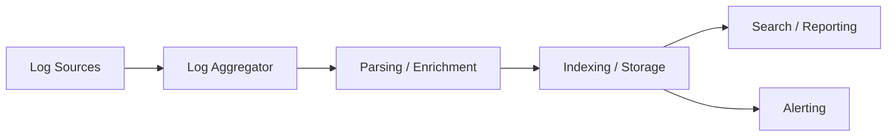
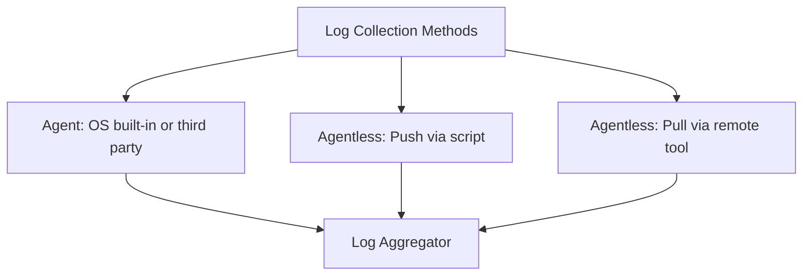
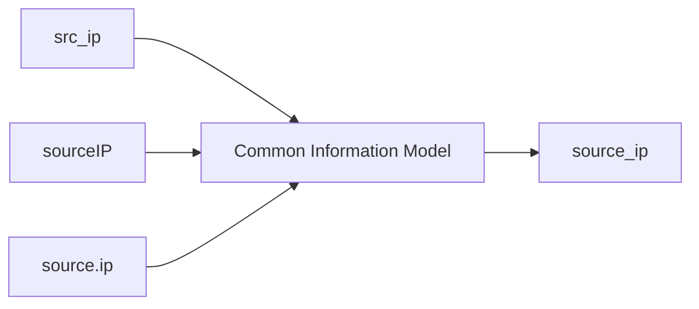

> **Goal of this section:**
> We'll understand the full journey of a log, from the moment it's created on the endpoint until it's stored and indexed in the SIEM. We'll get to know the different collection methods, the types of log formats, the importance of structure in parsing, and the concepts of Enrichment and Normalization, and finally we'll understand the log's lifecycle inside storage.


## Table of Contents
- [Introduction](#introduction)
- [The Logging Pipeline](#the-logging-pipeline)
- [Log Collection Methods](#log-collection-methods)
- [Log Collection Options in Windows](#log-collection-options-in-windows)
- [Log Collection Options in Linux](#log-collection-options-in-linux)
- [Unstructured Logs](#unstructured-logs)
- [Structured Log Formats](#structured-log-formats)
- [SIEM-Specific Formats: CEF and LEEF](#siem-specific-formats-cef-and-leef)
- [Why Structure Matters So Much](#why-structure-matters-so-much)
- [The SIEM Is Not Google](#the-siem-is-not-google)
- [Log Enrichment](#log-enrichment)
- [Log Field Normalization](#log-field-normalization)
- [Normalization Through Categorization](#normalization-through-categorization)
- [Log Storage](#log-storage)
- [The Log Lifecycle](#the-log-lifecycle)
- [Questions to Ask Your SIEM Engineer](#questions-to-ask-your-siem-engineer)
- [Section Summary](#section-summary)

## Introduction

In this module we'll study the **Logging Pipeline** in more detail. Even if your job role isn't SIEM engineering, understanding where logs come from and the stages they pass through is very important. We'll see how logs are collected, transported, parsed, stored, and indexed, and how all of that affects what we see in the SIEM.

We'll also study two very important processes: **Normalization** and **Enrichment**. These two processes add important context to logs, but they can cause confusion if you don't understand why and how they happen. As an analyst, you need to distinguish between the original source info and the information that was added later.

> [!NOTE]
> Without a thorough understanding of the log lifecycle, you'll easily get confused during an investigation, or you'll miss a chance to improve the quality of your logs, which leads to losing important detection capabilities.

## The Logging Pipeline

After a log is generated on the host or appliance, it has to be moved to a **Log Aggregator**.

### The Aggregator's Role

The aggregator's main job is to receive large volumes of logs at high speed, in multiple formats, from many devices at the same time. In some SIEM solutions, more than one host may perform the aggregation role, which helps with scaling and distributing the load geographically.

In general, the aggregator receives the logs and may perform:

- Parsing.
- Cleaning.
- Enrichment.
- Filtering.

Then it outputs them to the storage system in a more uniform format.

### The Role of the Storage and Indexing System

After the aggregator, logs move to a host responsible for storage and indexing. This system does most of the heavy lifting to make logs easily searchable, and it performs:

1. Parsing, Enrichment, and Normalization (if the aggregator didn't do them).
2. Persistent storage of the data.
3. Indexing the content in a database-like structure to make searching and retrieval easier.

The same system may also handle **Reporting** and **Alerting**, since both are basically searches over the data.



## Log Collection Methods

There are two main ways to collect logs from any endpoint:

### Agent

A separate program that runs continuously in the background, whose only job is to reliably collect logs and send them over the network to the Log Aggregator. Its sources:

- Tools built into the Operating System.
- Tools from the SIEM vendor itself.
- Third-party tools.

### Advantages of Using an Agent

- It can easily capture more than one log source.
- It can filter messages based on content.
- It can buffer messages.
- It sends data compressed and encrypted.

### Agentless

It doesn't require installing any separate program on the endpoint, and it comes in two forms:

- **Pull** — the central system logs in to the remote device and pulls the data itself.
- **Push** — a scheduled script runs periodically on the host and sends the logs out.



> [!TIP]
> Understanding how your logs are collected is the first step to understanding your logging lifecycle, because it's the first stage that can change the shape of a log through format conversion or by applying filtering rules.

## Log Collection Options in Windows

There are several options for collecting logs from Windows systems:

### SIEM Vendor Agents

| Tool | Note |
|------|--------|
| Elastic Beats | By Elastic |
| LogRhythm SysMon | By LogRhythm |
| McAfee SIEM Collector | By McAfee |
| QRadar WinCollect | By IBM QRadar |
| Splunk Universal Forwarder | By Splunk |

### The Built-in Windows Agent — Windows Event Forwarding (WEF)

- Present on every machine, and controlled through **GPO**.
- Supports Push/Pull, and is encrypted and compressed.
- Sends events in their **original XML** format to a dedicated machine called the **Windows Event Collector**.
- Forwarded events appear in a channel called **Forwarded Events**, and we still need an agent to collect them from the collector and send them to the SIEM.

### Third-Party Agents

Such as **NXLog**, **Fluentd**, and **Snare** — used if you need more customization than the vendor solution provides.

### Agentless

Uses **PowerShell**, **WMI**, or **MSRPC**. Faster to deploy but harder to configure correctly, and it requires firewall rules and accounts that allow remote login.

> [!IMPORTANT]
> Since Windows logs are already highly structured XML, **it's not advisable** to convert them to a format like Syslog, because that could lose some fidelity. The best option is converting to **JSON**, because it supports nested fields and arrays just like XML.

## Log Collection Options in Linux

The options are similar to Windows, but the most common tool is different:

1. **The built-in Syslog daemon** — such as **Rsyslog**, **Syslog-ng**, and **syslogd**. The most common option, because it's already on the system, and it's very easy to add an IP in one line of the configuration to send the logs out.
2. **SIEM vendor or third-party agents** — such as Beats, Universal Forwarder, NXLog, Fluentd, and NiFi.
3. **Agentless** — Push/Pull with scripts or remote login.

> [!NOTE]
> Unlike Windows, where the **WEF** solution is very complex to set up (it needs Event Sources, Collectors, and GPOs), in Linux just editing one line in the configuration file makes the daemon send logs out. That's why using the built-in Syslog daemon is far more common than any other solution.

## Unstructured Logs

One of the most important factors affecting the Logging Pipeline is the **log format**.

### The Problem

Many logs start with a Syslog header, but the message part itself varies a lot. The worst case is the **Unstructured "Sentence" Type Log**.

### Example

```
Dec 29 07:23:51 ubuntu dhclient[75879]: bound to 192.168.42.161 -- renewal in 703 seconds.
Dec 29 08:17:59 ubuntu CRON[55171]: pam_unix(cron:session): session opened for user root by (uid=0)
Dec 29 09:08:01 ubuntu sudo: student : TTY=pts/2 ; PWD=/var/log ; USER=root ; COMMAND=/usr/sbin/service sshd start
```

To build a parser for this example, you'd need to know every possible message each program might write, where the important information is, and how to extract it reliably, while watching out for optional fields and any future change in the log's format. The end result is usually unreliable parsing and the loss of important data.

> [!WARNING]
> When more than one program writes logs in different formats to the same file, the messages get mixed together like the example above, which makes parsing much, much harder.

## Structured Log Formats

The preferred formats are those with a predictable structure. The three most popular formats are:

### Comma Separated Value (CSV)

```
192.168.1.1,8.8.8.8,55001,53,udp
```

- The most efficient, because it's the format with the least formatting.
- Its downside is that it's **fragile** to any change in the order or number of columns.

### Key-Value Pairs

```
source_ip=192.168.1.1, destination_ip=8.8.8.8, source_port=55001, destination_port=53, protocol=udp
```

- More flexible: you can add, remove, or reorder fields without affecting parsing.
- A good compromise between efficiency and reliability.

### JSON

```json
{ "source_ip": "192.168.1.1", "destination_ip": "8.8.8.8", "source_port": "55001", "destination_port": "53", "protocol": "udp" }
```

- The most reliable for parsing, and it supports nested objects and arrays.
- The least efficient in terms of size, but that's not a big problem compared to the benefit.

| Format | Efficiency | Reliability |
|------|--------|---------|
| CSV | Highest | Lowest (fragile to any change) |
| Key-Value Pairs | Medium | Good |
| JSON | Lowest | Highest (supports nested data) |

> [!TIP]
> Since ease of parsing should be the top priority in any system whose goal is detection, **JSON is the preferred choice** overall.

## SIEM-Specific Formats: CEF and LEEF

Some SIEMs defined their own formats to guarantee a uniform structure and to attribute each message to the system that wrote it.

### CEF — Common Event Format

An open format, mostly used with **ArcSight**.

```
Header: CEF:Version|Device Vendor|Device Product|Device Version|Signature ID|Name|Severity|Extension
```

### LEEF — Log Event Extended Format

Used mainly with **IBM QRadar**.

```
Header: LEEF:2.0|Vendor|Product|Version|EventID|Delimiter|Extension
```

Both start with a Syslog header, followed by a set of fields separated by a **Pipe (|)** that identify the source system, and then the message itself in key-value format.

## Why Structure Matters So Much

Structure matters for two main reasons:

### 1. Parsing Speed and Reliability

The SIEM doesn't keep a copy of every log and scan through it like the **grep** command every time you search; that's called **Full Text Search**, and it's very inefficient. The better approach is for the SIEM to extract the important fields and write them into a database that can be queried at high speed.

### 2. Rule Matching

If fields can't be parsed out of the log, rules won't be able to match them, which means the alert won't fire — and that's the worst kind of error there is: a **False Negative**.

> [!IMPORTANT]
> Without proper parsing, rules won't work and searches will fail. Unless there's a strong reason to save bandwidth, choosing a more structured format is always the better decision.

## The SIEM Is Not Google

One of the most important lessons to learn as an analyst: **searches in the SIEM must be scoped**.

### Example: You Want to Look for "Sara" in the Proxy Logs

| Search | Efficiency | Reason |
|------|--------|---------|
| `sara` | Worst | Full text search across all fields and all log types |
| `logs = proxy AND sara` | Medium | Scoped to the log type only, but searches all fields (URL, HTTP method, etc.) |
| `logs = proxy AND user=sara` | Best | Scoped to the log type and the correct field — the fastest search possible |

> [!WARNING]
> Not all fields are indexed in some SIEMs, because that's very costly in terms of resources. You need to know which fields are indexed in your environment and try to search using only those to get the fastest results.

## Log Enrichment

### Definition

**Enrichment** is adding information to a log that wasn't originally in it, in order to provide context that helps interpret the event.

### Example

```
domain=xyzsite.com, query_type="A", source_ip=10.0.10.3
```

From this information alone, it's hard to judge whether the site is dangerous or not. But if the SIEM automatically adds this information:

- Status = newly observed domain
- Top1M rank = unranked
- Domain created = < 7 days ago
- System status = unpatched
- User = Kyle
- Role = Domain admin

The picture becomes much clearer, and you can make a decision faster.

> [!TIP]
> Enrichment is one of the biggest value-adds the SIEM provides, because it takes the small amount of basic information and turns it into a complete picture that makes quick triage easier for you. Without proper parsing, enrichment can't work at all.

## Log Field Normalization

### The Problem

Different log sources use different names for the same field, such as:

- `src_ip`
- `sourceIP`
- `source.ip`

All of these mean the same thing, but you won't be able to search for them all at once without normalization.

### The Solution: Common Information Model (CIM)



Instead of writing a complex search like:

```
src_ip=1.1.1.1 or sourceIP=1.1.1.1 or source.ip=1.1.1.1
```

Normalization unifies all sources under a single name such as `source_ip`, so you can write just one search:

```
source_ip=1.1.1.1
```

> [!NOTE]
> When you see a field name in the SIEM, it may not be the same name that was written in the raw log, because of normalization. If you try to search for the normalized name inside the raw log and it isn't there, that's most likely the reason.

## Normalization Through Categorization

Another type of normalization takes a log that represents a common event, such as a "Login," and assigns it a unified **Category**.

### Example: You Want to Find All of "Mike's" Login Attempts

**Without normalization:**

```
Windows: event_id=4624 or event_id=4625 AND user:mike
Linux: "Started session for" AND user:Mike AND process:sshd
```

And you may also need to search Cloud logs, Appliance logs, and Service logs in completely different ways.

**With normalization:**

```
category:login AND user:mike
```

And all the events from every source will show up instantly, regardless of the original log type.

> [!TIP]
> If your SIEM doesn't support categorization automatically, there's an alternative called **Tagging**: you make sure every login event gets a tag called "login," and then you can easily search with `tag=login`.

## Log Storage

The final stage in the pipeline. In general, most solutions store similar logs together (for example, all Firewall logs in one place and all Windows logs in another).

### The Concept of an Index

In Splunk, for example, you use a term like `index=ids_logs` or `index=windows` to specify where to search. If you don't specify one, the SIEM will search every possible location, which slows the search down a lot.

### Retention Periods

Each log type may have a different retention period depending on compliance requirements, such as "Firewall logs are deleted after a week" but "IDS logs are kept for a month."

### Storage Tiers (Hot/Warm/Cold)

| Tier | Description |
|------|--------|
| SSD (Hot) | Fast storage, very fast search |
| Spinning Disk (Warm) | Cheaper storage, slower search |
| Archive/Cold Storage | Archiving; usually needs to be reloaded before searching |
| Deletion | Permanent deletion |

## The Log Lifecycle

Once a log is created, it goes through a fairly fixed lifecycle:


1. The log is written.
2. The data is new and very important for Alerting, Threat Hunting, and Incident Response.
3. Over time, the data becomes less important and less likely to be searched.
4. Very old data may be moved to an archive.
5. Eventually, the data is deleted.

> [!IMPORTANT]
> The older a log gets, the harder it is to search for it quickly, and you may need extra steps just to retrieve it (such as reloading it from the archive).

## Questions to Ask Your SIEM Engineer

To work at maximum efficiency as an analyst, you need to know the answers to these questions:

### Data Collection
- Which systems are we collecting logs from? All of them, or only some?
- Which channels/files are we collecting from each type of system?
- What filters are applied, and where are their settings stored?

### Data Usage
- What fields are available in the SIEM's Common Information Model?
- Which fields are indexed and which aren't?

### Data Storage
- What are the retention periods for each type of data?
- How long does data stay on Hot Storage before it moves to Cold?

> [!WARNING]
> One of the most dangerous mistakes is thinking a particular attack "didn't happen" just because you didn't find a log proving it, when the real reason is that you're not collecting that log in the first place because of the agent's settings or filtering.

## Section Summary

- The **Logging Pipeline** consists of: Collection → Parsing/Enrichment → Indexing/Storage → Search/Reporting/Alerting.
- Logs are collected either with an **Agent** or **Agentless**, and each method has its pros and cons.
- In Windows, the best format to convert to is **JSON** to preserve data fidelity, and the most popular built-in tool is **WEF**.
- In Linux, the most common method is using the built-in **Syslog Daemon**, such as rsyslog.
- Structured formats (CSV, Key-Value, JSON) are much better than unstructured logs, and **JSON is the best** for parsing.
- **CEF** and **LEEF** are SIEM-specific formats that provide clear attribution of the source.
- Good structure is the foundation of **Indexing** and **Rule Matching**; without it you'll get **False Negatives**.
- Searches in the SIEM must be **scoped** by log type and field to be fast and effective.
- **Enrichment** adds context to the log, and **Normalization** unifies field names and categories.
- Logs go through a lifecycle of New → Old → Archived → Deleted, which affects how fast they can be searched.

