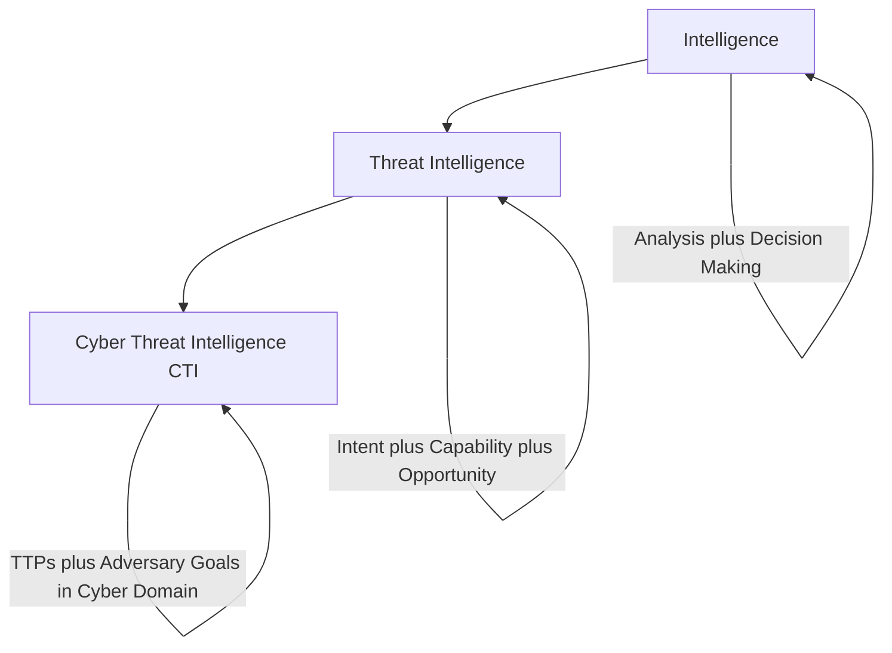
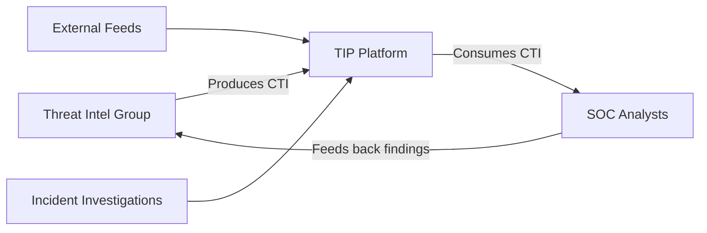
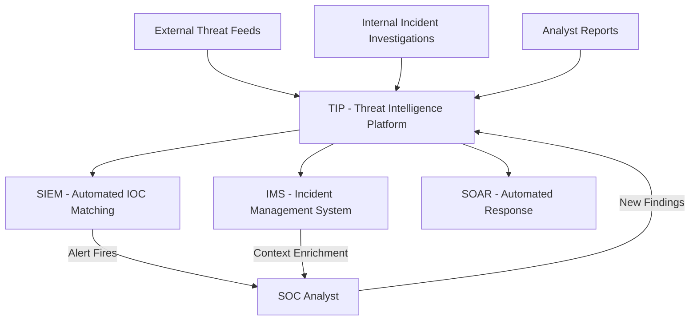
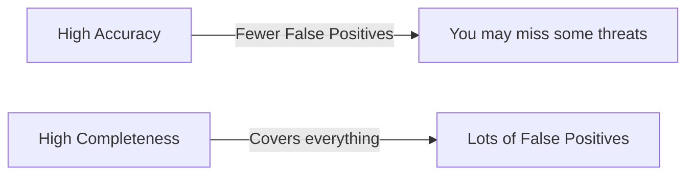
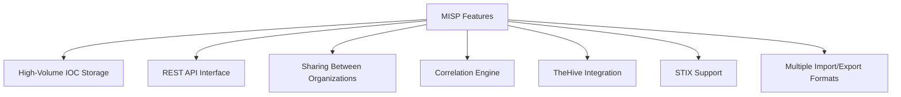
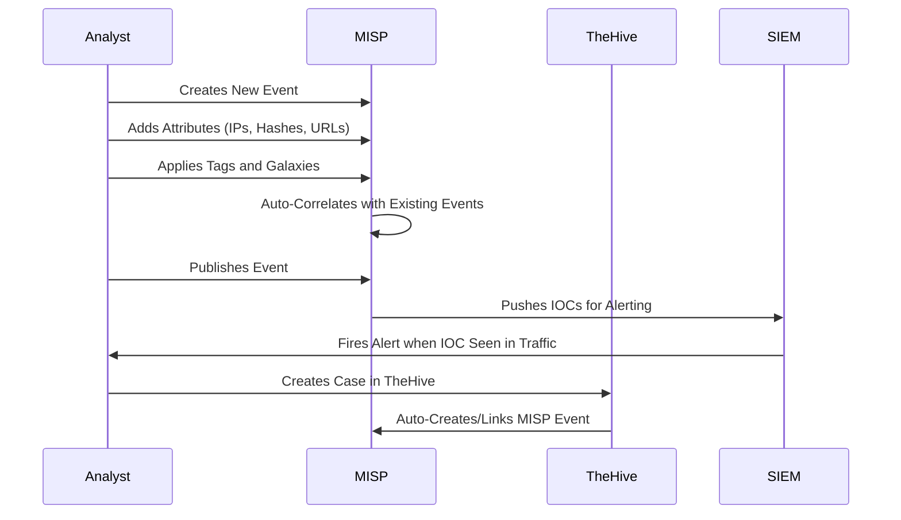
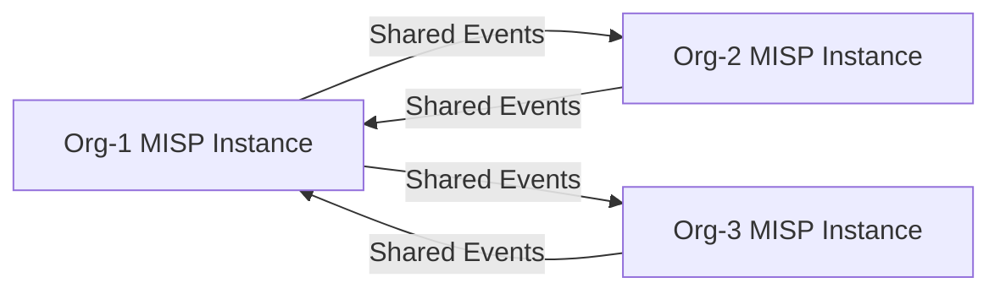

> **Goal of this section:**
> We'll understand what Cyber Threat Intelligence (CTI) is and how it helps the Blue Team get ahead of attackers, and we'll learn how to use Threat Intelligence Platforms (TIPs) such as MISP to store and share this information effectively.
---

## Table of Contents

- [Introduction](#introduction)
- [What Is Intelligence](#what-is-intelligence)
- [What Is a Threat](#what-is-a-threat)
- [What Is Cyber Threat Intelligence CTI](#what-is-cyber-threat-intelligence-cti)
- [Good vs Bad CTI](#good-vs-bad-cti)
- [Threat Intelligence Platforms TIP](#threat-intelligence-platforms-tip)
- [TIP Features and Requirements](#tip-features-and-requirements)
- [De-fanged Indicators](#de-fanged-indicators)
- [TIP Workflow](#tip-workflow)
- [Threat Intel Feeds and ISACs](#threat-intel-feeds-and-isacs)
- [MISP Platform](#misp-platform)
- [MISP Terminology](#misp-terminology)
- [MISP Workflow](#misp-workflow)
- [MISP Events and Correlation](#misp-events-and-correlation)
- [Summary](#summary)

---

## Introduction

Cyber Threat Intelligence is a topic people talk about a lot, but many of us don't know its correct definition. Many people believe CTI is just "a list of dangerous IPs and domains," but that's a very incomplete definition.

Real CTI is **analyzed information** that gives you a strategic and tactical advantage over attackers. Its purpose is to help you understand:
- **Who** the attacker is
- **How** they attack
- **Why** they attack
- **When** they might attack

The core idea is **"Offense informs defense"** — what you know about how the adversary attacks is what you use to harden your defenses.

---

## What Is Intelligence

### The Basic Definition

> "Taking in external information from a variety of sources and analyzing it against existing requirements in order to provide an assessment that will affect decision making."
> — Scott J. Roberts & Rebekah Brown, *Intelligence-Driven Incident Response*

Intelligence isn't just "gathering information" — it has to include:

1. **Collecting information** from multiple sources
2. **Analyzing** that information
3. **Comparing it** against predefined requirements
4. **Producing an assessment** that affects decisions

### Everyday Examples

| Example | Input | Analysis | Decision |
|------|-----------|--------------|--------------|
| Weather report | Weather data | Will it rain? | Should I take an umbrella? |
| Traffic report | Traffic density | How long will the drive take? | When should I leave? |
| CTI | Attacker data | Will they attack? | What will you protect? |

---

## What Is a Threat

### Defining a Threat

Rob M. Lee of SANS says that a threat is **a combination of 3 elements**:

```
Threat = Intent + Capability + Opportunity
```

| Element | Meaning | Example |
|--------|--------|------|
| **Intent** | The attacker's desire to target you | An APT group targeting the banking sector |
| **Capability** | Their ability to carry out the attack | They have advanced malware and deep expertise |
| **Opportunity** | The opening available to them | You have an unpatched vulnerability |

> [!IMPORTANT]
> If any one of these 3 elements is missing, there is no real threat. If the attacker has intent and capability but no opportunity (meaning your network is protected), they won't be able to attack you.

---

## What Is Cyber Threat Intelligence CTI

### The Full Definition

> "Threat intelligence is the analysis of adversaries — their capabilities, motivations, and goals; and cyber threat intelligence (CTI) is the analysis of how adversaries use the cyber domain to accomplish their goals."
> — Scott J. Roberts & Rebekah Brown

### The Relationship Between the Three Concepts



### Characteristics of Good CTI

- **It must be analyzed** — not just raw data
- **It must identify the attacker's TTPs** (Tactics, Techniques, and Procedures)
- **It must influence decisions** — meaning it is actionable
- **It must include human analysis** — automation alone isn't enough

---

## Good vs Bad CTI

### The Common Problem

Many SOCs receive incomplete threat intel, such as:

**Weak CTI (without context):**
```
The IOC "hxxp://malwareC2[.]net" was associated with 
a Trojan.SuperMalware campaign in June 2020.
```

The question the analyst asks: "So what am I supposed to do with this information?"

### The Right Format

**Strong CTI (with context):**
```
On 6/10/2020 spoofed "email[@]spoofedomain[.]com" sent "Invoice" themed emails 
that included the malicious URL "hxxp://totallynotlegit[.]com/probablymalware[.]exe" 
[MD5: 32 characters] (T1566.002), which is detected as Trojan.SuperMalware.

When executed, "probablymalware[.]exe" creates a Scheduled Task named "DoingBadStuff" 
(T1053.005) and begins C2 over port 443 to "hxxp://malwareC2[.]net" (T1071.001).
```

### The Golden Formula

```
IOC = Observable + Context
```

| Component | Meaning | Example |
|---------|--------|------|
| **Observable** | The raw indicator | IP address: 1.2.3.4 |
| **Context** | The context that explains it | "This was a C2 server for APT28 in an attack on the energy sector in March 2024" |

> [!WARNING]
> If your TIP doesn't store context with every IOC, you don't have a TIP — you just have an **Observable Aggregator**. That isn't enough, and it wastes analysts' time.

---

## Threat Intelligence Platforms TIP

### What Is a TIP?

A Threat Intelligence Platform is a specialized system for:
- **Storing** threat information and indicators
- **Searching** the data quickly
- **Correlating** different events
- **Sharing** with other organizations
- **Integrating** with other SOC tools

### Producers vs Consumers



> [!NOTE]
> A TIP **doesn't produce** intelligence on its own. It just stores it and makes it available. The intelligence comes from human analysis or from external feeds.

---

## TIP Features and Requirements

### Core Features

| Feature | Description | Importance |
|---------|--------|---------|
| **IOC Storage** | Storing IPs, domains, hashes, URLs | Essential |
| **Context Recording** | Storing the details with every IOC | Absolutely essential |
| **API Integration** | Connecting with SIEM, IMS, SOAR | Essential |
| **Bulk Import/Export** | Importing and exporting large volumes | Important |
| **Correlation Engine** | Automatically correlating events | Very important |
| **Sharing Capability** | Sharing information with other organizations | Useful |

### Questions to Ask Before Choosing a TIP

Before you choose the right TIP, ask yourself:

1. Do you need to store **Malware Configurations** and non-traditional fields?
2. How will you correlate the stored events?
3. Is sharing with external organizations required?
4. What **volume of indicators** will you be storing?

---

## De-fanged Indicators

### The Problem

When you write URLs or IPs in reports, Slack, or Excel, they can turn into **clickable links**, which is very dangerous if someone clicks on them by mistake.

### The Solution: De-fanging

Instead of writing the indicator as-is, you make small modifications so it's no longer clickable:

| Type | Original | De-fanged |
|-------|---------|-----------|
| **URL** | `http://evil.com/malware` | `hxxp://evil[.]com/malware` |
| **IP Address** | `1.2.3.4` | `1[.]2[.]3[.]4` |
| **Domain** | `evilsite.com` | `evilsite[.]com` |
| **Email** | `attacker@evil.com` | `attacker[@]evil[.]com` |

### Examples from Real Incidents

```
hxxp://satkas.waw[.]pl/rainloop/forecast    -> TrailBlazer C2
vm-srv-1.gel.ulaval[.]ca                   -> GoldMax C2
156[.]96[.]46[.]116                         -> Threat Actor Infrastructure
188[.]34[.]185[.]85                         -> Threat Actor Infrastructure
```

> [!TIP]
> Always use de-fanging when you share IOCs anywhere — reports, tickets, chat, email. It's a well-established standard in the security community.

---

## TIP Workflow

### How a TIP Integrates with the Rest of the SOC Tools



### Data Flow in a TIP

**Input:**
- External feeds (free and commercial)
- Results of internal investigations
- Analyst reports
- Sharing from other organizations

**Output:**
- IOC lists for the SIEM
- Context for the IMS when tickets are opened
- Automated actions through SOAR
- Shared events with other organizations

---

## Threat Intel Feeds and ISACs

### Types of Threat Feeds

| Type | Advantages | Disadvantages |
|-------|---------|--------|
| **Open Source / Free** | Free and available to everyone | Less accurate, needs filtering |
| **Commercial** | High accuracy, support | High cost |
| **Industry-Specific (ISACs)** | Relevant to your sector | Limited to members |

### Criteria for Evaluating a Feed

**1. Relevance**
Does this feed cover the threats you face in your sector?

**2. Speed**
How much time passes between an attack happening and it showing up in the feed?

**3. Accuracy vs. Completeness**



> [!NOTE]
> There's no perfect feed. You need to balance accuracy and completeness according to your organization's needs.

### ISACs (Information Sharing and Analysis Centers)

ISACs are specialized organizations that bring together companies in the same sector so they can share threat information. Joining them is **very important** to get intel that's relevant to your sector.

| ISAC | Sector |
|----------|---------|
| **H-ISAC** | Health |
| **FS-ISAC** | Financial services |
| **IT-ISAC** | Information technology |
| **E-ISAC** | Energy |
| **MS-ISAC** | Multi-state governments |
| **A-ISAC** | Aviation |

---

## MISP Platform

### What Is MISP?

**MISP (Malware Information Sharing Platform)** is the best-known free and open-source TIP. It's used by very large organizations, and it's the de facto standard in open-source threat intelligence.

### Its Main Features



### Other Products on the Market

**Free (Open Source):**
- **MISP** — the most common
- **OpenCTI** — a modern, advanced option

**Commercial:**
- **Palo Alto XSOAR TIM**
- **ThreatConnect**
- **CrowdStrike Falcon X**
- **Recorded Future**
- **IBM X-Force Exchange**
- **Anomali ThreatStream**

> [!IMPORTANT]
> A commercial TIP doesn't produce intelligence for you. It just stores and displays what you collect. If you want a threat intelligence vendor that performs analysis, that's a completely different product.

---

## MISP Terminology

### Core MISP Terminology

#### Events

An **Event** is the core entity in MISP. Every investigation, malware sample, or incident gets its own separate event. Each event contains:
- A unique **ID**
- A descriptive **Title**
- The **Date** of the incident
- **Tags** for classification
- **Attributes** with the details

#### Attributes

**Attributes** are the actual data associated with the event. They can be:

| Attribute Type | Example |
|-------------------|------|
| **IP Address** | 192.168.1.100 |
| **Domain** | evilsite[.]com |
| **MD5 Hash** | d41d8cd98f00b204e9800998ecf8427e |
| **SHA256 Hash** | e3b0c44298fc1c149... |
| **URL** | hxxp://evil[.]com/payload |
| **Email Subject** | "Your Invoice is Ready" |
| **Filename** | invoice.doc |
| **User-Agent** | Mozilla/5.0 (compatible malware) |

#### Classification Features

| Feature | Function |
|---------|---------|
| **Sightings** | Counts how many times you've seen this IOC (true/false positives) |
| **Tags** | Additional labels on events |
| **Taxonomies** | Ready-made sets of tags (such as TLP, Kill Chain) |
| **Galaxies** | Complex classifications (Threat Actors, Malware Families, MITRE ATT&CK) |

### TLP (Traffic Light Protocol)

TLP is a classification system for sharing information:

| Classification | Color | Meaning |
|---------|-------|---------|
| **TLP:WHITE** | White | Can be shared with anyone |
| **TLP:GREEN** | Green | Shared within the professional community |
| **TLP:AMBER** | Amber | Limited to the organization and its clients |
| **TLP:RED** | Red | Highly confidential, for the recipient only |

---

## MISP Workflow

### Manual Usage



### Automated Usage

- The **SIEM** makes API calls to MISP to check IOCs
- **SOAR** automatically pulls context from MISP when an alert fires
- **Subscribed Feeds** automatically download new events
- **TheHive** automatically creates MISP events from cases

---

## MISP Events and Correlation

### The Power of Correlation in MISP

The idea behind correlation is that when you add a new IOC, MISP automatically searches all existing events to see whether the same IOC has been seen before.

**A practical example:**

```
Event 1 (January attack):
  source_ip: 12.34.56.78
  domain: evilsite[.]com
  filename: shipment_received.xls
  hash: 298a736489bdfe869      <-- Same hash!
  Tags: kill-chain:delivery, trojan
  Galaxy: APT99

Event 2 (March attack):
  source_ip: 100.200.55.66    <-- Different IP
  domain: goooogle[.]com      <-- Different domain
  filename: invoice.doc        <-- Different filename
  hash: 298a736489bdfe869      <-- Same hash!
  Tags: kill-chain:delivery
```

When the analyst adds Event 2, MISP automatically notices that the hash exists in Event 1 and links them together.

**The result:** the analyst immediately knows that:
- Both attacks came from the same group (APT99)
- The same tooling was used in both
- The goooogle[.]com domain is new infrastructure for APT99

### Sharing Between Organizations



Each organization decides which events it will share, and MISP syncs them automatically.

---

## Summary

### Key Points

- **CTI** is analyzed information (not just a list of IOCs) that gives you an advantage over the attacker
- **A Threat** = Intent + Capability + Opportunity — if one is missing, there's no threat
- **A good IOC** = Observable + Context — without context, an IOC wastes analysts' time
- **A TIP** is a storage and management tool; it doesn't produce intelligence on its own
- **De-fanging** is essential for any IOC you share in any document or application
- **MISP** is the best-known free TIP, and it supports correlation and sharing between organizations
- **ISACs** are important sources of industry-specific threat intel
