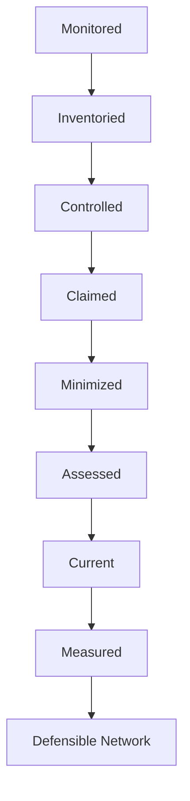
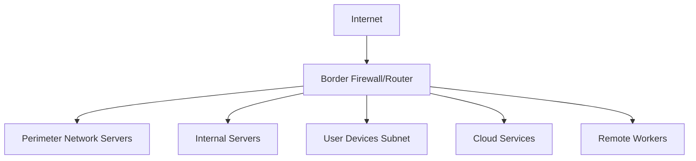
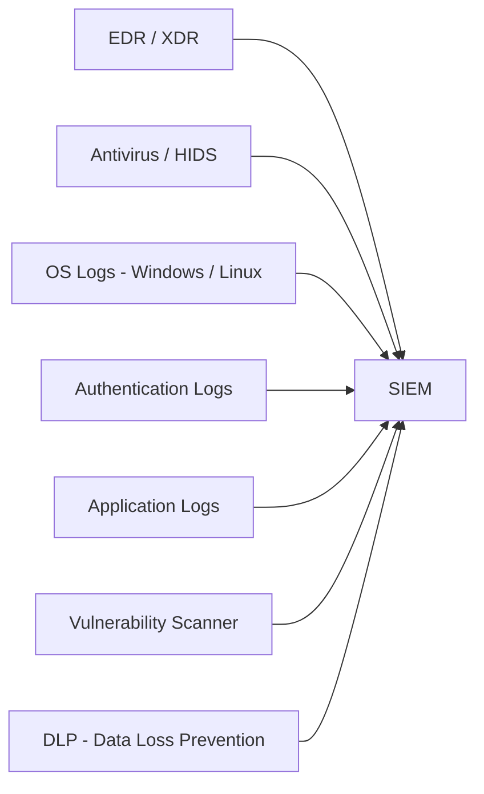
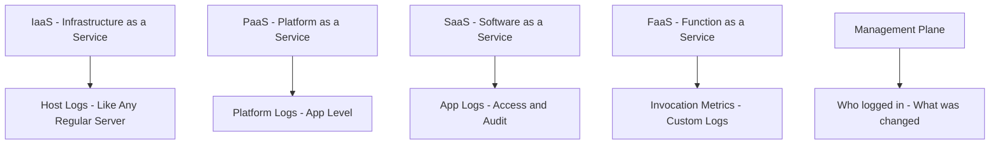
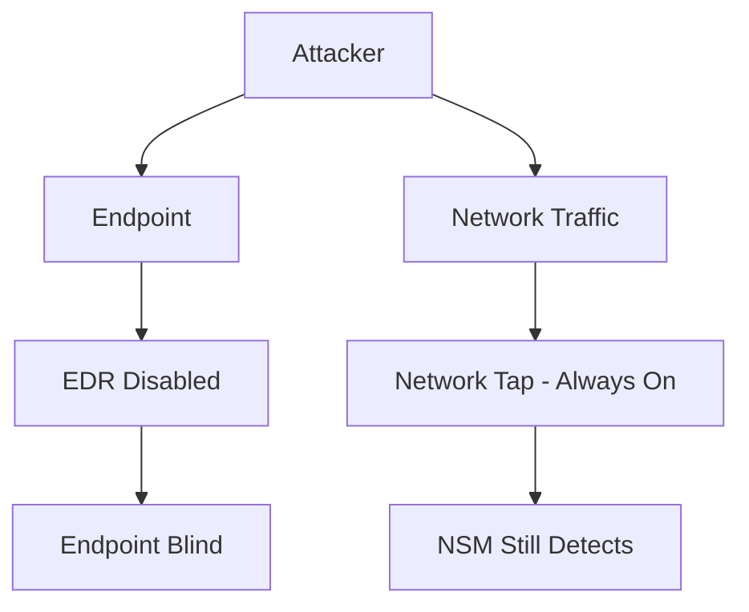
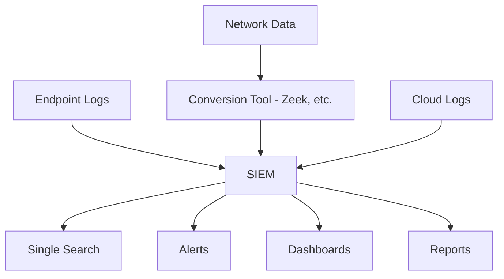
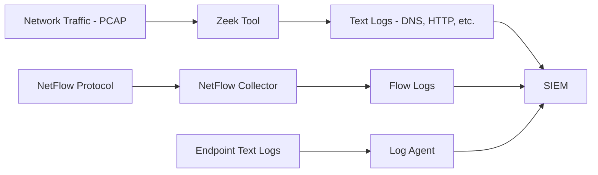

> **Goal of this section:**  
> We'll learn what makes a network defensible, and how to monitor everything that happens in it — whether at the level of the network itself or at the level of endpoints and the cloud. By the end, you'll know what data you need to collect and how to bring it into one place in the SIEM.

---

## Table of Contents
- [Introduction](#introduction)
- [What is a Defensible Network](#what-is-a-defensible-network)
- [The 8 Properties of a Defensible Network](#the-8-properties-of-a-defensible-network)
- [Two Sides of Monitoring](#two-sides-of-monitoring)
- [Network Security Monitoring NSM](#network-security-monitoring-nsm)
- [Where Are We Monitoring](#where-are-we-monitoring)
- [Endpoint and Application Monitoring CSM](#endpoint-and-application-monitoring-csm)
- [Cloud Monitoring](#cloud-monitoring)
- [Network vs Endpoint Data - Do You Need Both](#network-vs-endpoint-data---do-you-need-both)
- [Monitoring Data Sources Overview](#monitoring-data-sources-overview)
- [Data Centralization and the SIEM](#data-centralization-and-the-siem)
- [How Data Gets to the SIEM](#how-data-gets-to-the-siem)
- [Summary](#summary)

---

## Introduction

When we talk about cybersecurity, the first question that always comes up is: **"Is this company's network even defensible?"**

Not all networks are alike. Some networks let an attacker do whatever they want without anyone noticing. In networks that are built correctly, we can detect any attack quickly and respond.

This section answers a very important question:
> **"What needs to be in place in the network so I can actually defend it?"**

---

## What is a Defensible Network

A **Defensible Network** is a network that lets the security team see what's happening, understand it, and act on it in time.

This concept was defined by the expert **Richard Bejtlich** in his well-known 2008 article, and remarkably, its content still holds up completely today.

The core idea is that a network without **Visibility** has no **Defense**.

> [!IMPORTANT]
> If you can't see what's happening in the network, you can't defend it. Visibility is the foundation.

---

## The 8 Properties of a Defensible Network

Richard Bejtlich defined **8 properties** that must be present in any network for it to be defensible. Let me explain them in order:

### 1. Monitored

The first and most important property. You need to see the traffic passing through the network and collect logs from everywhere.

- Start with the simplest thing: **Session Data** (who talked to whom)
- If you have the capability: collect **Full Content Data**
- Also: **Statistical Data** such as NetFlow

### 2. Inventoried

You need to know every device on the network:

- What are the devices' names?
- What software is on them?
- What services are running?

You can't protect something you don't know about.

### 3. Controlled

Once you know the network, you start controlling the traffic:

- **Ingress Filtering**: controlling what comes in
- **Egress Filtering**: controlling what goes out
- **Network Access Control**: who can reach what

### 4. Claimed

Every asset must have an owner. You need to know:

- Who is responsible for each server?
- Who manages each service?
- This is essential during Incident Response

### 5. Minimized

Reduce the attack surface as much as possible:

- Stop the services you don't need
- Remove unnecessary software
- Close the ports you don't use

### 6. Assessed

Run **Vulnerability Assessments** regularly:

- Find weaknesses before the attacker does
- Perform **Adversary Simulation** (Pen Testing)
- Evaluate your defenses continuously

### 7. Current

Keep everything up to date:

- Operating systems
- Applications
- Device firmware

### 8. Measured

Measure your progress:

- Is security improving?
- Are the controls working?
- Maintain a continuous feedback loop

---

### Diagram: Properties of a Defensible Network

---

## Two Sides of Monitoring

Monitoring is divided into two main parts:

| Type | Name | Meaning |
|-------|-------|---------|
| First | Network Monitoring (NSM) | Monitoring the traffic passing over the network |
| Second | Endpoint/App Monitoring (CSM) | Monitoring what happens inside devices and applications |

> [!NOTE]
> The distinction isn't always 100% clear. For example, DNS running in the cloud is an application, but it runs a network protocol. What matters is that you collect the log, not that you classify it correctly.

---

## Network Security Monitoring NSM

**NSM** is monitoring and analyzing network traffic to detect any suspicious activity.

### What Do We Monitor?

- **Data in Motion**: data moving across the network
- Services such as: DNS, HTTP/HTTPS, SMB, RDP, FTP, SSH
- Attacker behavior such as:
  - **Exploit Delivery**: sending exploits
  - **Suspicious File Transfers**: suspicious files
  - **Internal Recon and Pivoting**: internal reconnaissance
  - **C2 Traffic**: Command and Control communications
  - **Data Exfiltration**: data theft

### Why Does NSM Matter?

If you can't see network traffic, an attacker can do all of this without anyone noticing.

> [!WARNING]
> Without NSM, an attacker can be in the network for months before anyone finds them.

---

## Where Are We Monitoring

### The Full Picture of the Network

### Where Exactly Do We Monitor?

| Area | How to Monitor |
|---------|----------------|
| Perimeter Network | Firewall Logs, IDS/IPS |
| Internal Servers | Host Logs, EDR, Application Logs |
| User Subnets | Network Taps, Mirror Ports, Host Firewalls |
| Cloud Services | VPC Flow Logs, Cloud Provider Logs |
| Remote Workers | VPN Logs, EDR Agents, Cloud Proxies |

> [!TIP]
> An EDR-like tool such as Sysmon is free and records network information on the endpoint itself — that's very useful for remote workers.

---

## Endpoint and Application Monitoring CSM

**CSM** (Continuous Security Monitoring) is the continuous monitoring of endpoints and applications.

### What Do We Monitor on the Endpoint?

- **Running Processes**: which processes are running?
- **Command Line Arguments**: which commands were executed?
- **Autorun Items**: what runs automatically?
- **Installed Programs**: which programs are installed?
- **File/Registry Changes**: are there any unexpected changes?
- **Login Activity**: who logged in, when, and how?
- **Running Scripts**: which scripts were run?

### Endpoint Data Sources

### CSM vs NSM

| | NSM | CSM |
|-|-----|-----|
| Data | Data in Motion | Data at Rest |
| Collected by | Network Sensors | Host Agents |
| Examples | Zeek, NetFlow, PCAP | EDR, Sysmon, Windows Logs |
| Advantage | Sees the traffic | Sees deeper details |

---

## Cloud Monitoring

The cloud is an important part of the modern network, and how you monitor it depends on the type of service.

### Cloud Service Types and How to Monitor Them

### Details of Each Type

#### IaaS (Example: AWS EC2, Azure VM)
- Just like having a regular server
- You can install an EDR agent on it
- AWS offers **CloudWatch** to collect logs automatically

#### PaaS (Example: AWS RDS, Azure SQL)
- You can't access the OS
- You monitor at the application level only
- Collect database logs and access logs

#### SaaS (Example: Microsoft 365, Salesforce)
- You don't control the infrastructure at all
- You monitor: who's logging in? What are they doing?
- **The problem**: the vendor is the one who decides whether to give you these logs or not

#### FaaS (Example: AWS Lambda)
- **Serverless** — you don't even have a server
- You monitor: the number of invocations and the output

#### Management Plane
- Always monitor who logs in to the cloud account
- Who is creating new instances?
- Who is deleting things?

> [!WARNING]
> If credentials are stolen and someone logs in to your cloud account while you're not monitoring the Management Plane, they could spin up expensive GPU instances for crypto mining without you knowing!

---

## Network vs Endpoint Data - Do You Need Both

### The Common Question

> "If I have good NSM, do I need CSM? And vice versa?"

The short answer: **you need both**.

### Scenario 1 — Hit by a Malware File

- You only have network data
- You saw that the machine downloaded a file called `calc.exe`
- You don't know what that file did
- You need to do sandbox analysis — and that takes time!

If you have **Endpoint Data**:
- You see the Process Creation Logs right away
- You see that `calc.exe` created a new service, modified the Registry, and connected to a specific IP
- **Much faster**

### Scenario 2 — The EDR Was Disabled

- The attacker used phishing and got onto the machine
- They disabled the EDR and logging
- **The endpoint data can no longer be trusted!**

If you have **Network Data from a Network Tap**:
- The tap is hardware that can't be turned off by software
- You can still see the traffic going in and out of the machine
- **A backup method for detection**

> [!IMPORTANT]
> Endpoints can't always be trusted, because they can be taken over. A network tap is a hardware device that can't be disabled by software.

---

## Monitoring Data Sources Overview

### NSM Data Sources

| Source | What It Provides |
|--------|-----------|
| Network Extraction (Zeek) | Application Layer Metadata |
| NetFlow (from Routers/Switches) | Session Data, IP, Port, Volume |
| Firewall Logs | Allow/Block Actions, Layer 7 Info |
| IDS/IPS/NDR Logs | Alert Names, Matched Rules |
| Proxy Logs | URLs, HTTP Methods, User |
| Service Logs (DNS, DHCP, SMTP) | Application Specific Data |

### Endpoint Data Sources

| Source | What It Provides |
|--------|-----------|
| Authentication Logs | Login Success/Fail, User, Source IP |
| Antivirus / EDR | Malware Detection, Process Trees |
| Process Creation Logs | Command Lines, Parent Process |
| Host Firewall Logs | Per-Process Network Connections |
| Application Logs | Access, Errors, Audit Trails |
| DLP Logs | File Movement, Data Access |
| Vulnerability Scanner | Known CVEs per Host |

---

## Data Centralization and the SIEM

### The Problem Without Data Centralization

Imagine you have an alert on a suspicious IP. You need to open:
- IDS Console
- Firewall Console
- DNS Logs
- EDR Dashboard
- Proxy Logs
- ...

That takes time and effort, and you might miss something important.

### The Solution: The SIEM

The **SIEM** collects all this data in one place and gives you:
- **Single Search Interface**: search all the data with a single query
- **Correlation Rules**: if an IP shows up in both the IDS and DNS, raise an alert
- **Visualizations**: dashboards and charts

> [!TIP]
> The SIEM doesn't just collect — it performs **Correlation**, meaning that if it sees the same IP in 3 different sources, it links them together and produces a stronger alert.

---

## How Data Gets to the SIEM

### The Problem

The SIEM only accepts **logs** (text).  
But some types of data aren't text:
- **NetFlow**: a network protocol with its own format
- **PCAP**: binary packet capture files

### The Solution

### How Each Type of Data Reaches the SIEM

| Type | Method |
|-------|---------|
| Windows Event Logs | Log Agent (Winlogbeat, NXLog, etc.) |
| Linux Syslog | Rsyslog/Syslog-ng sends it to the SIEM |
| Network Traffic | Zeek converts it into logs |
| NetFlow | A NetFlow Collector converts it |
| Cloud Logs | API Integration |

> [!NOTE]
> Zeek is the "decoder" for network traffic — it takes raw PCAP and gives you organized logs for each protocol, such as DNS.log, HTTP.log, SSL.log, etc.

---

## Summary

### Key Points

- A **Defensible Network** needs 8 properties: Monitored, Inventoried, Controlled, Claimed, Minimized, Assessed, Current, Measured
- **Monitoring** is divided into NSM (network) and CSM (endpoint)
- **NSM** monitors data "in motion" — Data in Motion
- **CSM** monitors data "at rest" — Data at Rest
- The **Cloud** has different types: IaaS, PaaS, SaaS, FaaS, Management Plane
- You need **both** NSM and CSM — each one complements the other
- The **SIEM** is the central collection point for all data
- A **Network Tap** is more reliable than the endpoint, because it's hardware that can't be disabled by software

