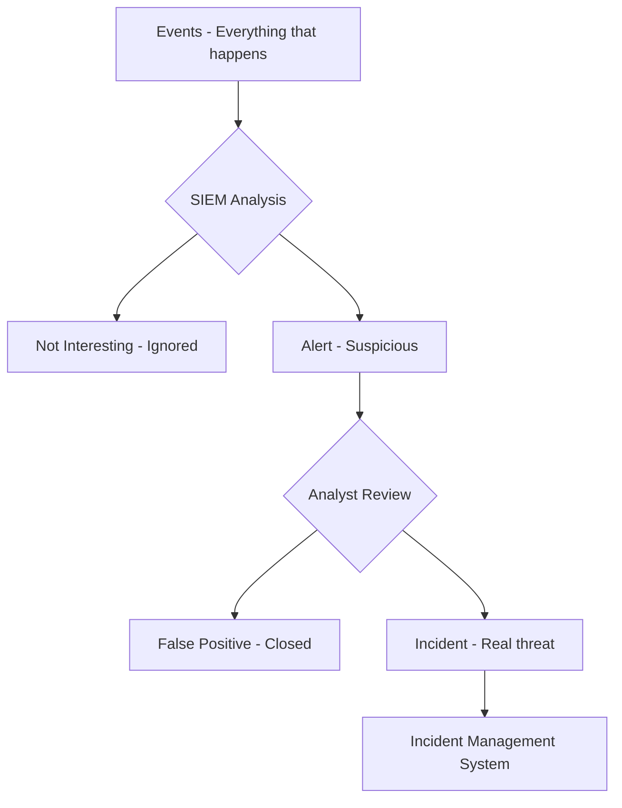
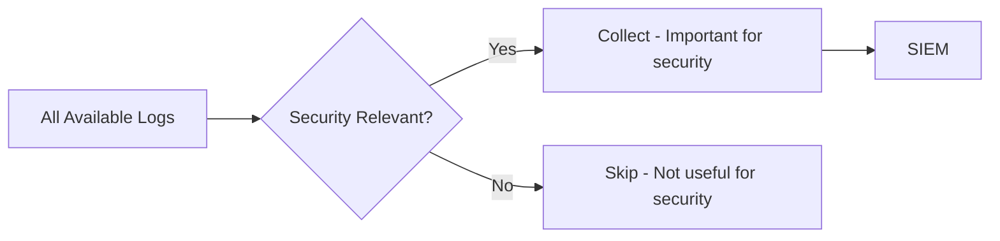
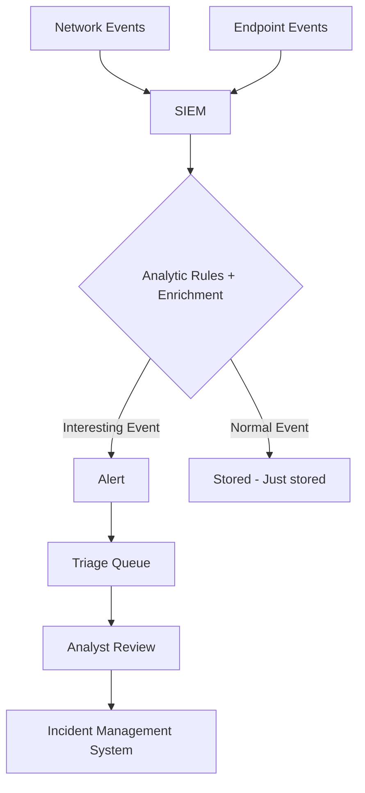
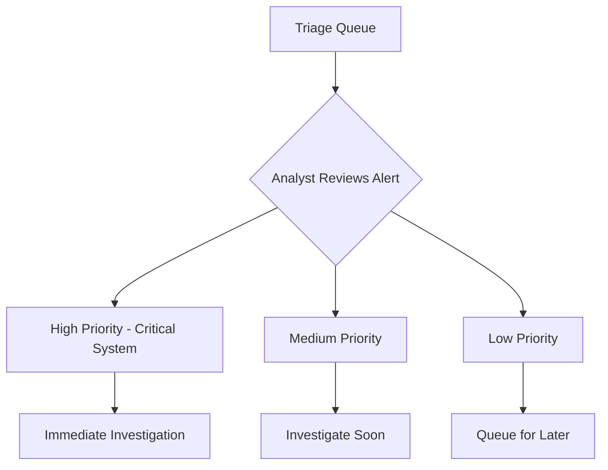
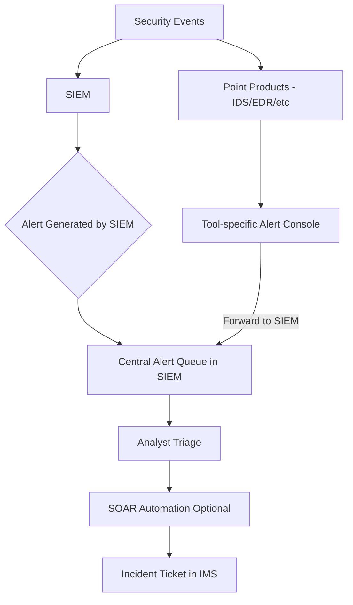
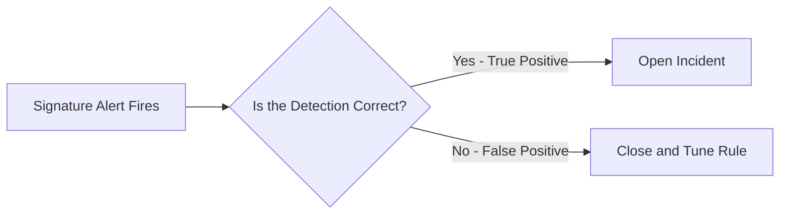
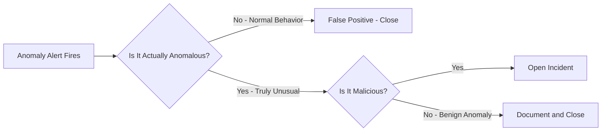
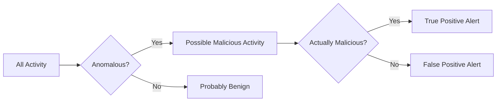
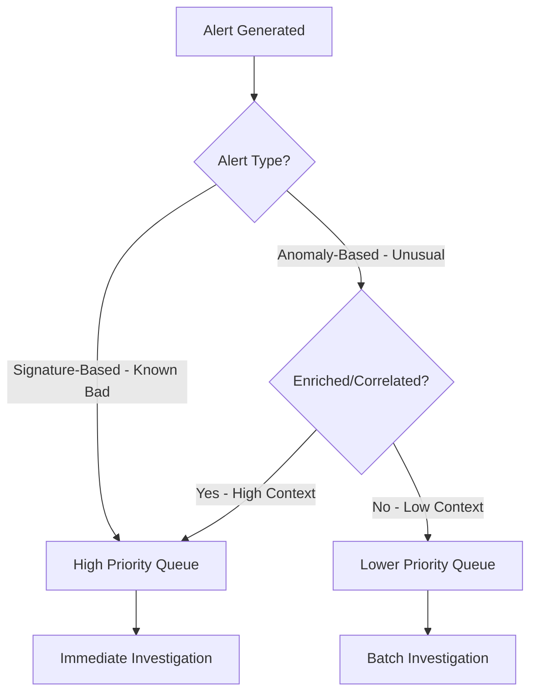

> **Goal of this section:**
> We'll learn the difference between an Event, an Alert, and an Incident, and how Logs move through the SOC from the moment they're recorded until they become a full Incident we have to handle. We'll also understand the fundamental difference between Signature-based Alerts and Anomaly-based Alerts, and how each type affects the Analyst's work.

---

## Table of Contents
- [Introduction](#introduction)
- [Events vs Alerts vs Incidents](#events-vs-alerts-vs-incidents)
- [Event Collection](#event-collection)
- [How Many Logs Should We Collect?](#how-many-logs-should-we-collect)
- [Event Log Flow](#event-log-flow)
- [Alert Collection](#alert-collection)
- [Alert Triage](#alert-triage)
- [Alert Log Flow Options](#alert-log-flow-options)
- [Two Types of Alerts](#two-types-of-alerts)
- [Anomalies vs Signatures](#anomalies-vs-signatures)
- [Workflow Design](#workflow-design)
- [Practical Example: IDS Rules](#practical-example-ids-rules)
- [Summary](#summary)

---

## Introduction

In the SOC, the Analyst drowns in a sea of data every day. The most important question isn't "Is there data?" — the answer is always yes. The real question is:

> **"Out of all this data, what's worth opening an investigation into?"**

To answer that question correctly, you need to understand the basic hierarchy in Security Operations:

```
Events  →  Alerts  →  Incidents
```

Everything starts as an ordinary **Event**. Some Events become an **Alert**, and some Alerts that are confirmed to be dangerous become an **Incident**.

---

## Events vs Alerts vs Incidents

### What is an Event?

An **Event** is anything that happens on the Network or the System and gets recorded. This definition carries no judgment — it doesn't have to be something dangerous.

**Examples of Events:**
- A User logged in
- A Browser opened a Website
- A Service started on a Server
- A DNS Query was sent
- A File was opened

> [!NOTE]
> An Event on its own doesn't say there's an attack. It only says "this thing happened." Most of the Events collected in the SIEM are completely ordinary occurrences.

---

### What is an Alert?

An **Alert** is an Event that has been flagged as possibly suspicious or unauthorized. When the SIEM finds an Event that matches a specific Rule, it raises it to an Alert.

**Examples of Alerts:**
- An IDS detected Malware Command and Control Traffic
- A User tried to log in from a different country
- A Port Scan was run against an Internal Server
- A Firewall Blocked Connection on an unusual Port

> [!IMPORTANT]
> An Alert doesn't necessarily mean there's an attack — it could be a False Positive. The Analyst's role is to determine that.

---

### What is an Incident?

An **Incident** is an actual violation or imminent threat of violation of Security Policies. This means the Alert has been confirmed and there is a real risk to Confidentiality, Integrity, or Availability.

**Source:** NIST SP800-61

**Examples of Incidents:**
- Malware was installed on a Machine
- A Data Breach occurred
- Ransomware started encrypting files
- An Attacker has Access to a Domain Controller

---

### The difference between the three in one sentence

| Term | Definition | Example |
|---------|---------|------|
| **Event** | Anything that happens and is recorded | A User logged in |
| **Alert** | A suspicious Event that needs investigation | A Login from an unusual IP |
| **Incident** | An Alert confirmed to be a real attack | An Attacker is inside the System |

---

### The progression from Event to Incident



---

## Event Collection

### Logs are records of Events

Most of the Logs we collect are Records of ordinary Events. For example:

**From Windows Sysmon:**
```
UtcTime: 2018-09-23 16:16:16.054
ProcessId: 8012
Image: C:\Users\user1\AppData\Local\slack\app-3.3.1\slack.exe
User: win10\user1
Protocol: tcp
SourceIp: 10.150.159.161
DestinationIp: 52.85.81.133
DestinationPort: 443
```

**From the Linux Auth Log:**
```
Sep 23 08:54:56 ubuntu CRON[16355]: pam_unix(cron:session): session opened for user root
```

**From an Apache Web Server:**
```
117.201.11.139 - - [02/Jan/2017:02:35:54 -0800] "GET / HTTP/1.1" 200 34374
```

These Logs on their own don't say "there's an attack." They only say "such-and-such happened."

> [!TIP]
> What makes a Log interesting is when we Correlate it with other Logs or match it against Threat Intelligence Lists in the SIEM.

---

### Types of Log Sources

**Network-based Sources:**
- Squid Proxy Logs
- Apache/NGINX Access Logs
- BIND DNS Query Logs
- Firewall Logs

**Endpoint-based Sources:**
- Windows Event Logs
- Sysmon Logs
- Linux Auth Logs
- Application Logs

---

## How Many Logs Should We Collect?

### The "collect everything" problem

There's a temptation to say, "Let me collect all the Logs so I don't miss anything." The problem is that this comes at a high cost:

| Problem | Impact |
|---------|---------|
| More Volume in the SIEM | Higher cost |
| More Noise | Harder to find the Signal |
| Slower Searches | Longer investigation time |
| More False Positives | Analyst burnout |

### The goal: Security-Relevant Logs only



A **Security-Relevant Log** is any Log that could help you detect an attack.

> [!WARNING]
> Most Teams make two mistakes at the same time:
> - They collect **more** Logs than they need that aren't useful for security
> - They miss **important Logs** such as Process Creation Logs or PowerShell Logs

---

## Event Log Flow

### How do Logs move through the SOC?



### The steps in detail:

**Step 1 - Collection:**
Logs are collected from Network Appliances and Endpoints and sent to the SIEM.

**Step 2 - SIEM Processing:**
The SIEM performs:
- **Parsing:** Understanding the content of the Log
- **Enrichment:** Adding extra information (IP Reputation, Domain Age, etc.)
- **Rule Matching:** Matching the Log against Analytics Rules

**Step 3 - Alert Generation:**
If the Log matches a Rule, it becomes an Alert and goes to the Triage Queue.

**Step 4 - Analyst Triage:**
The Analyst reviews the Alert and decides: False Positive or a real Incident?

**Step 5 - Incident Management:**
If the Alert is confirmed, it becomes an Incident and is placed in the IMS, such as TheHive.

---

## Alert Collection

### The difference between an Event Log and an Alert Log

Not all Logs represent ordinary Events. Some Logs that come from Security Tools are Alerts in themselves.

**Example: Snort IDS Alert:**
```
12/12-06:22:52 [**] [1:2014126:1] ET CURRENT_EVENTS DRIVEBY
Blackhole Likely Flash Exploit Request /field.swf [**]
[Classification: A Network Trojan was Detected] [Priority: 1]
192.168.45.10:1046 -> 78.46.173.138:80
```

This Log doesn't say "a Request happened" — it says "an Exploit Kit was detected!"

**Example: Palo Alto Firewall Threat Log:**
```
THREAT,url,... 192.168.0.2 ... block-url,"onlinebrandsecuritys.com/install/ws.zip",malware-sites
```

This says "Blocked a URL known to be a Malware Site."

> [!IMPORTANT]
> Alert Logs must be handled differently in the SIEM. They aren't just data — they are signals that need immediate Triage.

---

### An important question: where should Alerts go?

There are several options:

| Option | Advantages | Disadvantages |
|--------|---------|---------|
| Triage in the IDS Console itself | A specialized Interface | Multiple lists, hard to prioritize |
| All Alerts in the SIEM | Full Context, a single Queue | No Custom Interface for each Tool |
| SOAR Platform | Full Automation | Greater complexity |

**Best in most cases:** Collect all Alerts in the SIEM, because:
- Context from all Data Sources is available in one place
- One Queue instead of multiple lists
- You can Correlate an IDS Alert with an Endpoint Event
- High-Fidelity Alerts can be turned into SOAR Automation

---

## Alert Triage

### The Triage Queue

All Alerts are gathered into a list for Triage. The ideal Triage Queue shows:
- The Alert's Severity
- The source
- How many times it has repeated
- How important the affected System is

### Keys to successful Triage:

**1. Prioritization:**
The Analyst must work on the most dangerous first. The criteria:
- How far the attack has progressed
- How important the targeted System is
- The type of Account affected
- Whether the attack looks Targeted or Random

**2. Context:**
Additional information (User, IP Reputation, Asset Value) helps you make decisions quickly.

**3. Speed:**
Attacks move fast. The Analyst has to move just as fast or faster.



---

## Alert Log Flow Options



### Comparing the two options:

**Option 1: Triage in each Tool separately**

Advantages:
- Each Tool has an Interface specialized for a specific Alert Type
- A PCAP Tool shows you the Packet contents directly

Disadvantages:
- Multiple lists = difficulty prioritizing
- No Context shared between the Tools
- You may miss activity that combines Events from different sources

**Option 2: All Alerts in a single Queue in the SIEM**

Advantages:
- One place for everything
- The SIEM can Correlate an IDS Alert + Endpoint Event + Network Log
- Higher Fidelity Alerts
- You can apply SOAR Automation to everything

Disadvantages:
- The SIEM doesn't have the same Custom Interface as each Tool

> [!TIP]
> The hybrid solution: send the Alerts to the SIEM and add Links to the Point Product Console. That way you get the best of both.

---

## Two Types of Alerts

### Type one: Signature-Based Alerts (Known-Bad)

A **Signature-based Alert** is generated when the SIEM or IDS finds something that matches a known attack Pattern.

**The logic of a Signature:**
> "This Traffic resembles a known Malware file / a malicious Domain / an IP that appears on a Threat Intel List"

**Examples:**
- A Download of a File with a Hash known to be Malware
- A Connection to a Domain on a Threat Intel List
- A known Exploit Attempt such as Log4j CVE-2021-44228

**How to handle a Signature Alert:**


---

### Type two: Anomaly-Based Alerts

An **Anomaly-based Alert** isn't based on something known to be malicious — it's based on the fact that something is **unusual** in the environment.

**The logic of an Anomaly:**
> "This User has never logged in from this country before" or "This Server sent more Outbound Traffic than usual"

**Examples:**
- A User logged in from a new Location
- A Process running on an unusual Port
- An Upload Volume much larger than usual
- A Login at an unusual time (3 AM, for example)

**How to handle an Anomaly Alert:**


An Anomaly Alert needs two verification steps instead of one!

---

### Comparing the two types

| Attribute | Signature-Based | Anomaly-Based |
|-------|----------------|---------------|
| **Basis** | Known-Bad List | Deviation from Normal |
| **Fidelity** | Usually high | Usually low |
| **False Positives** | Fewer | More |
| **Detects Zero-Days** | No | Possibly |
| **Verification steps** | One step | Two steps |
| **Tuning** | Easy | Difficult |

> [!NOTE]
> Even though Anomaly-based Alerts have lower Fidelity, they are the only ones capable of detecting Zero-Day Attacks that have no Signature.

---

## Anomalies vs Signatures

### The mathematical truth

```
All Malicious Activity → Anomalous (a deviation from the norm)
But not every Anomaly → Malicious
```

Anomaly Detection relies on the fact that malicious activity is usually unusual. That isn't always true, but as a tool for reducing Noise it's reasonable.



### How do you improve Anomaly Alert Fidelity?

**Enrichment:** Add Context to the Alert (User Role, Asset Criticality, etc.)

**Correlation:** Link the Anomaly to other Events from the same Host or User

**Example:**
```
Anomaly only: first-ever Login from Paris → low importance
After Correlation: Login from Paris + 50 Failed Logins + Port Scan → very high importance
```

---

## Workflow Design

### How do you design the Workflow based on the Alert type?



**The general rule:**
- **Signature Alerts** → high priority, you'll work on them first
- **Anomaly Alerts with high Context** → the same priority as Signature
- **Anomaly Alerts with low Context** → lower priority; they can be grouped and worked on in batches

> [!WARNING]
> If too many Anomaly Alerts are wasting the Analysts' time, you can give them a separate Queue or a Threshold for grouping. But don't disable them completely — you could miss a Zero-Day Attack.

---

## Practical Example: IDS Rules

### Snort Rules — which type?

| Rule Name | Type | Reason |
|-----------|-------|-------|
| `ET EXPLOIT Apache log4j RCE (CVE-2021-44228)` | Signature | A known Exploit with a CVE |
| `ET MALWARE Cobalt Strike C2 Response` | Signature | Known Malware |
| `ET PHISHING ACH Transaction Phishing` | Signature | A known Phishing Pattern |
| `ET JA3 Hash - Suspected Cobalt Strike` | Signature | A known C2 Hash |
| `ET POLICY ZIPPED EXE in transit` | Anomaly | Not always malicious |
| `ET POLICY Wget User Agent` | Anomaly | Not always malicious |
| `ET POLICY TLS on Unusual Port` | Anomaly | Unusual but not necessarily malicious |
| `ET CHAT IRC JOIN command` | Anomaly | IRC isn't malicious in itself |
| `ET POLICY PDF with JavaScript` | Anomaly | Common in some PDFs |

> [!TIP]
> POLICY Alerts are Anomaly Alerts. When you work on one of them, ask yourself: "Is this a deviation from the norm in our environment? And if so, is it malicious?"

---

## Summary

### Key points

- **Event:** Anything that happens and is recorded — no judgment
- **Alert:** An Event that drew attention because it matched a Rule or was anomalous
- **Incident:** An Alert confirmed to be a real attack affecting the CIA Triad

- **The SIEM** is the hub that collects Events and turns them into Alerts through Analytic Rules and Enrichment

- **Signature Alerts:** High Fidelity; work on them first
- **Anomaly Alerts:** Lower Fidelity, need two verification steps, but are essential for detecting Zero-Days

- **A single Alert Queue in the SIEM** is better than multiple lists in each Tool
