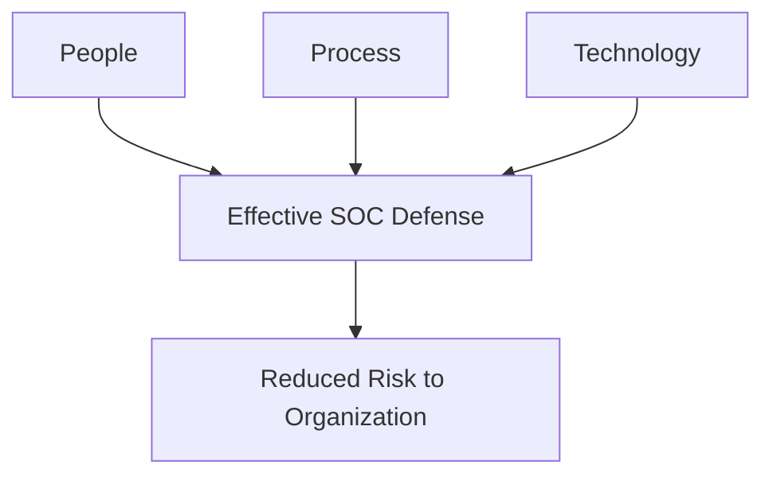
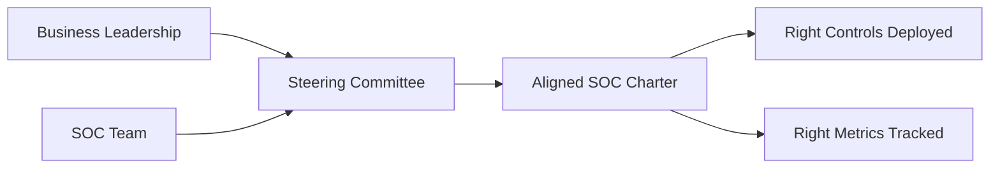
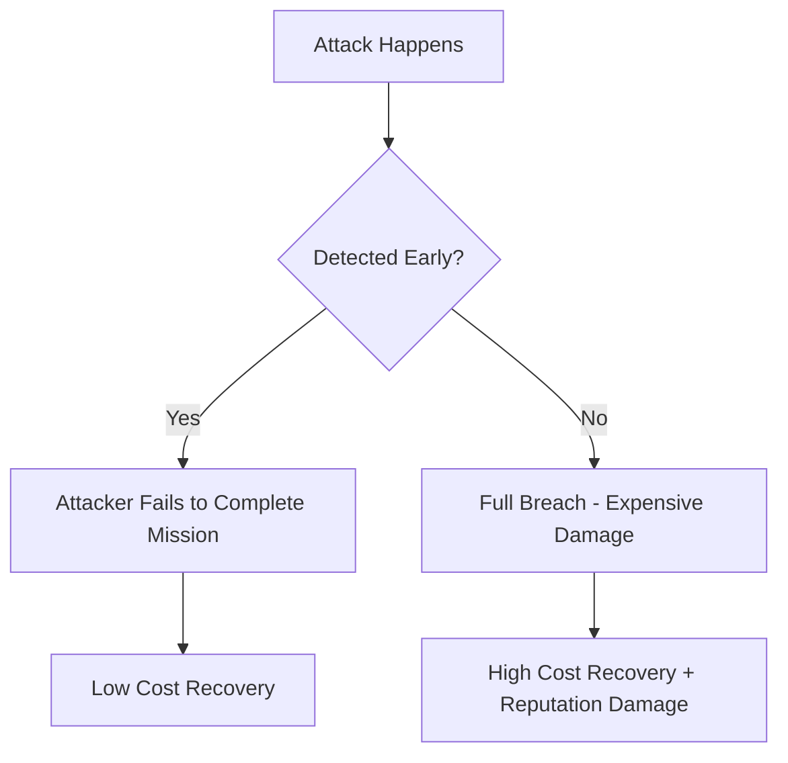
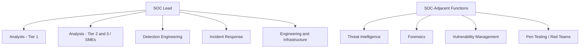
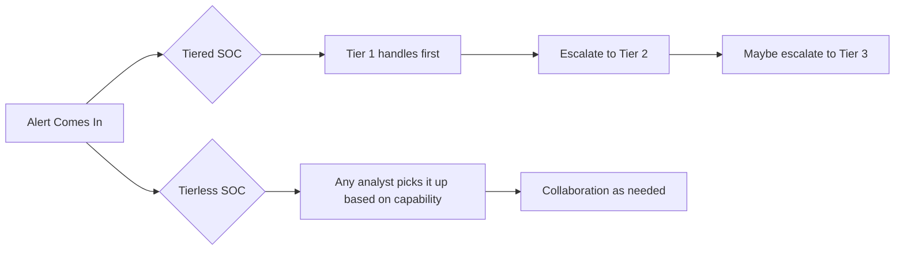
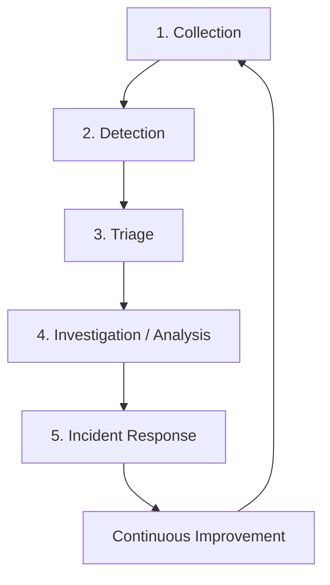
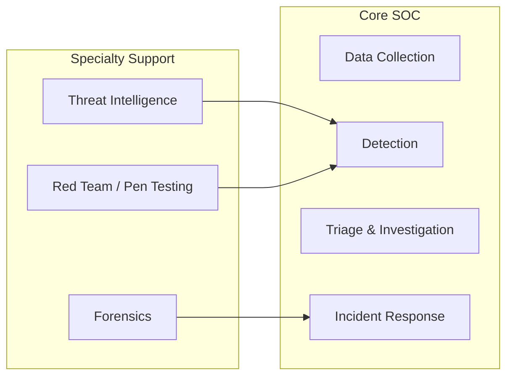
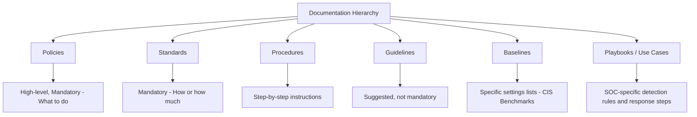

> **Goal of this section:**
> You'll understand what a SOC (Security Operations Center) is and how it works, and the essential components that make it work properly — from People, Process, and Technology all the way to Org Charts and Metrics.
---

## Table of Contents

- [Introduction](#introduction)
- [The Three Components of a SOC](#the-three-components-of-a-soc)
- [The Four Questions for Defining the Mission](#the-four-questions-for-defining-the-mission)
- [SOC Charter and the Steering Committee](#soc-charter-and-the-steering-committee)
- [Risk Appetite](#risk-appetite)
- [Blue Team Truths](#blue-team-truths)
- [SOC Structure and the Org Chart](#soc-structure-and-the-org-chart)
- [Tiered vs Tierless SOCs](#tiered-vs-tierless-socs)
- [SOC Workflow Steps](#soc-workflow-steps)
- [Core vs Specialty SOC Functions](#core-vs-specialty-soc-functions)
- [Critical Information You Must Have](#critical-information-you-must-have)
- [Types of SOC Documentation](#types-of-soc-documentation)
- [SOC Metrics](#soc-metrics)
- [Summary](#summary)
---

## Introduction

The SOC is the center where cyber threats to the organization are monitored, analyzed, and responded to. It's not just a room full of desks and screens — it's an integrated system of people, tools, and processes.

The main goal is summed up in one sentence from the Cyberwire:

> **"Reduce the probability of material impact to my organization due to a cyber event."**

In other words, our goal isn't to build a perfect network that can never be breached — that's impossible. Our goal is to reduce the impact of any attack that might happen.

---

## The Three Components of a SOC

The SOC stands on **3 legs** — if one falls, the stool falls:

### 1. People

People are the beating heart of the SOC. No technology or process can make up for a trained, happy, motivated team. Choosing the right people can make or break the team.

### 2. Process

Process is the defined sequence of steps that people carry out. It defines **what** gets done and **how** it gets done. Without a clear process, everyone works their own way and you get different results.

### 3. Technology

Technology is the multiplier — it makes people more capable and faster. But it's important to know: technology isn't a substitute for people; it's a tool in people's hands.

> [!IMPORTANT]
> Technology doesn't replace people. If the analyst is doing work that automation could do, then the analyst isn't working the right way in the first place.

---

## The Four Questions for Defining the Mission

From the book "Crafting the Infosec Playbook" — 4 questions every SOC must answer:

| # | Question | Its Purpose |
|---|--------|-----------|
| 1 | **What are we trying to protect?** | Identify the critical assets |
| 2 | **What are the threats?** | Understand the attackers and their methods |
| 3 | **How do we detect them?** | Choose the right tools and sensors |
| 4 | **How will we respond?** | Prepare response plans and playbooks |

> [!TIP]
> It's not enough to say "we protect the company's data from APTs" — you need to know **which** APTs, **how** they attack, **which** data exactly, and **where** it's stored. The more detail you have, the better your chances of success.

---

## SOC Charter and the Steering Committee

### SOC Charter

The Charter is the SOC's founding document — like a constitution. It defines:

- **Constituency**: who are we protecting?
- **Services**: what services do we provide?
- **Scope**: what are the limits of our authority?
- **Mission Statement**: a short sentence that states the team's purpose
- **Organizational Structure**: how is the team organized?

> [!NOTE]
> The Charter isn't a rigid document — it's a living document that must be updated as threats and the organization evolve.

### Steering Committee

The Steering Committee is a regular meeting with the organization's key stakeholders. Its purpose is to:

- Make sure the SOC is spending its time on what actually matters to the organization
- Align the SOC's capabilities with the business's needs
- Discuss risk priorities

---

## Risk Appetite

### What Is Risk Appetite?

Risk Appetite is the amount of risk the organization is willing to accept. Not all organizations are the same:

| Organization Type | Risk Appetite | What to Expect |
|-------------|--------------|---------|
| Military / Government | Very low | Very strict controls |
| Hospital / Healthcare | Low | Highly sensitive patient data |
| Enterprise Company | Medium | A balance between security and productivity |
| New startup | High | Speed matters more than security at the start |

### Risk Appetite Meets Reality — A Practical Example

Imagine you work at a pharmaceutical company. There's a production machine running Windows XP that can't be changed for legal reasons. This machine uses unencrypted FTP and has an old web server.

**The wrong solution:** you tell management, "This machine is very dangerous, we have to shut it down."
← The response: "This machine produces X dollars an hour. No!"

**The right solution:** apply **Compensating Controls** from outside the device:
- A network firewall that blocks every port except the ones it needs
- An antivirus network appliance that inspects the traffic
- A web application firewall for the old web server

> [!WARNING]
> Your role as the Blue Team isn't to reject every risk — your role is to understand the risk, explain it to management, and propose practical solutions that fit the business's requirements.

---

## Blue Team Truths

### Blue Team Truth #1: The Breach Will Happen

The hard truth: there's no 100% complete defense. What separates a good SOC from a bad one is **the speed of detection and response**.

### Blue Team Truth #2: The Company Doesn't Exist to Be Secure

Cybersecurity is a "Loss Prevention" function — like security at a store. Imagine a store that does TSA screening on the way in and out — it wouldn't sell anything!

What you need to do:
- Understand the risk the company is willing to accept
- Balance security against productivity requirements
- Report the real risks to management clearly

---

## SOC Structure and the Org Chart

There's no "ideal" structure — every organization chooses the structure that suits it. What matters is that the whole team works together efficiently.

---

## Tiered vs Tierless SOCs

### Tiered SOC

A Tiered SOC has defined levels:

| Level | Title | Tasks |
|---------|--------|--------|
| **Tier 1** | Entry Level Analyst | Initial triage, opening tickets |
| **Tier 2** | Mid-Level Analyst | Deeper analysis, scoping the attack |
| **Tier 3** | Senior Analyst / SME | Complex analysis, Threat Hunting, developing the methodology |

**Pros:** a clear path for promotion, organized operations.
**Cons:** it can be very limiting and lead to burnout and high turnover.

### Tierless SOC

Everyone works together on everything — based on their abilities.

**Pros:** faster learning, happier analysts, better retention.
**Cons:** requires more self-discipline and smarter alert management.

> [!NOTE]
> SANS student surveys show that more than half of organizations work with a Tierless model or something close to it.

---

## SOC Workflow Steps

The SOC works in 5 basic steps:

### Each Step Explained

**1. Collection**
Collecting logs, network traffic, and endpoint events from everywhere on the network.

**2. Detection**
Monitoring the collected data and detecting suspicious activity using the SIEM, IDS, Threat Intelligence, and analysis rules.

**3. Triage**
Ordering alerts by priority — which one is the most dangerous and needs to be handled first?

**4. Investigation**
Digging into the alert to determine: is this a True Positive? What happened? How extensive is the damage?

**5. Incident Response**
Contain the attack, eradicate the threat, recover the systems, and document everything to learn from it.

> [!TIP]
> Most new analysts spend their time on triage and investigation. But outstanding analysts also understand collection and detection — so they can improve the whole process.

---

## Core vs Specialty SOC Functions

### Core SOC Functions

| Function | Description |
|---------|--------|
| **Data Collection** | Collecting network and endpoint data |
| **Detection** | Identifying suspicious activity from the collected data |
| **Triage and Investigation** | Triaging and investigating detected alerts |
| **Incident Response** | Responding to incidents and minimizing damage |

### Specialty Functions

| Function | Description |
|---------|--------|
| **Threat Intelligence** | Collecting and analyzing information about attackers and their methods |
| **Forensics** | Detailed forensic analysis after incidents |
| **Self-Assessment** | Vulnerability Assessment, Red Teaming, and Configuration Monitoring |

---

## Critical Information You Must Have

Every SOC must always have:

| Document / Information | Purpose |
|-------------------|-------|
| **Network Diagram** | Understand the network's layout and points of visibility |
| **Points of Visibility** | Know where the taps, SPAN ports, and PCAP are |
| **Data Flow Diagram** | Understand how traffic moves |
| **Log Flow Diagram** | Where logs come from and where they go |
| **Incident Response Plan** | Steps for responding to major incidents |
| **Communication Plan** | Who to contact and when |
| **Critical Assets List** | The most important assets you must protect |
| **Disaster Recovery Plan** | The continuity plan after disasters |

> [!WARNING]
> If an analyst searches for a log, doesn't find it, and decides the attack didn't happen — that's wrong! The log may exist, but you're just not collecting it. You need to know **which** logs you collect and which you don't.

---

## Types of SOC Documentation

### The Difference Between the Documents

| Type | Mandatory? | Level of Detail | Example |
|-------|----------|--------------|-------|
| **Policy** | Mandatory | High level | "All devices must have antivirus" |
| **Standard** | Mandatory | Medium | "Antivirus settings must be as follows..." |
| **Procedure** | Mandatory | Very detailed | "Antivirus installation steps: 1, 2, 3..." |
| **Guideline** | Optional | Medium | "Best practices for deploying antivirus" |
| **Baseline** | Reference | Very detailed | CIS Benchmarks for Windows Server |
| **Playbook / Use Case** | SOC-specific | Operational | "Steps for responding to a phishing attack" |

---

## SOC Metrics

### What Makes a Good Metric?

Metrics are how the SOC is held accountable. But not every number is a good metric!

**Criteria for a good metric:**

| Criterion | Question |
|---------|--------|
| **Goal-Aligned** | Does it help track a specific goal? |
| **Actionable** | Is there a threshold, and if you cross it, what do you do? |
| **Well-Defined** | If two people calculate it, will they get the same number? |
| **Frequently Updated** | Does it update automatically and quickly enough to respond? |

> [!WARNING]
> Ask yourself: "If the metric improves, has security actually improved?" If the answer is "not necessarily," then the metric is wrong.

### Examples of Useful Metrics

- Mean Time to Detect (MTTD) an attack
- Mean Time to Respond (MTTR)
- The number of True Positives compared to False Positives
- The size of the alert queue over time
- The percentage of MITRE ATT&CK techniques covered

---

## summary
### Key Points

- The SOC stands on **People + Process + Technology** — all three together
- The four questions (What to protect, Threats, Detection, Response) are the foundation for defining the SOC's mission
- The SOC Charter is the founding document — it needs management's approval
- The Steering Committee ensures the SOC spends its time on the right things
- Risk Appetite is determined by the nature of the organization — the SOC has to work within it
- The breach will happen — the goal is to reduce the impact, not to prevent every attack
- Tiered vs Tierless — neither is more correct; each has its advantages
- The steps: Collection → Detection → Triage → Investigation → IR → Improvement
- Not all documents are the same: Policy ≠ Standard ≠ Procedure ≠ Guideline
- Metrics must be actionable and tied to real goals

