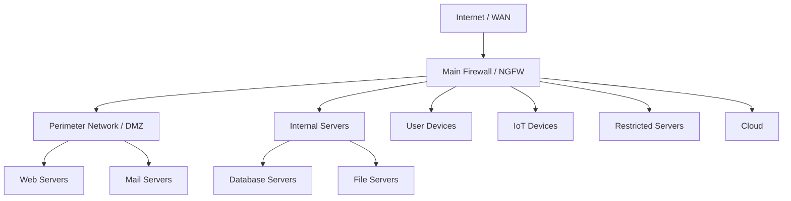
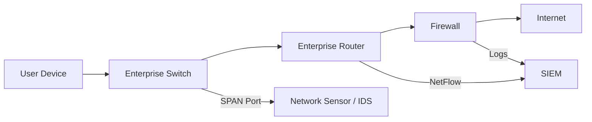
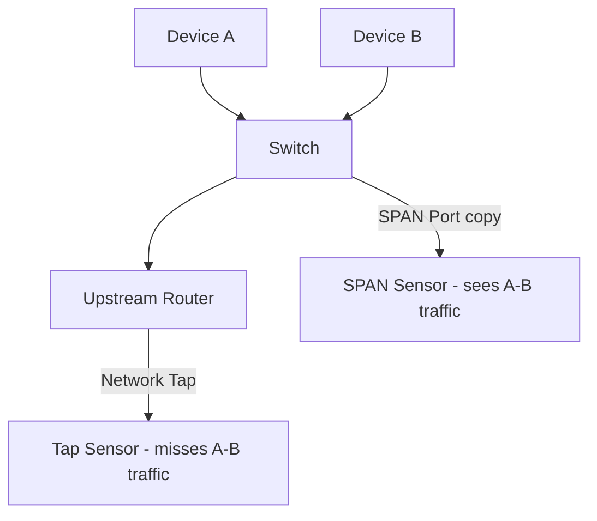
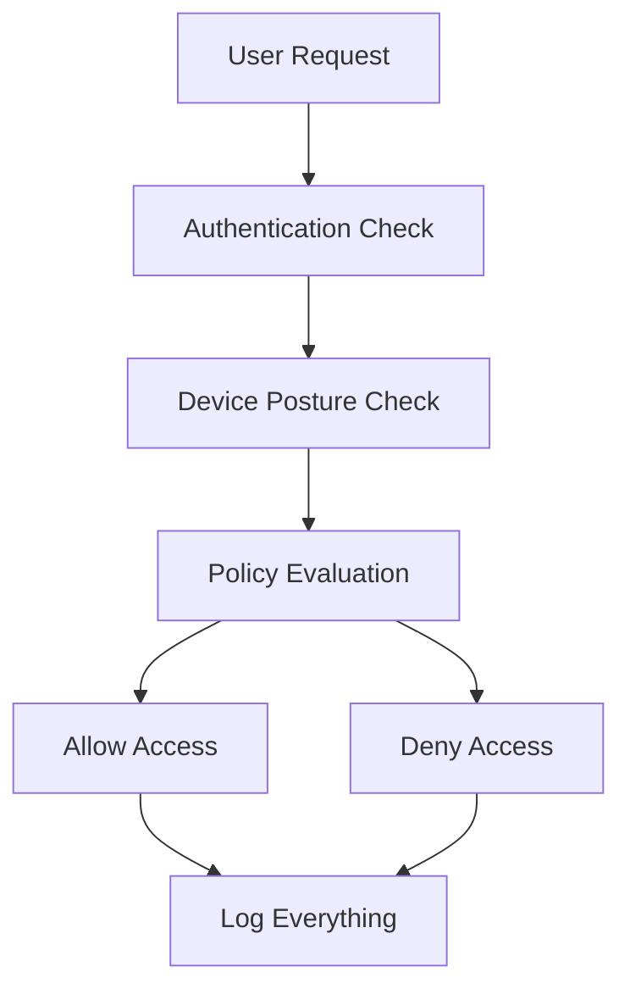

> **Goal of this section:**
> You will understand how a network is built and which devices control its traffic, and how, as a Defender, you can see what's happening on the network and stop attackers.


---

## Table of Contents

- [Introduction](#introduction)
- [Network Architecture Overview](#network-architecture-overview)
- [Enterprise Routers](#enterprise-routers)
- [Network Zones](#network-zones)
- [Enterprise Switches](#enterprise-switches)
- [Visibility Points: SPAN vs Network Tap](#visibility-points-span-vs-network-tap)
- [Enterprise Firewalls](#enterprise-firewalls)
- [Next-Gen Firewalls (NGFW)](#next-gen-firewalls-ngfw)
- [Zero-Trust Architecture](#zero-trust-architecture)
- [Why Network Architecture Matters](#why-network-architecture-matters)
- [Defending a Flat Network](#defending-a-flat-network)
- [Diagrams](#diagrams)
- [Comparison Tables](#comparison-tables)
- [Key Notes](#key-notes)
- [Summary](#summary)

---

## Introduction

As a Defender, you need to understand the network you protect the way a surgeon understands the human body before operating. If you don't know the Network Architecture, when an attacker shows up you won't be able to grasp what's happening or find the evidence.

A network isn't just cables and devices. It is a complete system of zones, segments, and firewalls, each of which plays a role in the defense.

---

## Network Architecture Overview

### Why Do We Need to Understand the Architecture?

When an incident happens, the first question you ask is:
> "Do I have data about what happened?"

If you don't know your network well, you might say "there's no evidence" when in fact the evidence exists and you just don't know where to find it. This leads the analyst to wrong conclusions.

### The Core Components You Need to Understand:

- **Network Segments and Subnets** — Who lives where on the network?
- **Traffic Flow** — Where does the traffic go?
- **Points of Visibility** — Where can I see that traffic?

---

## Enterprise Routers

### The Home Router vs the Enterprise Router

The home router is very simple:
- One side for the Internet (WAN)
- One side for the home (LAN)

The Enterprise Router, on the other hand:
- Divides the network into multiple subnets
- Handles routing between all the segments
- There may be more than one router (Border Routers + Internal Routers)

### What Matters to You as a Blue Teamer in the Router?

| Feature | Security Benefit |
|--------|----------------|
| **NetFlow** | Gives you information about the traffic passing through (who talked to whom, and how much data was transferred) |
| **ACLs (Access Control Lists)** | Let you block specific traffic based on Source/Destination IP or Port |
| **802.1X** | Prevents unauthorized devices from connecting to the network |
| **VPN and IPSec** | Encrypted connections for remote users |
| **IPS** | Built-in Intrusion Prevention |

> [!TIP]
> If you aren't collecting NetFlow logs from the routers, ask the Networking Team for a copy. This is golden data for the Security Team.

---

## Network Zones

### What Is a Zone?

Imagine the company as a building with rooms:
- Each room has specific people who are allowed to enter it
- There are guards at the doors who check identities
- Not everyone can enter every place

A zone is the same idea on the network: a group of devices with the same type of use, with the firewall guarding the traffic between them.

### Common Types of Zones

| Zone | Contents | Risk Level |
|------|---------|---------------|
| **External / Internet** | Everything outside the network | Very high |
| **Perimeter Network (DMZ)** | The servers that talk to the internet (Web Servers, Mail Servers) | High |
| **Internal Servers** | Internal servers (Database, File Servers) | Medium |
| **User Devices (Desktops)** | Employees' laptops and computers | Medium |
| **IoT** | Cameras, printers, factory devices | High (often weak) |
| **Guest Network** | Guests and visitors | High (Untrusted) |
| **Cloud** | AWS, Azure, GCP | Variable |
| **Restricted / Air-Gapped** | Highly confidential data, isolated from the internet | The most important thing to protect |

### Why Is Segmentation So Important?

Micro-Segmentation is the ideal solution: every device has its own rules. But it is hard to implement, so most companies use Zone-based Segmentation.

---

## Enterprise Switches

### The Switch in Security

The switch works at Layer 2 (Data Link Layer) and connects devices in the same segment to each other. What matters about it from a security standpoint:

| Feature | Security Use |
|--------|----------------|
| **Traffic Mirror / SPAN Port** | Sends a copy of all the traffic to a sensor for analysis |
| **NetFlow** | Same idea as on the router, but at the level of the internal segment |
| **802.1X** | Prevents unauthenticated devices from connecting |
| **ACLs** | Isolate devices from each other within the same switch |
| **VLANs** | Divide the network logically even on the same physical infrastructure |

### The Switch vs the Router in Visibility

The router and the firewall see the traffic that passes between them (Inter-Zone Traffic). But if two computers in the same zone talk to each other, the router doesn't see them. Only the switch does!

---

## Visibility Points: SPAN vs Network Tap

### What Is a Visibility Point?

To see the traffic, you need to make a copy of it and send it to a sensor. There are two ways:

### 1. SPAN Port (Switch Port Analyzer) / Mirror Port

- The switch makes a copy of the traffic and sends it to a specific port
- **Advantages:** Cheaper, no extra hardware needed
- **Disadvantages:**
  - It uses the switch's CPU
  - Packet loss can occur if there is a lot of traffic
  - It sees the traffic that passes through the switch (including between devices in the same segment)

### 2. Network Tap

- A physical device placed on the cable that makes a copy of the traffic
- **Advantages:** Passive, it never affects the network, and it works at Layer 1/2
- **Disadvantages:** More expensive, needs aggregation if it collects traffic from both directions

### When Is Each One Preferred?

| Situation | Best Choice |
|--------|--------|
| Traffic between two computers in the same segment | SPAN Port (because the tap won't see them) |
| High-speed traffic on a busy network | Network Tap |
| Limited budget | SPAN Port |
| You need high accuracy and can't miss packets | Network Tap |

> [!WARNING]
> If you have a Lateral Movement Attack (an attacker moving between devices in the same segment), a Network Tap above the switch won't see it! You need a SPAN Port on the switch itself.

---

## Enterprise Firewalls

### The Home Firewall vs the Enterprise Firewall

**The home firewall:**
- Only 2 ports (Inside + Outside)
- Blocks traffic coming from the Internet
- Can't tell users or applications apart

**Enterprise Next-Gen Firewall (NGFW):**
- Controls traffic between all the zones
- Works from Layer 2 to Layer 7
- Understands the user's identity, not just the IP
- Understands the application, not just the port

### The NGFW and Deep Packet Inspection (DPI)

The NGFW inspects the inside of the packet (not just the header) to understand:
- Which application is using this connection
- Which user is doing this
- Which feature of the application is being used (for example: Upload vs Download)

---

## Next-Gen Firewalls (NGFW)

### The Core Idea: "Everything is an Application"

Instead of saying "block Port 22," you say "block SSH except for IT Admins on approved servers."

### Examples of NGFW Rules

```
Rule 1: Only IT Admins can use SSH to Approved Locations
Rule 2: Gmail is allowed, but Upload and Download are blocked
Rule 3: SMB is blocked between User Devices
Rule 4: Only the HR Department can access the HR Database
```

### Why Is the NGFW the First Step Toward Zero-Trust?

Because it ties rules to identity, not to the IP address. If a user moves from one place to another, the rules apply to them wherever they are.

---

## Zero-Trust Architecture

### The Core Philosophy

> "Trust nothing, verify everything"

### The Five Principles of Zero-Trust

| Principle | Meaning |
|--------|--------|
| **The network is always hostile** | Even internal traffic can be malicious |
| **External and internal threats exist** | The attacker may already be inside the network |
| **Location is not enough for trust** | Just because a request comes from inside doesn't mean it's safe |
| **Everything is authenticated** | Every user, every device, every connection |
| **Policies are dynamic** | They are calculated based on as much available data as possible |

### Most Networks Aren't Zero-Trust

The important thing to know is that you don't have to implement Zero-Trust fully. Even if you apply 50% of the principles, your network will be much more secure.

---

## Why Network Architecture Matters

### The Flat Network Is a Disaster

A flat network is a network without segmentation, where all devices talk to each other freely.

**The disaster scenario:**
1. An attacker compromises a single laptop through phishing
2. In a flat network, they can move to any other device immediately
3. They steal credentials from the Domain Controller
4. They take down the entire network within hours

**The contained scenario (with segmentation):**
1. An attacker compromises a single laptop
2. The firewall prevents them from moving to other segments
3. The Blue Team has time to find and stop them

### A Real Example: WannaCry and NotPetya (2017)

Two of the most famous attacks in history exploited exactly this kind of flat network:

- **The exploit used:** MS17-010 ETERNALBLUE (from leaked NSA tools)
- **Spread:** The moment a device was infected, it tried to infect every other device on the network
- **The result in flat networks:** Entire companies were taken down within hours
- **The result in segmented networks:** The damage was contained to specific segments

---

## Defending a Flat Network

### If Your Network Is Flat, It's Not Over, but You Have to Compensate

If you don't have segmentation, you have to compensate with:

| Alternative Solution | Benefit |
|-------------|---------|
| **Host-Based Firewalls** | Every device protects itself |
| **EDR (Endpoint Detection and Response)** | Early detection on every endpoint |
| **Antivirus** | Basic protection for every device |
| **Anti-Exploitation (EMET / Exploit Guard)** | Prevents exploits from running |
| **Better Monitoring** | You need to see everything faster |
| **Faster Response** | If the attack spreads quickly, your response has to be faster |

> [!IMPORTANT]
> In a flat network, the Blue Team has to move faster than the attacker. If the attacker moves at speed 100 in a flat network, you have to move at speed 101.

---

## Diagrams

### The Structure of Network Zones



### The Traffic's Journey Across the Network



### SPAN Port vs Network Tap



### Zero-Trust Flow



---

## Comparison Tables

### Comparing Network Devices from the Blue Team's Perspective

| Device | Main Function | Security Benefit | Weakness |
|--------|----------------|-------------------|------------|
| **Router** | Connects subnets to each other | NetFlow, ACLs | Can't see inside the segment |
| **Switch** | Connects devices within the segment | SPAN, VLANs, 802.1X | Needs correct configuration |
| **NGFW** | Advanced traffic control | Layer 7 Inspection, Identity | Expensive, complex |
| **Traditional Firewall** | Blocks ports and IPs | Simple | Doesn't understand applications |

### Comparing Firewall Types

| Criterion | Traditional Firewall | NGFW |
|---------|---------------------|------|
| **Layers** | Layer 3-4 | Layer 2-7 |
| **Understands the application** | No | Yes |
| **Understands user identity** | No | Yes |
| **Deep Packet Inspection** | Limited | Advanced |
| **Price** | Cheaper | More expensive |
| **A step toward Zero-Trust** | No | Yes |

### SPAN Port vs Network Tap

| Criterion | SPAN Port | Network Tap |
|---------|-----------|-------------|
| **Cost** | Cheap (built into the switch) | More expensive (separate hardware) |
| **Impact on the network** | Uses the switch's CPU | Passive, no impact |
| **Sees traffic inside the segment** | Yes | No |
| **Packet Loss** | Possible when congested | Rare |
| **Bandwidth Limitations** | Overflow can occur | Makes a complete copy |

---

## Key Notes

> [!NOTE]
> The router and the firewall only see the traffic that moves between zones. Internal traffic within the same zone doesn't pass through them; it only passes through the switch.

> [!WARNING]
> If two devices in the same segment (the same VLAN) talk to each other and you have a Network Tap above the switch, you won't see that traffic! This is a very important blind spot when investigating Lateral Movement.

> [!IMPORTANT]
> A flat network isn't just a technical weakness; it's an existential risk to the company. WannaCry proved that entire companies can be taken down within hours because there was no segmentation.

> [!TIP]
> As a SOC Analyst, you should have a diagram that shows:
> 1. The network zones and how traffic flows between them
> 2. The location of every SPAN Port and Network Tap
> 3. Which devices send NetFlow and which don't
> You'll need this every time an incident comes in and you need to know where to get the evidence from.

> [!NOTE]
> The NGFW is the first practical step toward Zero-Trust because it ties rules to identity rather than to the IP address. A user can change location, but their identity stays the same.

---

## Summary

### Key Concepts

- **Network Architecture** = Understanding the shape of the network and how traffic flows through it
- **Network Zones** = Dividing the network into segments based on the type of devices and their sensitivity
- **Segmentation** = The Defender's strongest weapon for slowing down the attacker
- **SPAN Port** = A mirror of the traffic at the switch level
- **Network Tap** = A passive copy of the traffic at the wire level
- **NGFW** = A firewall that understands Layer 7 and identity
- **Zero-Trust** = "Don't trust, verify": everything is authenticated
- **Flat Network** = A network without segmentation = very high risk
- **NetFlow** = Data about the traffic (who talked to whom, and how much) from routers and switches


